# 🏖️ Casual & Travel · AI Outfit Swap Prompts

[← README](../README.md) · 21 prompts · [aiclothswap.net](https://aiclothswap.net/outfit-swap-prompts?utm_source=github&utm_medium=awesome&utm_campaign=awesome-ai-outfit-swap-prompts)

### Mediterranean Breezy Linen Vacation Two-Piece

```text
Change clothes: Take the person from image 1 and dress her in the relaxed natural beige linen button-down shirt and matching shorts from image 2. Sunny coastal seaside resort, wind blowing fabric naturally, 3:4 ratio.
```

**Model:** Nano Banana Pro

> Relaxed resort wear shines with airy breathable linen textures and soft sun-drenched coastal tones.

<a href="https://aiclothswap.net/outfit-swap-prompts/p/mediterranean-linen-vacation-set/?utm_source=github&utm_medium=awesome&utm_campaign=awesome-ai-outfit-swap-prompts">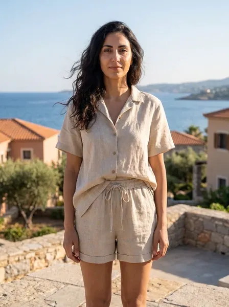</a>

[Example result & try this prompt](https://aiclothswap.net/outfit-swap-prompts/p/mediterranean-linen-vacation-set/?utm_source=github&utm_medium=awesome&utm_campaign=awesome-ai-outfit-swap-prompts)

### Breton Stripe Top City Break Outfit

```text
Keep the exact same face, hair, body and identity from image 1; dress her in the navy and white Breton striped long-sleeve top with straight-leg light blue jeans and white canvas sneakers from image 2. Charming cobblestone European city street in daylight, relaxed full-body travel portrait. Full garment visible, face fully in frame and not cropped, no logos, no text, photorealistic, aspect ratio 4:5.
```

**Model:** Nano Banana Pro

> Stripes, light denim and sneakers is the go-to city break uniform.

<a href="https://aiclothswap.net/outfit-swap-prompts/p/breton-stripe-top-city-break/?utm_source=github&utm_medium=awesome&utm_campaign=awesome-ai-outfit-swap-prompts">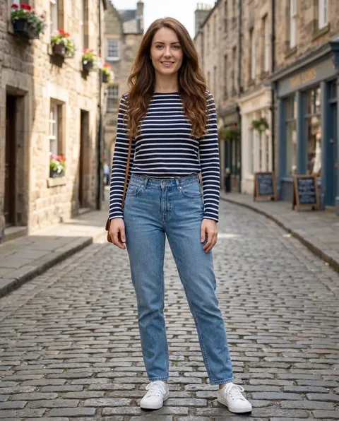</a>

[Example result & try this prompt](https://aiclothswap.net/outfit-swap-prompts/p/breton-stripe-top-city-break/?utm_source=github&utm_medium=awesome&utm_campaign=awesome-ai-outfit-swap-prompts)

### Yellow Rain Shell Hiking Trip

```text
Keep the exact same face, hair, body and identity from image 1; dress him in the bright yellow hooded waterproof rain shell jacket with black hiking pants from image 2. Misty mountain trail with pine forest, wide full-body hiking portrait. Full garment visible, face fully in frame and not cropped, no logos, no text, photorealistic, aspect ratio 3:2.
```

**Model:** Nano Banana Pro

> A bright shell pops against misty landscapes and keeps you visible on trails.

<a href="https://aiclothswap.net/outfit-swap-prompts/p/yellow-rain-shell-hiking-trip/?utm_source=github&utm_medium=awesome&utm_campaign=awesome-ai-outfit-swap-prompts">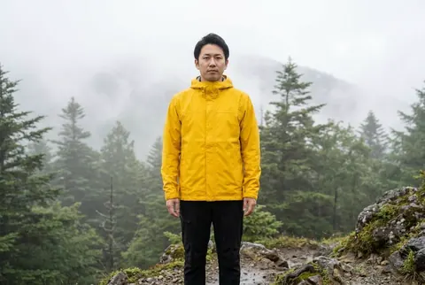</a>

[Example result & try this prompt](https://aiclothswap.net/outfit-swap-prompts/p/yellow-rain-shell-hiking-trip/?utm_source=github&utm_medium=awesome&utm_campaign=awesome-ai-outfit-swap-prompts)

### Utility Cargo Vest Weekend Look

```text
Keep the exact same face, hair, body and identity from image 1; dress him in a khaki cotton utility vest with four flap pockets layered over a plain white t-shirt with light wash jeans from image 2. Old town cobblestone street on a sunny morning, three-quarter pose. Full garment visible, face fully in frame and not cropped, no logos, no text, photorealistic, aspect ratio 4:5.
```

**Model:** GPT Image 2.5

> A cargo vest over a tee adds pockets and polish to a travel outfit.

<a href="https://aiclothswap.net/outfit-swap-prompts/p/utility-cargo-vest-festival/?utm_source=github&utm_medium=awesome&utm_campaign=awesome-ai-outfit-swap-prompts">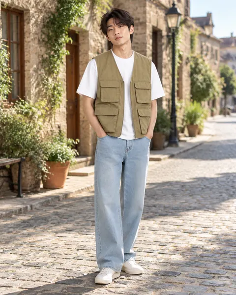</a>

[Example result & try this prompt](https://aiclothswap.net/outfit-swap-prompts/p/utility-cargo-vest-festival/?utm_source=github&utm_medium=awesome&utm_campaign=awesome-ai-outfit-swap-prompts)

### Cable-Knit Cardigan Cabin Trip

```text
Keep the exact same face, hair, body and identity from image 1; dress her in an oatmeal chunky cable-knit shawl-collar cardigan with wooden buttons over a plain white tee from image 2. Cozy wooden cabin with fireplace and mountain window view, waist-up portrait. Full garment visible, face fully in frame and not cropped, no logos, no text, photorealistic, aspect ratio 1:1.
```

**Model:** GPT Image 2.5

> A chunky cardigan is the coziest layer for a mountain cabin weekend.

<a href="https://aiclothswap.net/outfit-swap-prompts/p/cable-knit-cardigan-cabin-trip/?utm_source=github&utm_medium=awesome&utm_campaign=awesome-ai-outfit-swap-prompts">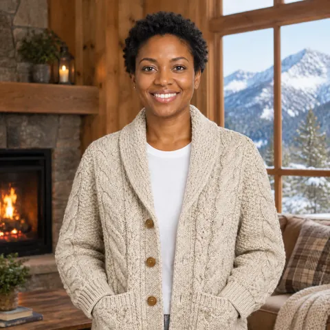</a>

[Example result & try this prompt](https://aiclothswap.net/outfit-swap-prompts/p/cable-knit-cardigan-cabin-trip/?utm_source=github&utm_medium=awesome&utm_campaign=awesome-ai-outfit-swap-prompts)

### Forced Perspective Denim Travel Look

```text
Keep the exact same face, hair, body and identity from image 1; dress him in the light-wash denim jacket and white wide-leg trousers from image 2. Playful forced-perspective travel photo: he reaches toward a distant monorail train so it looks tiny between his fingers, city landmark street, wide composition, face visible and smiling. Full garment visible, face fully in frame and not cropped, no logos, no text, photorealistic, aspect ratio 16:9.
```

**Model:** GPT Image 2.5

> The viral forced-perspective travel photo, in trending denim.

<a href="https://aiclothswap.net/outfit-swap-prompts/p/forced-perspective-denim-travel-look/?utm_source=github&utm_medium=awesome&utm_campaign=awesome-ai-outfit-swap-prompts">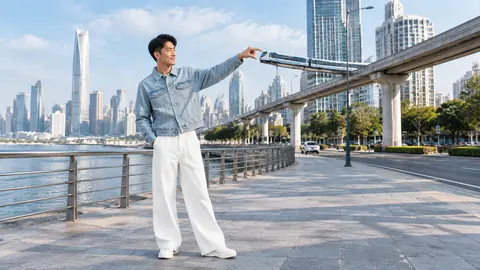</a>

[Example result & try this prompt](https://aiclothswap.net/outfit-swap-prompts/p/forced-perspective-denim-travel-look/?utm_source=github&utm_medium=awesome&utm_campaign=awesome-ai-outfit-swap-prompts)

### Denim Maxi Skirt City Travel Look

```text
Keep the exact same face, hair, body and identity from image 1; dress her in the long denim maxi skirt and cream knit top from image 2. Old town cobblestone street, walking travel pose with a canvas tote. Full garment visible, face fully in frame and not cropped, no logos, no text, photorealistic, aspect ratio 2:3.
```

**Model:** GPT Image 2.5

> The denim maxi skirt is 2026's travel staple.

<a href="https://aiclothswap.net/outfit-swap-prompts/p/denim-maxi-skirt-city-travel/?utm_source=github&utm_medium=awesome&utm_campaign=awesome-ai-outfit-swap-prompts">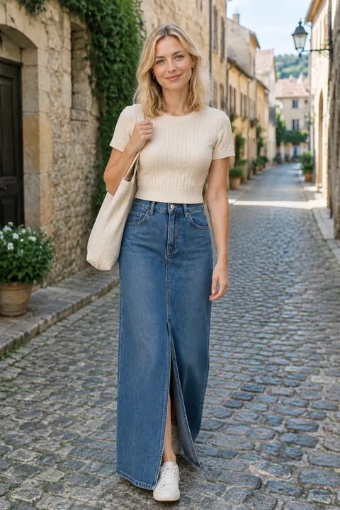</a>

[Example result & try this prompt](https://aiclothswap.net/outfit-swap-prompts/p/denim-maxi-skirt-city-travel/?utm_source=github&utm_medium=awesome&utm_campaign=awesome-ai-outfit-swap-prompts)

### Low-Angle Sneaker-Foreground Travel Look

```text
Keep the exact same face, hair, body and identity from image 1; dress her in the sage green utility jacket, white t-shirt and beige cargo trousers from image 2. Playful low-angle travel photo with one sneaker stepping toward the camera in the foreground, landmark tower behind, face fully visible and smiling. Full garment visible, face fully in frame and not cropped, no logos, no text, photorealistic, aspect ratio 3:4.
```

**Model:** GPT Image 2.5

> Low-angle sneaker-foreground shots are Gen-Z's travel photo grammar.

<a href="https://aiclothswap.net/outfit-swap-prompts/p/low-angle-sneaker-foreground-travel/?utm_source=github&utm_medium=awesome&utm_campaign=awesome-ai-outfit-swap-prompts">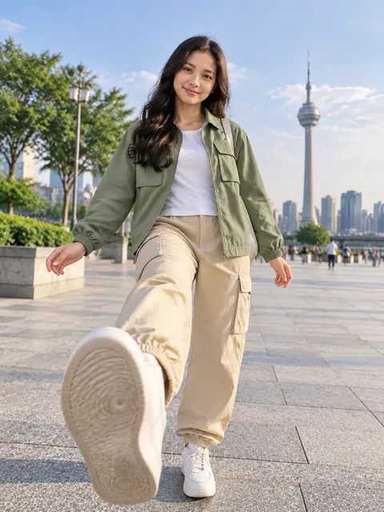</a>

[Example result & try this prompt](https://aiclothswap.net/outfit-swap-prompts/p/low-angle-sneaker-foreground-travel/?utm_source=github&utm_medium=awesome&utm_campaign=awesome-ai-outfit-swap-prompts)

### Train Window Linen Travel Look

```text
Keep the exact same face, hair, body and identity from image 1; dress him in the sand beige linen shirt and cream wide-leg trousers from image 2. He sits by a scenic train window turned three-quarters toward camera, green countryside outside, calm travel mood, wide composition. Full garment visible, face fully in frame and not cropped, no logos, no text, photorealistic, aspect ratio 16:9.
```

**Model:** GPT Image 2.5

> Train-window contemplative travel portraits are a viral aesthetic.

<a href="https://aiclothswap.net/outfit-swap-prompts/p/train-window-linen-travel-look/?utm_source=github&utm_medium=awesome&utm_campaign=awesome-ai-outfit-swap-prompts">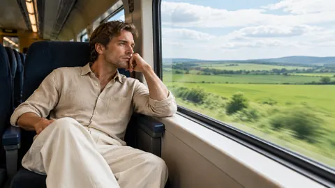</a>

[Example result & try this prompt](https://aiclothswap.net/outfit-swap-prompts/p/train-window-linen-travel-look/?utm_source=github&utm_medium=awesome&utm_campaign=awesome-ai-outfit-swap-prompts)

### Beige Trench Paris Street Travel Look

```text
Keep the exact same face, hair, body and identity from image 1; dress her in the beige double-breasted trench coat from image 2 over a simple navy knit. Paris riverside walkway, walking-stopped pose looking at camera. Full garment visible, face fully in frame and not cropped, no logos, no text, photorealistic, aspect ratio 3:4.
```

**Model:** GPT Image 2.5

> Paris Fashion Week street style and beige trench coats are everywhere on X.

<a href="https://aiclothswap.net/outfit-swap-prompts/p/beige-trench-paris-street-travel/?utm_source=github&utm_medium=awesome&utm_campaign=awesome-ai-outfit-swap-prompts">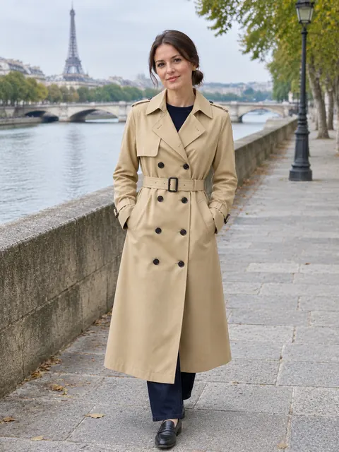</a>

[Example result & try this prompt](https://aiclothswap.net/outfit-swap-prompts/p/beige-trench-paris-street-travel/?utm_source=github&utm_medium=awesome&utm_campaign=awesome-ai-outfit-swap-prompts)

### Autumn Plaid Bucket-Hat Travel Look

```text
Keep the exact same face, hair, body and identity from image 1; dress her in the rust-and-cream plaid flannel shirt and soft bucket hat from image 2. Leaf-lined park path, relaxed standing pose, face fully visible under the hat brim. Full garment visible, face fully in frame and not cropped, no logos, no text, photorealistic, aspect ratio 4:5.
```

**Model:** GPT Image 2.5

> Autumn retro plaid shirt + bucket hat street portraits are circulating as casual OOTD.

<a href="https://aiclothswap.net/outfit-swap-prompts/p/autumn-plaid-bucket-travel-look/?utm_source=github&utm_medium=awesome&utm_campaign=awesome-ai-outfit-swap-prompts">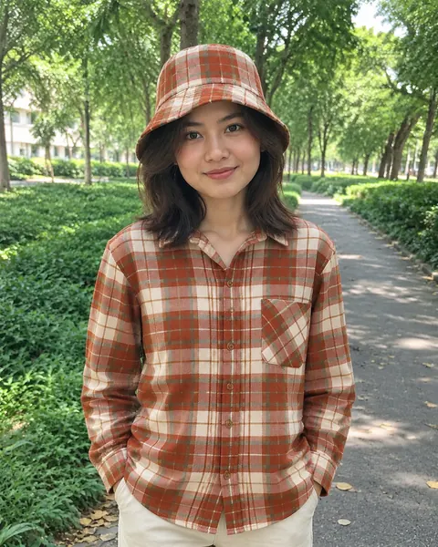</a>

[Example result & try this prompt](https://aiclothswap.net/outfit-swap-prompts/p/autumn-plaid-bucket-travel-look/?utm_source=github&utm_medium=awesome&utm_campaign=awesome-ai-outfit-swap-prompts)

### Pumpkin-Patch Flannel Travel Look

```text
Keep the exact same face, hair, body and identity from image 1; dress her in the burnt-orange plaid flannel over white tee and light wash mom jeans from image 2. Pumpkin farm path with autumn trees, relaxed walking-stopped pose facing camera. Human adult face fully in frame and not cropped, no pumpkin head, no logos, no text, photorealistic, aspect ratio 3:4.
```

**Model:** GPT Image 2.5

> Pumpkin-head photoshoot locations are patches and farms — flannel + denim is the travel outfit half of the trend.

<a href="https://aiclothswap.net/outfit-swap-prompts/p/pumpkin-patch-flannel-travel-look/?utm_source=github&utm_medium=awesome&utm_campaign=awesome-ai-outfit-swap-prompts">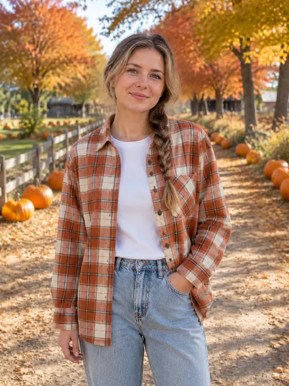</a>

[Example result & try this prompt](https://aiclothswap.net/outfit-swap-prompts/p/pumpkin-patch-flannel-travel-look/?utm_source=github&utm_medium=awesome&utm_campaign=awesome-ai-outfit-swap-prompts)

### Rust Quilted Fall Travel Coat

```text
Keep the exact same face, hair, body and identity from image 1; dress her in the rust quilted fall travel coat from image 2 over a cream sweater. Misty autumn city street, walking-stopped pose facing camera. Human adult face fully in frame and not cropped, no pumpkin head, no logos, no text, photorealistic, aspect ratio 2:3.
```

**Model:** GPT Image 2.5

> Post-shoot autumn travel on X leans rust quilted coats after pumpkin-head photo days.

<a href="https://aiclothswap.net/outfit-swap-prompts/p/rust-quilted-fall-travel-coat/?utm_source=github&utm_medium=awesome&utm_campaign=awesome-ai-outfit-swap-prompts">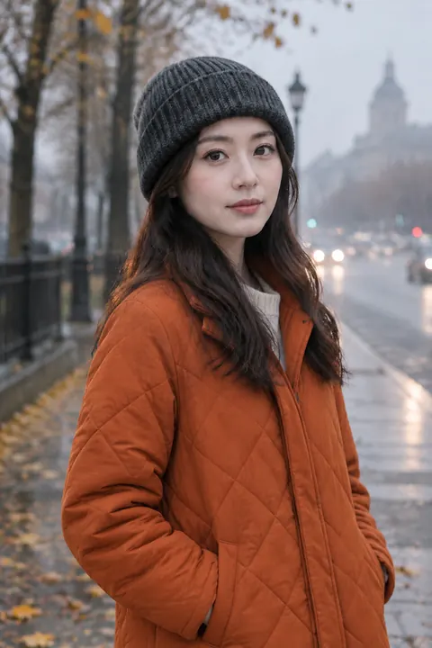</a>

[Example result & try this prompt](https://aiclothswap.net/outfit-swap-prompts/p/rust-quilted-fall-travel-coat/?utm_source=github&utm_medium=awesome&utm_campaign=awesome-ai-outfit-swap-prompts)

### AI Pumpkin Patch Photoshoot Outfit Ideas: Flannel and Knit

```text
Keep the exact same face, hair, body and identity from image 1; dress her in the cream knit cardigan over red buffalo-check flannel with jeans from image 2. Pumpkin patch on a sunny autumn afternoon, she sits on a hay bale beside orange pumpkins, warm light. Real human face, no pumpkin head. Adult faces fully visible and not cropped, no logos, no text, no watermark, photorealistic, aspect ratio 2:3.
```

**Model:** GPT Image 2.5

> ‘pumpkin head photoshoot outfit ideas’ is a top autocomplete — we skip the pumpkin head and nail the outfit in the patch.

<a href="https://aiclothswap.net/outfit-swap-prompts/p/ai-pumpkin-patch-outfit-ideas-flannel/?utm_source=github&utm_medium=awesome&utm_campaign=awesome-ai-outfit-swap-prompts">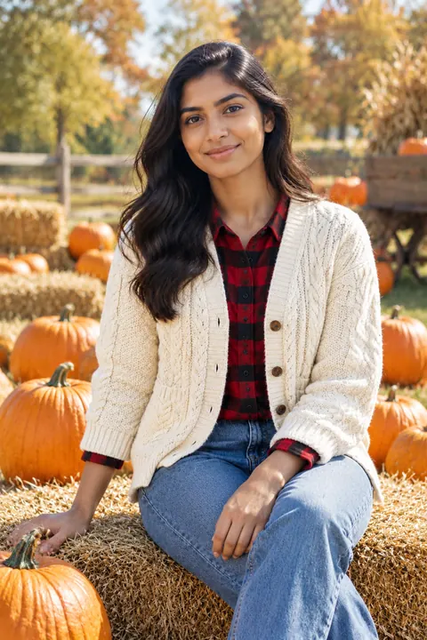</a>

[Example result & try this prompt](https://aiclothswap.net/outfit-swap-prompts/p/ai-pumpkin-patch-outfit-ideas-flannel/?utm_source=github&utm_medium=awesome&utm_campaign=awesome-ai-outfit-swap-prompts)

### AI Outfit Breakdown Prompt: City Travel Look

```text
Keep the exact same face, hair, body and identity from image 1; dress her in the beige light jacket, white tee, wide-leg denim and canvas tote from image 2. Outfit breakdown vertical layout: she walks on an old-town cobblestone street on the left half, and on the right the jacket, tee, jeans, tote and white sneakers float as neat cut-out cards with thin lines, no words or labels. Adult faces fully visible and not cropped, no logos, no text, no watermark, photorealistic, aspect ratio 9:16.
```

**Model:** GPT Image 2.5

> ‘ai outfit breakdown prompt’ is the #1 long tail this week — apply it to a comfy city-break outfit.

<a href="https://aiclothswap.net/outfit-swap-prompts/p/ai-outfit-breakdown-prompt-travel-look/?utm_source=github&utm_medium=awesome&utm_campaign=awesome-ai-outfit-swap-prompts">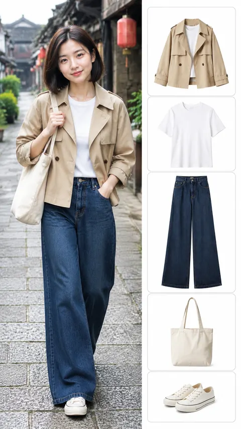</a>

[Example result & try this prompt](https://aiclothswap.net/outfit-swap-prompts/p/ai-outfit-breakdown-prompt-travel-look/?utm_source=github&utm_medium=awesome&utm_campaign=awesome-ai-outfit-swap-prompts)

### AI Windy Day Belted Trench Coat

```text
Keep the exact same face, hair, body and identity from image 1; dress her in the khaki belted trench coat from image 2. Breezy autumn city street with leaves blowing, coat hem moving in the wind, walking pose, full body. Adult faces fully visible and not cropped, no logos, no text, no watermark, photorealistic, aspect ratio 2:3.
```

**Model:** GPT Image 2.5


<a href="https://aiclothswap.net/outfit-swap-prompts/p/ai-windy-day-belted-trench-coat/?utm_source=github&utm_medium=awesome&utm_campaign=awesome-ai-outfit-swap-prompts">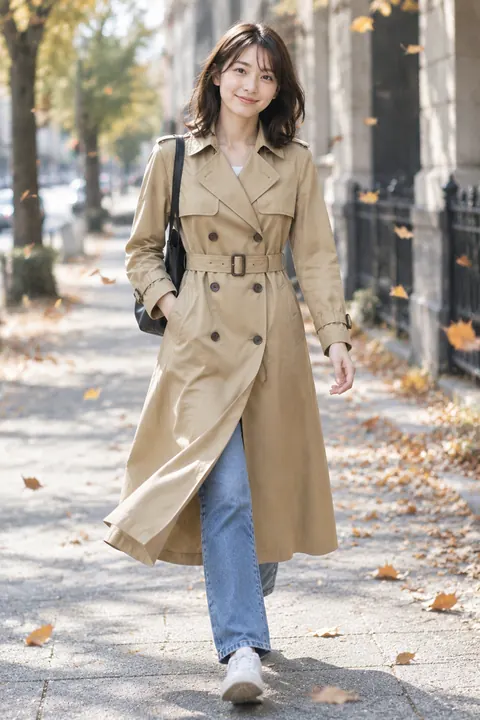</a>

[Example result & try this prompt](https://aiclothswap.net/outfit-swap-prompts/p/ai-windy-day-belted-trench-coat/?utm_source=github&utm_medium=awesome&utm_campaign=awesome-ai-outfit-swap-prompts)

### AI Autumn Alpine Hiking Fleece Outfit

```text
Keep the exact same face, hair, body and identity from image 1; dress him in the rust half-zip fleece and olive hiking pants from image 2. Autumn alpine trail with red and gold foliage and distant peaks, walking pose with plain backpack, full body. Adult faces fully visible and not cropped, no logos, no text, no watermark, photorealistic, aspect ratio 4:3.
```

**Model:** GPT Image 2.5


<a href="https://aiclothswap.net/outfit-swap-prompts/p/ai-autumn-alpine-hiking-fleece-outfit/?utm_source=github&utm_medium=awesome&utm_campaign=awesome-ai-outfit-swap-prompts">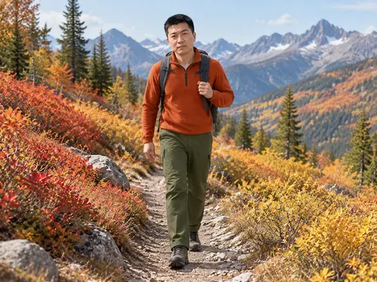</a>

[Example result & try this prompt](https://aiclothswap.net/outfit-swap-prompts/p/ai-autumn-alpine-hiking-fleece-outfit/?utm_source=github&utm_medium=awesome&utm_campaign=awesome-ai-outfit-swap-prompts)

### Cropped Cloud Puffer Wide Denim

```text
Keep the exact same face, hair, body and identity from image 1; dress her in the cropped voluminous cloud-grey puffer jacket over a fitted black turtleneck with indigo wide-leg denim and chunky sneakers from image 2. Windy autumn city street with fallen leaves, three-quarter walking pose. Adult faces fully visible and not cropped, no logos, no text, no watermark, photorealistic, aspect ratio 3:4.
```

**Model:** GPT Image 2.5

> Cropped voluminous puffer plus wide-leg denim is the layering hit of mid-October.

<a href="https://aiclothswap.net/outfit-swap-prompts/p/cropped-cloud-puffer-wide-denim/?utm_source=github&utm_medium=awesome&utm_campaign=awesome-ai-outfit-swap-prompts">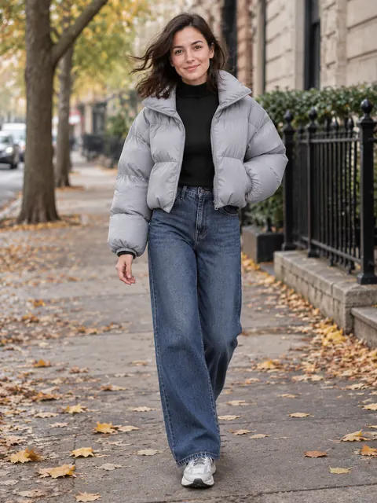</a>

[Example result & try this prompt](https://aiclothswap.net/outfit-swap-prompts/p/cropped-cloud-puffer-wide-denim/?utm_source=github&utm_medium=awesome&utm_campaign=awesome-ai-outfit-swap-prompts)

### Flannel Over Slip Travel Look

```text
Keep the exact same face, hair, body and identity from image 1; dress her in the open rust-and-cream plaid flannel shirt over a black midi slip dress with ankle boots from image 2. Country road trip rest-stop with autumn trees, full-body candid stance. Adult faces fully visible and not cropped, no logos, no text, no watermark, photorealistic, aspect ratio 2:3.
```

**Model:** GPT Image 2.5

> Flannel over a slip dress is a top fall travel formula — rustic shirt, sleek dress.

<a href="https://aiclothswap.net/outfit-swap-prompts/p/flannel-shirt-over-slip-travel/?utm_source=github&utm_medium=awesome&utm_campaign=awesome-ai-outfit-swap-prompts">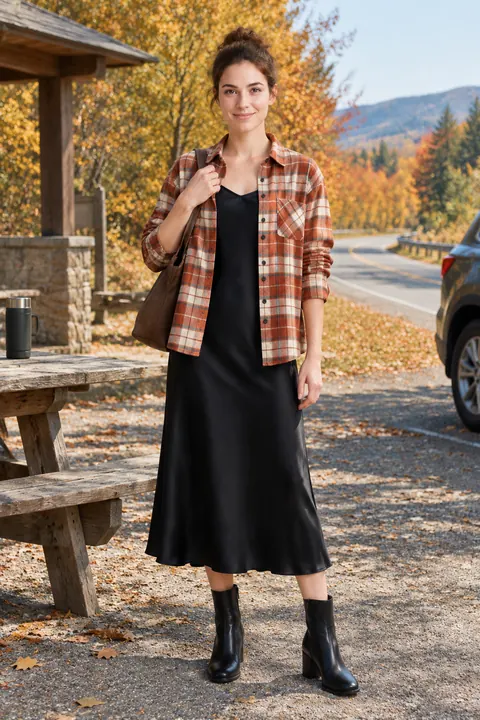</a>

[Example result & try this prompt](https://aiclothswap.net/outfit-swap-prompts/p/flannel-shirt-over-slip-travel/?utm_source=github&utm_medium=awesome&utm_campaign=awesome-ai-outfit-swap-prompts)

### Classic Denim Jacket Weekend Travel Look

```text
Change clothes: take the person from image 1 and dress her in the classic denim jacket look from image 2. Keep identity. Soft travel daylight, photorealistic, aspect ratio 3:4.
```

**Model:** GPT Image 2.5

> Classic medium-wash denim jacket for weekend travel looks.

<a href="https://aiclothswap.net/outfit-swap-prompts/p/denim-jacket-weekend-travel/?utm_source=github&utm_medium=awesome&utm_campaign=awesome-ai-outfit-swap-prompts">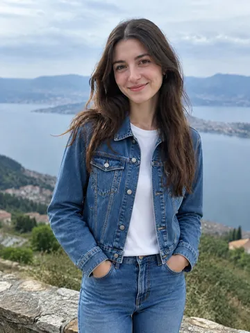</a>

[Example result & try this prompt](https://aiclothswap.net/outfit-swap-prompts/p/denim-jacket-weekend-travel/?utm_source=github&utm_medium=awesome&utm_campaign=awesome-ai-outfit-swap-prompts)

### Safari Utility Travel Set Wide Shot

```text
Keep person from image 1. Dress her in the khaki safari utility travel set from image 2. Soft outdoor travel light, wide composition, photorealistic, aspect ratio 16:9.
```

**Model:** GPT Image 2.5

> Khaki safari utility shirt and cargos in a wide travel frame.

<a href="https://aiclothswap.net/outfit-swap-prompts/p/safari-utility-travel-set/?utm_source=github&utm_medium=awesome&utm_campaign=awesome-ai-outfit-swap-prompts">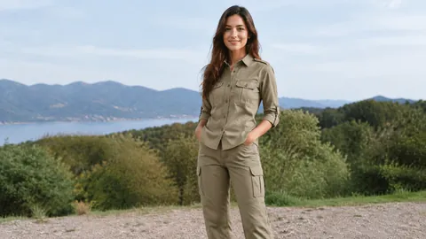</a>

[Example result & try this prompt](https://aiclothswap.net/outfit-swap-prompts/p/safari-utility-travel-set/?utm_source=github&utm_medium=awesome&utm_campaign=awesome-ai-outfit-swap-prompts)
