# 🎨 Color Swap · AI Outfit Swap Prompts

[← README](../README.md) · 17 prompts · [aiclothswap.net](https://aiclothswap.net/inspiration?utm_source=github&utm_medium=awesome&utm_campaign=awesome-ai-outfit-swap-prompts)

### Puffer Jacket Cobalt Blue Recolor

```text
Keep the exact same face, hair, body and identity from image 1; dress her in the black quilted puffer jacket with stand collar from image 2, but recolor the garment to vivid cobalt blue while keeping its exact cut, quilting/pleats and fabric texture. Snowy park in winter daylight, wide full-body portrait. Full garment visible, face fully in frame and not cropped, no logos, no text, photorealistic, aspect ratio 16:9.
```

**Model:** Nano Banana Pro

> Recolor the same puffer to bold cobalt to test a brighter winter look.

<a href="https://aiclothswap.net/inspiration/p/puffer-jacket-cobalt-recolor/?utm_source=github&utm_medium=awesome&utm_campaign=awesome-ai-outfit-swap-prompts"></a>

[Example result & try this prompt](https://aiclothswap.net/inspiration/p/puffer-jacket-cobalt-recolor/?utm_source=github&utm_medium=awesome&utm_campaign=awesome-ai-outfit-swap-prompts)

### Pleated Midi Skirt Sage Green Recolor

```text
Keep the exact same face, hair, body and identity from image 1; dress her in the navy blue satin pleated midi skirt from image 2, but recolor the garment to soft sage green while keeping its exact cut, quilting/pleats and fabric texture. Bright minimal cafe interior, full-body portrait from head to shoes so the whole skirt is visible. Full garment visible, face fully in frame and not cropped, no logos, no text, photorealistic, aspect ratio 4:5.
```

**Model:** Nano Banana Pro

> Try a pleated skirt in sage before you buy a second color.

<a href="https://aiclothswap.net/inspiration/p/pleated-midi-skirt-sage-recolor/?utm_source=github&utm_medium=awesome&utm_campaign=awesome-ai-outfit-swap-prompts"></a>

[Example result & try this prompt](https://aiclothswap.net/inspiration/p/pleated-midi-skirt-sage-recolor/?utm_source=github&utm_medium=awesome&utm_campaign=awesome-ai-outfit-swap-prompts)

### Linen Shirt Terracotta Recolor

```text
Keep the exact same face, hair, body and identity from image 1; dress her in a relaxed-fit linen button-up shirt in terracotta orange with a camp collar from image 2. Same pose and seamless light studio; only the shirt color changes to the terracotta shade from image 2, waist-up framing. Full garment visible, face fully in frame and not cropped, no logos, no text, photorealistic, aspect ratio 1:1.
```

**Model:** GPT Image 2.5

> Recolor a basic linen shirt to a warm terracotta for summer.

<a href="https://aiclothswap.net/inspiration/p/linen-shirt-terracotta-recolor/?utm_source=github&utm_medium=awesome&utm_campaign=awesome-ai-outfit-swap-prompts"></a>

[Example result & try this prompt](https://aiclothswap.net/inspiration/p/linen-shirt-terracotta-recolor/?utm_source=github&utm_medium=awesome&utm_campaign=awesome-ai-outfit-swap-prompts)

### Wide-Leg Jeans Washed Black Recolor

```text
Keep the exact same face, hair, body and identity from image 1; dress her in high-waisted wide-leg jeans in washed black denim, five-pocket style, no logos or labels from image 2. Same pose, top and light studio; only the jeans change to washed black as in image 2, full-body framing. Full garment visible, face fully in frame and not cropped, no logos, no text, photorealistic, aspect ratio 2:3.
```

**Model:** GPT Image 2.5

> See how wide-leg jeans look in washed black versus classic blue.

<a href="https://aiclothswap.net/inspiration/p/wide-leg-jeans-black-recolor/?utm_source=github&utm_medium=awesome&utm_campaign=awesome-ai-outfit-swap-prompts"></a>

[Example result & try this prompt](https://aiclothswap.net/inspiration/p/wide-leg-jeans-black-recolor/?utm_source=github&utm_medium=awesome&utm_campaign=awesome-ai-outfit-swap-prompts)

### Corduroy Jacket Rust Recolor

```text
Keep the exact same face, hair, body and identity from image 1; dress her in the rust orange corduroy trucker jacket from image 2. Neutral studio, three-quarter pose showing the jacket colour clearly. Full garment visible, face fully in frame and not cropped, no logos, no text, photorealistic, aspect ratio 4:5.
```

**Model:** GPT Image 2.5

> Same corduroy jacket, new rust colour: one tap, new season.

<a href="https://aiclothswap.net/inspiration/p/corduroy-jacket-rust-recolor/?utm_source=github&utm_medium=awesome&utm_campaign=awesome-ai-outfit-swap-prompts"></a>

[Example result & try this prompt](https://aiclothswap.net/inspiration/p/corduroy-jacket-rust-recolor/?utm_source=github&utm_medium=awesome&utm_campaign=awesome-ai-outfit-swap-prompts)

### Satin Blouse Wine Recolor

```text
Keep the exact same face, hair, body and identity from image 1; dress her in the wine red satin blouse from image 2. Bright room beside a tall mirror in an outfit-check pose, face turned to camera and fully visible. Full garment visible, face fully in frame and not cropped, no logos, no text, photorealistic, aspect ratio 3:4.
```

**Model:** GPT Image 2.5

> Try the same satin blouse in wine before you commit.

<a href="https://aiclothswap.net/inspiration/p/satin-blouse-wine-recolor/?utm_source=github&utm_medium=awesome&utm_campaign=awesome-ai-outfit-swap-prompts"></a>

[Example result & try this prompt](https://aiclothswap.net/inspiration/p/satin-blouse-wine-recolor/?utm_source=github&utm_medium=awesome&utm_campaign=awesome-ai-outfit-swap-prompts)

### Denim Jacket Olive Recolor

```text
Keep the exact same face, hair, body and identity from image 1; dress her in the olive green denim trucker jacket from image 2. Neutral studio, three-quarter pose showing the jacket colour clearly. Full garment visible, face fully in frame and not cropped, no logos, no text, photorealistic, aspect ratio 4:5.
```

**Model:** GPT Image 2.5

> See the same denim jacket in olive before you buy a second one.

<a href="https://aiclothswap.net/inspiration/p/denim-jacket-olive-recolor/?utm_source=github&utm_medium=awesome&utm_campaign=awesome-ai-outfit-swap-prompts">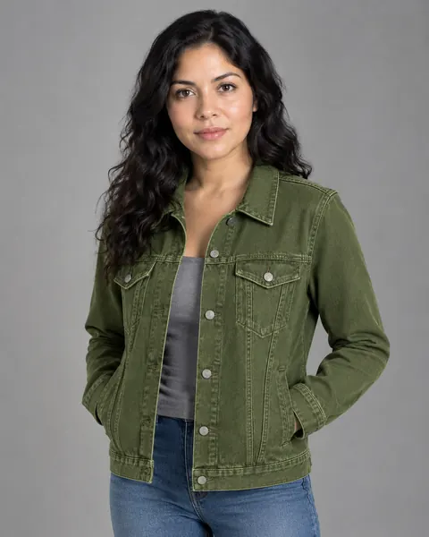</a>

[Example result & try this prompt](https://aiclothswap.net/inspiration/p/denim-jacket-olive-recolor/?utm_source=github&utm_medium=awesome&utm_campaign=awesome-ai-outfit-swap-prompts)

### Emerald Wool Coat Recolor

```text
Keep the exact same face, hair, body and identity from image 1; dress her in the emerald green long wool coat from image 2. Bright room beside a tall mirror in an outfit-check pose, face turned to camera and fully visible. Full garment visible, face fully in frame and not cropped, no logos, no text, photorealistic, aspect ratio 3:4.
```

**Model:** GPT Image 2.5

> Try a classic wool coat in emerald before committing to colour.

<a href="https://aiclothswap.net/inspiration/p/emerald-wool-coat-recolor/?utm_source=github&utm_medium=awesome&utm_campaign=awesome-ai-outfit-swap-prompts">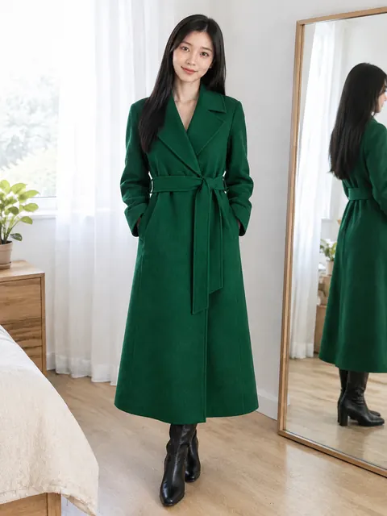</a>

[Example result & try this prompt](https://aiclothswap.net/inspiration/p/emerald-wool-coat-recolor/?utm_source=github&utm_medium=awesome&utm_campaign=awesome-ai-outfit-swap-prompts)

### Trench Coat Olive Recolor

```text
Keep the exact same face, hair, body and identity from image 1; recolor and replace her outerwear with the olive green trench coat from image 2, same cut and fit. City sidewalk, standing pose facing camera. Full garment visible, face fully in frame and not cropped, no logos, no text, photorealistic, aspect ratio 3:4.
```

**Model:** GPT Image 2.5

> Trench coats are the outerwear story of the week — recoloring camel to olive is a natural try-on.

<a href="https://aiclothswap.net/inspiration/p/trench-coat-olive-recolor/?utm_source=github&utm_medium=awesome&utm_campaign=awesome-ai-outfit-swap-prompts">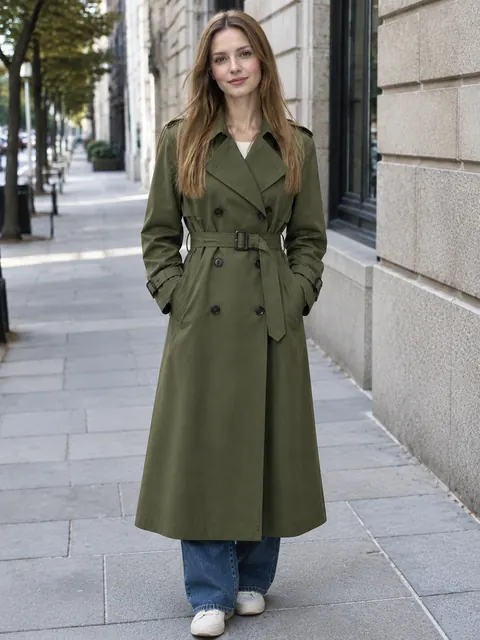</a>

[Example result & try this prompt](https://aiclothswap.net/inspiration/p/trench-coat-olive-recolor/?utm_source=github&utm_medium=awesome&utm_campaign=awesome-ai-outfit-swap-prompts)

### Leather Jacket Black Recolor

```text
Keep the exact same face, hair, body and identity from image 1; recolor and replace her jacket with the black leather biker jacket from image 2, same cut. Brick wall street, standing pose facing camera. Full garment visible, face fully in frame and not cropped, no logos, no text, photorealistic, aspect ratio 4:5.
```

**Model:** GPT Image 2.5

> Beige leather jackets tagged quiet luxury are circulating — black recolor is the classic swap.

<a href="https://aiclothswap.net/inspiration/p/leather-jacket-black-recolor/?utm_source=github&utm_medium=awesome&utm_campaign=awesome-ai-outfit-swap-prompts">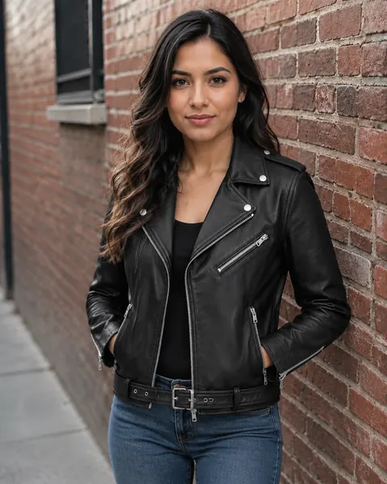</a>

[Example result & try this prompt](https://aiclothswap.net/inspiration/p/leather-jacket-black-recolor/?utm_source=github&utm_medium=awesome&utm_campaign=awesome-ai-outfit-swap-prompts)

### Trench Coat Pumpkin-Orange Recolor

```text
Keep the exact same face, hair, body and identity from image 1; dress her in the pumpkin-orange trench coat from image 2 over a cream knit and dark trousers. Neutral gray studio, standing pose facing camera. Human adult face fully in frame and not cropped, no pumpkin head, no logos, no text, photorealistic, aspect ratio 3:4.
```

**Model:** GPT Image 2.5

> Color-swap creators on X recolor classics into pumpkin orange during pumpkin-head season.

<a href="https://aiclothswap.net/inspiration/p/trench-coat-pumpkin-orange-recolor/?utm_source=github&utm_medium=awesome&utm_campaign=awesome-ai-outfit-swap-prompts">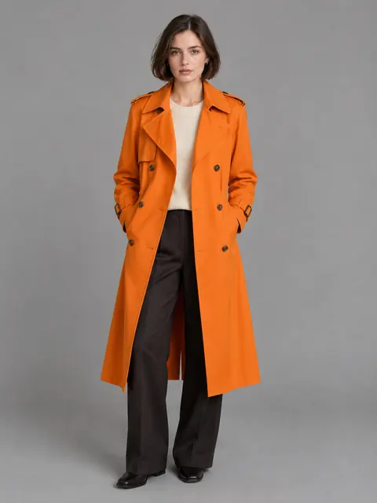</a>

[Example result & try this prompt](https://aiclothswap.net/inspiration/p/trench-coat-pumpkin-orange-recolor/?utm_source=github&utm_medium=awesome&utm_campaign=awesome-ai-outfit-swap-prompts)

### Blazer Amber-Spice Recolor

```text
Keep the exact same face, hair, body and identity from image 1; dress her in the amber-spice blazer from image 2 over a white shirt with black trousers. Soft white studio, poised standing pose. Human adult face fully in frame and not cropped, no pumpkin head, no logos, no text, photorealistic, aspect ratio 4:5.
```

**Model:** GPT Image 2.5

> Amber-spice blazer recolors ride the same October heat as AI pumpkin-head photos on X.

<a href="https://aiclothswap.net/inspiration/p/blazer-amber-spice-recolor/?utm_source=github&utm_medium=awesome&utm_campaign=awesome-ai-outfit-swap-prompts">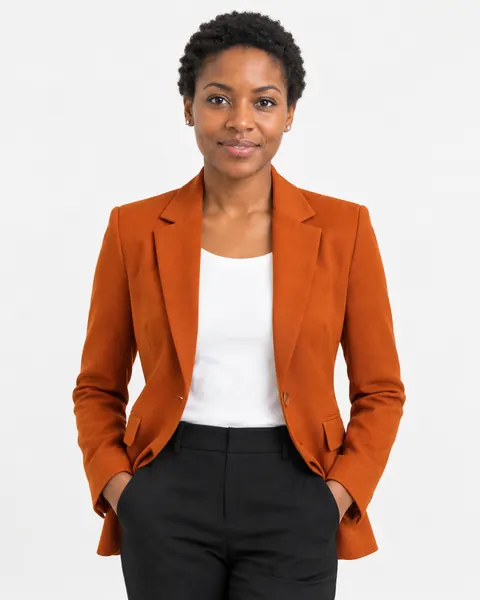</a>

[Example result & try this prompt](https://aiclothswap.net/inspiration/p/blazer-amber-spice-recolor/?utm_source=github&utm_medium=awesome&utm_campaign=awesome-ai-outfit-swap-prompts)

### Fitting Room Try-On Haul: Knit in a New Colorway

```text
Keep the exact same face, hair, body and identity from image 1; dress her in the sage-green ribbed cardigan (same cut, new color) from image 2. Store fitting room with curtain and hooks, mirror selfie with plain phone, bright retail lighting. Adult faces fully visible and not cropped, no logos, no text, no watermark, photorealistic, aspect ratio 3:4.
```

**Model:** GPT Image 2.5

> Fitting-room try-on hauls are a growing UGC format — test the same knit in a new color before you buy.

<a href="https://aiclothswap.net/inspiration/p/fitting-room-try-on-haul-knit-colorway/?utm_source=github&utm_medium=awesome&utm_campaign=awesome-ai-outfit-swap-prompts">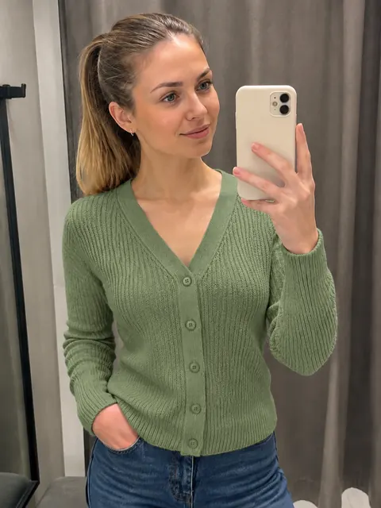</a>

[Example result & try this prompt](https://aiclothswap.net/inspiration/p/fitting-room-try-on-haul-knit-colorway/?utm_source=github&utm_medium=awesome&utm_campaign=awesome-ai-outfit-swap-prompts)

### AI Old Money Women: Cardigan Recolor to Navy

```text
Keep the exact same face, hair, body and identity from image 1; dress her in the navy fine-knit V-neck cardigan (keep the same cut, new color) from image 2. Country-club terrace with green lawn, soft daylight, relaxed elegant pose. Adult faces fully visible and not cropped, no logos, no text, no watermark, photorealistic, aspect ratio 4:5.
```

**Model:** GPT Image 2.5

> Old-money women looks hinge on navy, cream and camel — recolor a cardigan to see which shade fits you.

<a href="https://aiclothswap.net/inspiration/p/ai-old-money-women-navy-cardigan-recolor/?utm_source=github&utm_medium=awesome&utm_campaign=awesome-ai-outfit-swap-prompts">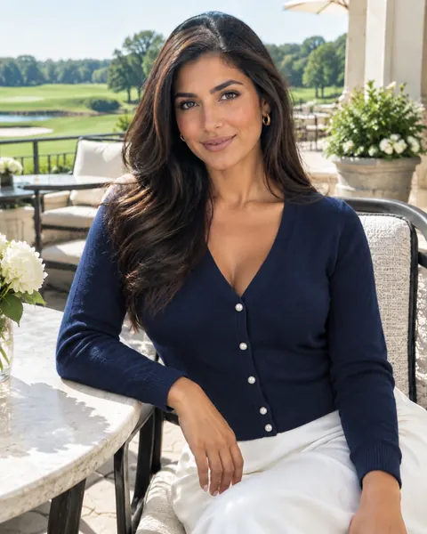</a>

[Example result & try this prompt](https://aiclothswap.net/inspiration/p/ai-old-money-women-navy-cardigan-recolor/?utm_source=github&utm_medium=awesome&utm_campaign=awesome-ai-outfit-swap-prompts)

### Double-Breasted Trench Coat 4-Color Palette Swap

```text
Keep identical person and trench silhouette, generate a side-by-side comparison across 4 Pantone seasonal hues: camel, olive, charcoal and burgundy. Clean runway background, 16:9 widescreen.
```

**Model:** Nano Banana Pro

> Wide 16:9 canvas is ideal for displaying multi-colorway outerwear variations, perfect for e-commerce color swatch try-ons.

<a href="https://aiclothswap.net/inspiration/p/pantone-palette-trench-color-swap/?utm_source=github&utm_medium=awesome&utm_campaign=awesome-ai-outfit-swap-prompts">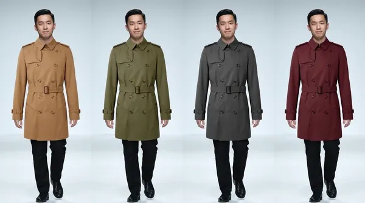</a>

[Example result & try this prompt](https://aiclothswap.net/inspiration/p/pantone-palette-trench-color-swap/?utm_source=github&utm_medium=awesome&utm_campaign=awesome-ai-outfit-swap-prompts)

### Wool Coat Winter Colorways Swap

```text
Keep identical person and wool-coat silhouette from image 1 and garment reference image 2. Present a clean side-by-side winter colorway swap across camel, charcoal, burgundy, and forest green. Same pose and lighting, photorealistic, aspect ratio 16:9.
```

**Model:** GPT Image 2.5

> Double-breasted wool coat shown across camel, charcoal, burgundy, and forest green.

<a href="https://aiclothswap.net/inspiration/p/wool-coat-winter-colorways/?utm_source=github&utm_medium=awesome&utm_campaign=awesome-ai-outfit-swap-prompts">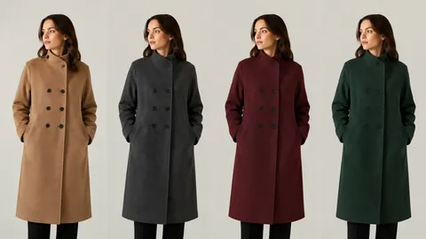</a>

[Example result & try this prompt](https://aiclothswap.net/inspiration/p/wool-coat-winter-colorways/?utm_source=github&utm_medium=awesome&utm_campaign=awesome-ai-outfit-swap-prompts)

### Silk Blouse Pastel Palette Swap

```text
Keep identical person and blouse silhouette; using garment from image 2, generate a pastel palette swap across blush, mint, lavender, and butter yellow. Clean comparison layout, photorealistic, aspect ratio 4:3.
```

**Model:** GPT Image 2.5

> Silk blouse pastel palette across blush, mint, lavender, and butter yellow.

<a href="https://aiclothswap.net/inspiration/p/silk-blouse-pastel-palette-swap/?utm_source=github&utm_medium=awesome&utm_campaign=awesome-ai-outfit-swap-prompts">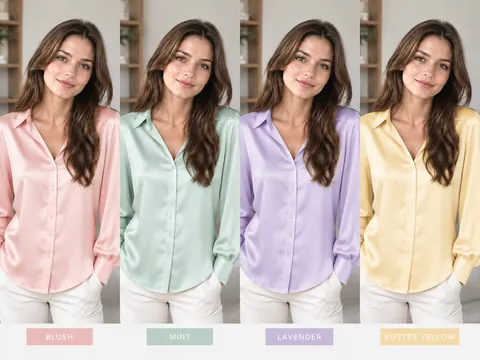</a>

[Example result & try this prompt](https://aiclothswap.net/inspiration/p/silk-blouse-pastel-palette-swap/?utm_source=github&utm_medium=awesome&utm_campaign=awesome-ai-outfit-swap-prompts)
