# 🏮 Cultural & Festive · AI Outfit Swap Prompts

[← README](../README.md) · 17 prompts · [aiclothswap.net](https://aiclothswap.net/inspiration?utm_source=github&utm_medium=awesome&utm_campaign=awesome-ai-outfit-swap-prompts)

### Song Dynasty Weaving-Gold Horse-Face Skirt Hanfu

```text
Cultural try-on: Dress the same woman from picture 1 into traditional Chinese Song Dynasty Hanfu outfit from picture 2, featuring a gold-threaded horse-face pleated skirt and pastel silk robe. Classical garden gazebo, 3:4.
```

**Model:** Nano Banana Pro

> Heritage aesthetics hit. Seamlessly swaps contemporary portraits into graceful traditional Song-dynasty Hanfu portraiture.

<a href="https://aiclothswap.net/inspiration/p/song-dynasty-hanfu-horse-face-skirt/?utm_source=github&utm_medium=awesome&utm_campaign=awesome-ai-outfit-swap-prompts"></a>

[Example result & try this prompt](https://aiclothswap.net/inspiration/p/song-dynasty-hanfu-horse-face-skirt/?utm_source=github&utm_medium=awesome&utm_campaign=awesome-ai-outfit-swap-prompts)

### Magenta Silk Saree Festive Look

```text
Keep the exact same face, hair, body and identity from image 1; dress her in the magenta silk saree with gold woven border and matching gold blouse from image 2. Festive courtyard decorated with marigold garlands and oil lamps, full-body portrait with the saree draped correctly over the shoulder. Full garment visible, face fully in frame and not cropped, no logos, no text, photorealistic, aspect ratio 2:3.
```

**Model:** Nano Banana Pro

> Magenta and gold is a classic festive saree palette for Diwali and weddings.

<a href="https://aiclothswap.net/inspiration/p/magenta-silk-saree-festive/?utm_source=github&utm_medium=awesome&utm_campaign=awesome-ai-outfit-swap-prompts"></a>

[Example result & try this prompt](https://aiclothswap.net/inspiration/p/magenta-silk-saree-festive/?utm_source=github&utm_medium=awesome&utm_campaign=awesome-ai-outfit-swap-prompts)

### Indigo Yukata Summer Festival Look

```text
Keep the exact same face, hair, body and identity from image 1; dress her in the indigo cotton yukata with white morning-glory flower pattern and a mustard obi sash from image 2. Evening summer festival street with paper lanterns, full-body portrait with the yukata wrapped left over right. Full garment visible, face fully in frame and not cropped, no logos, no text, photorealistic, aspect ratio 3:4.
```

**Model:** Nano Banana Pro

> A light cotton yukata with a contrast obi is perfect for summer festival photos.

<a href="https://aiclothswap.net/inspiration/p/indigo-yukata-summer-festival/?utm_source=github&utm_medium=awesome&utm_campaign=awesome-ai-outfit-swap-prompts"></a>

[Example result & try this prompt](https://aiclothswap.net/inspiration/p/indigo-yukata-summer-festival/?utm_source=github&utm_medium=awesome&utm_campaign=awesome-ai-outfit-swap-prompts)

### Embroidered Kaftan Festive Look

```text
Keep the exact same face, hair, body and identity from image 1; dress her in a deep teal floor-length kaftan with gold geometric embroidery along the neckline and sleeves, long flowing sleeves from image 2. Courtyard with zellige tiles, lanterns and warm evening light, full-body pose. Full garment visible, face fully in frame and not cropped, no logos, no text, photorealistic, aspect ratio 2:3.
```

**Model:** GPT Image 2.5

> A flowing embroidered kaftan is a graceful choice for festive gatherings.

<a href="https://aiclothswap.net/inspiration/p/moroccan-embroidered-kaftan-eid/?utm_source=github&utm_medium=awesome&utm_campaign=awesome-ai-outfit-swap-prompts"></a>

[Example result & try this prompt](https://aiclothswap.net/inspiration/p/moroccan-embroidered-kaftan-eid/?utm_source=github&utm_medium=awesome&utm_campaign=awesome-ai-outfit-swap-prompts)

### Traditional Dirndl Festival Look

```text
Keep the exact same face, hair, body and identity from image 1; dress her in a traditional dirndl dress with a forest green bodice, white puff-sleeve blouse, burgundy skirt and a cream apron from image 2. Festive outdoor beer garden with wooden tables and string lights, three-quarter pose. Full garment visible, face fully in frame and not cropped, no logos, no text, photorealistic, aspect ratio 3:4.
```

**Model:** GPT Image 2.5

> A classic dirndl with apron is the go-to look for autumn beer festivals.

<a href="https://aiclothswap.net/inspiration/p/dirndl-oktoberfest-festive/?utm_source=github&utm_medium=awesome&utm_campaign=awesome-ai-outfit-swap-prompts"></a>

[Example result & try this prompt](https://aiclothswap.net/inspiration/p/dirndl-oktoberfest-festive/?utm_source=github&utm_medium=awesome&utm_campaign=awesome-ai-outfit-swap-prompts)

### Emerald Embroidered Kurta Festive Set

```text
Keep the exact same face, hair, body and identity from image 1; dress her in the emerald green embroidered kurta festive set from image 2. Lantern-lit courtyard, graceful standing pose. Full garment visible, face fully in frame and not cropped, no logos, no text, photorealistic, aspect ratio 3:4.
```

**Model:** GPT Image 2.5

> Emerald embroidery for festive evenings that call for colour.

<a href="https://aiclothswap.net/inspiration/p/emerald-embroidered-kurta-festive-set/?utm_source=github&utm_medium=awesome&utm_campaign=awesome-ai-outfit-swap-prompts"></a>

[Example result & try this prompt](https://aiclothswap.net/inspiration/p/emerald-embroidered-kurta-festive-set/?utm_source=github&utm_medium=awesome&utm_campaign=awesome-ai-outfit-swap-prompts)

### Crimson Gold Festive Saree Look

```text
Keep the exact same face, hair, body and identity from image 1; dress her in the crimson red saree with wide gold border from image 2, draped traditionally. Decorated festival hall, warm lights, elegant standing pose. Full garment visible, face fully in frame and not cropped, no logos, no text, photorealistic, aspect ratio 2:3.
```

**Model:** GPT Image 2.5

> Crimson and gold: the most celebratory saree pairing.

<a href="https://aiclothswap.net/inspiration/p/crimson-gold-festive-saree-look/?utm_source=github&utm_medium=awesome&utm_campaign=awesome-ai-outfit-swap-prompts">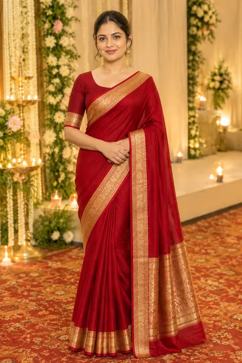</a>

[Example result & try this prompt](https://aiclothswap.net/inspiration/p/crimson-gold-festive-saree-look/?utm_source=github&utm_medium=awesome&utm_campaign=awesome-ai-outfit-swap-prompts)

### Navratri Black Embroidered Kurta Menswear

```text
Keep the exact same face, hair, body and identity from image 1; dress him in the black embroidered kurta with subtle gold patterns and white trousers from image 2. Festival street decorated with marigold garlands, warm evening light, proud standing pose. Full garment visible, face fully in frame and not cropped, no logos, no text, photorealistic, aspect ratio 3:4.
```

**Model:** GPT Image 2.5

> Festive kurta portraits for Navratri are a trending AI photo prompt.

<a href="https://aiclothswap.net/inspiration/p/navratri-black-kurta-festive-mens/?utm_source=github&utm_medium=awesome&utm_campaign=awesome-ai-outfit-swap-prompts">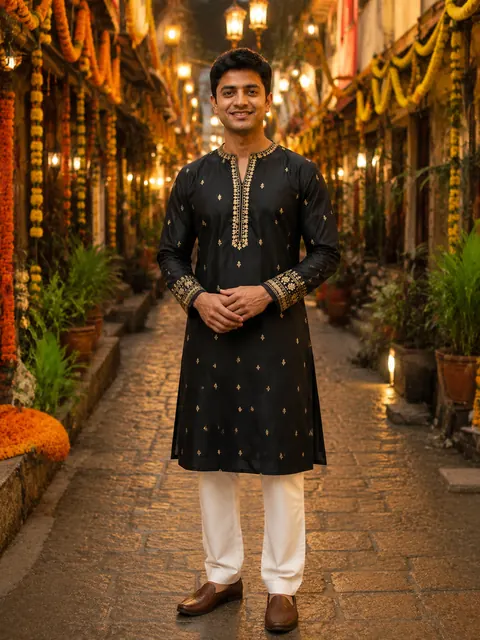</a>

[Example result & try this prompt](https://aiclothswap.net/inspiration/p/navratri-black-kurta-festive-mens/?utm_source=github&utm_medium=awesome&utm_campaign=awesome-ai-outfit-swap-prompts)

### Crimson Ao Dai Festive Look

```text
Keep the exact same face, hair, body and identity from image 1; dress her in the crimson red ao dai with gold floral embroidery and matching trousers from image 2. Lantern-lit old town street, graceful standing pose. Full garment visible, face fully in frame and not cropped, no logos, no text, photorealistic, aspect ratio 2:3.
```

**Model:** GPT Image 2.5

> Ao dai festive portraits are a beloved cultural photo style.

<a href="https://aiclothswap.net/inspiration/p/crimson-ao-dai-festive-look/?utm_source=github&utm_medium=awesome&utm_campaign=awesome-ai-outfit-swap-prompts">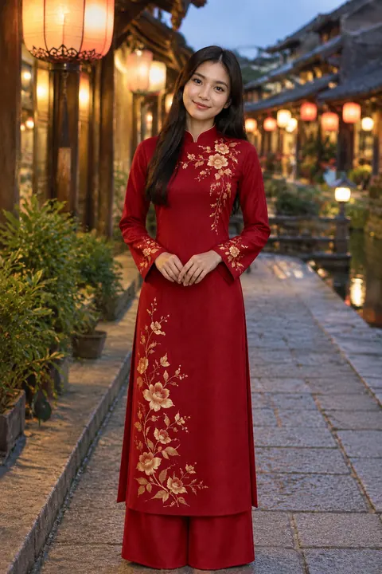</a>

[Example result & try this prompt](https://aiclothswap.net/inspiration/p/crimson-ao-dai-festive-look/?utm_source=github&utm_medium=awesome&utm_campaign=awesome-ai-outfit-swap-prompts)

### Coral Aso-Ebi Corset Festive Set

```text
Keep the exact same face, hair, body and identity from image 1; dress her in the coral brocade corset blouse and matching straight skirt from image 2. Decorated wedding reception hall, confident standing pose. Full garment visible, face fully in frame and not cropped, no logos, no text, photorealistic, aspect ratio 3:4.
```

**Model:** GPT Image 2.5

> Aso-ebi wedding-guest sets are a hot cultural conversation on X wedding threads.

<a href="https://aiclothswap.net/inspiration/p/coral-aso-ebi-corset-festive/?utm_source=github&utm_medium=awesome&utm_campaign=awesome-ai-outfit-swap-prompts">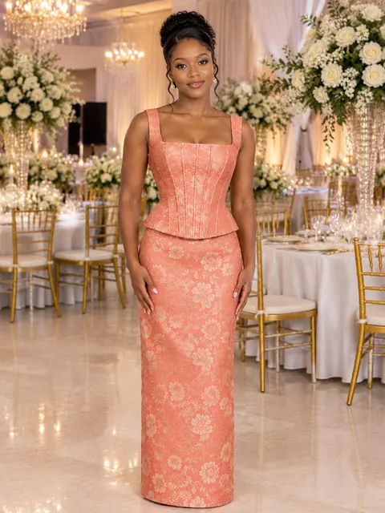</a>

[Example result & try this prompt](https://aiclothswap.net/inspiration/p/coral-aso-ebi-corset-festive/?utm_source=github&utm_medium=awesome&utm_campaign=awesome-ai-outfit-swap-prompts)

### Diwali Gold Anarkali Festive Look

```text
Keep the exact same face, hair, body and identity from image 1; dress her in the gold-and-maroon anarkali festive gown from image 2. Lantern-lit courtyard, graceful standing pose. Full garment visible, face fully in frame and not cropped, no logos, no text, photorealistic, aspect ratio 2:3.
```

**Model:** GPT Image 2.5

> Diwali festive outfits are peaking on X as families share celebration looks.

<a href="https://aiclothswap.net/inspiration/p/diwali-gold-anarkali-festive/?utm_source=github&utm_medium=awesome&utm_campaign=awesome-ai-outfit-swap-prompts">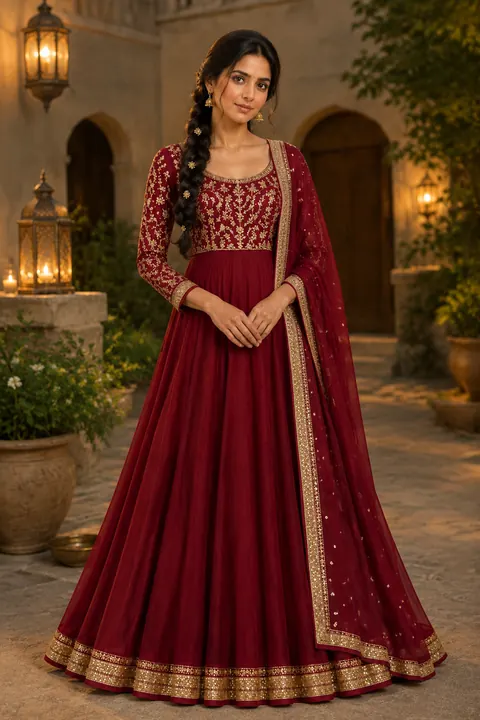</a>

[Example result & try this prompt](https://aiclothswap.net/inspiration/p/diwali-gold-anarkali-festive/?utm_source=github&utm_medium=awesome&utm_campaign=awesome-ai-outfit-swap-prompts)

### Marigold Amber Festive Lehenga

```text
Keep the exact same face, hair, body and identity from image 1; dress her in the amber-marigold festive lehenga from image 2. Festival courtyard with warm evening light, graceful standing pose. Human adult face fully in frame and not cropped, no pumpkin head, no logos, no text, photorealistic, aspect ratio 2:3.
```

**Model:** GPT Image 2.5

> Harvest and marigold orange on X autumn feeds overlap pumpkin-head season — festive amber lehenga without costume faces.

<a href="https://aiclothswap.net/inspiration/p/marigold-amber-festive-lehenga/?utm_source=github&utm_medium=awesome&utm_campaign=awesome-ai-outfit-swap-prompts">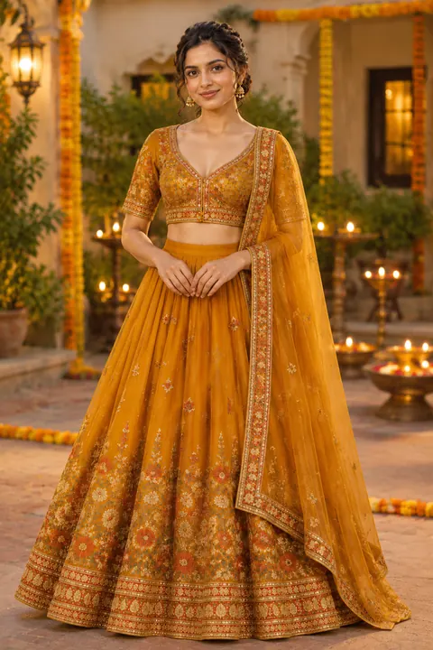</a>

[Example result & try this prompt](https://aiclothswap.net/inspiration/p/marigold-amber-festive-lehenga/?utm_source=github&utm_medium=awesome&utm_campaign=awesome-ai-outfit-swap-prompts)

### Copper Brocade Harvest Qipao

```text
Keep the exact same face, hair, body and identity from image 1; dress her in the copper brocade harvest qipao from image 2. Lantern-lit festive courtyard, poised standing pose. Human adult face fully in frame and not cropped, no pumpkin head, no logos, no text, photorealistic, aspect ratio 3:4.
```

**Model:** GPT Image 2.5

> October pumpkin and harvest aesthetics on X soft-map to copper brocade festive qipao looks.

<a href="https://aiclothswap.net/inspiration/p/copper-brocade-harvest-qipao/?utm_source=github&utm_medium=awesome&utm_campaign=awesome-ai-outfit-swap-prompts">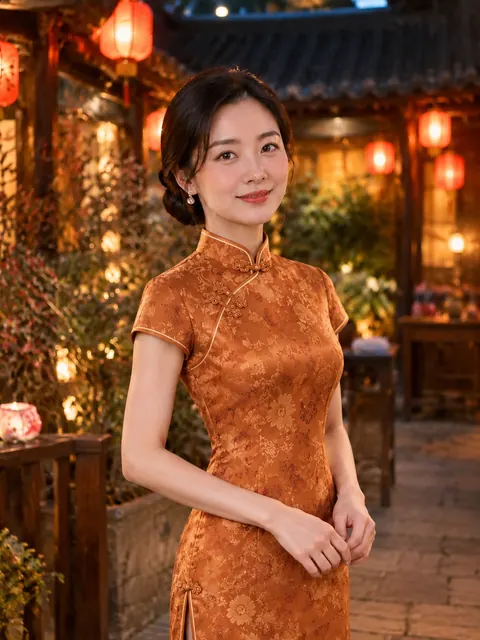</a>

[Example result & try this prompt](https://aiclothswap.net/inspiration/p/copper-brocade-harvest-qipao/?utm_source=github&utm_medium=awesome&utm_campaign=awesome-ai-outfit-swap-prompts)

### AI Diwali Photo for Boys: Silk Kurta with Diyas

```text
Keep the exact same face, hair, body and identity from image 1; dress him in the teal silk kurta with gold embroidery from image 2. Festive terrace at night lined with glowing clay diyas, marigold garlands and a soft sparkler glow, waist-up smiling pose. Adult faces fully visible and not cropped, no logos, no text, no watermark, photorealistic, aspect ratio 4:5.
```

**Model:** GPT Image 2.5

> ‘ai diwali photo prompt boy’ is spiking ahead of Diwali — a jewel-tone silk kurta with diyas and sparklers.

<a href="https://aiclothswap.net/inspiration/p/ai-diwali-photo-boy-silk-kurta/?utm_source=github&utm_medium=awesome&utm_campaign=awesome-ai-outfit-swap-prompts">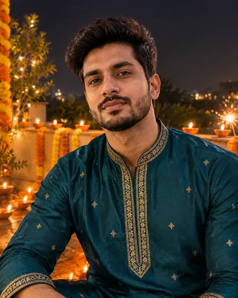</a>

[Example result & try this prompt](https://aiclothswap.net/inspiration/p/ai-diwali-photo-boy-silk-kurta/?utm_source=github&utm_medium=awesome&utm_campaign=awesome-ai-outfit-swap-prompts)

### AI Diwali Couple Photo: Lehenga and Kurta

```text
Keep the exact same face, hair, body and identity from image 1; dress the woman and the man in the ruby lehenga (for her) and cream silk kurta with ruby stole (for him) from image 2. Courtyard decorated with diyas, rangoli and warm string lights, couple smiling together holding a diya. Adult faces fully visible and not cropped, no logos, no text, no watermark, photorealistic, aspect ratio 3:2.
```

**Model:** GPT Image 2.5

> Diwali couple photo prompts peak now — coordinate a ruby lehenga and a cream kurta under string lights.

<a href="https://aiclothswap.net/inspiration/p/ai-diwali-couple-photo-lehenga-sherwani/?utm_source=github&utm_medium=awesome&utm_campaign=awesome-ai-outfit-swap-prompts">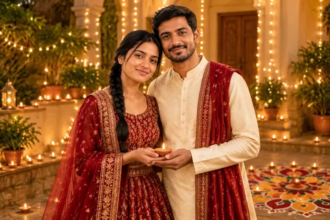</a>

[Example result & try this prompt](https://aiclothswap.net/inspiration/p/ai-diwali-couple-photo-lehenga-sherwani/?utm_source=github&utm_medium=awesome&utm_campaign=awesome-ai-outfit-swap-prompts)

### Modern Hanbok Festive Dress

```text
Cultural try-on: dress the same woman from picture 1 into the modern pastel hanbok-inspired festive dress from picture 2. Preserve face and hair. Soft festive lighting, photorealistic, aspect ratio 3:4.
```

**Model:** GPT Image 2.5

> Modern pastel hanbok-inspired festive dress with soft ribbons.

<a href="https://aiclothswap.net/inspiration/p/modern-hanbok-festive-dress/?utm_source=github&utm_medium=awesome&utm_campaign=awesome-ai-outfit-swap-prompts">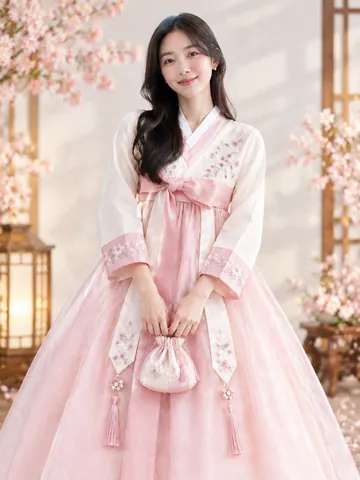</a>

[Example result & try this prompt](https://aiclothswap.net/inspiration/p/modern-hanbok-festive-dress/?utm_source=github&utm_medium=awesome&utm_campaign=awesome-ai-outfit-swap-prompts)

### Floral Silk Qipao for New Year

```text
Keep identity from image 1. Dress her in the crimson floral silk qipao from image 2. Warm festive New Year lighting, photorealistic, aspect ratio 4:5.
```

**Model:** GPT Image 2.5

> Crimson floral silk qipao for New Year festive try-ons.

<a href="https://aiclothswap.net/inspiration/p/qipao-silk-floral-new-year/?utm_source=github&utm_medium=awesome&utm_campaign=awesome-ai-outfit-swap-prompts">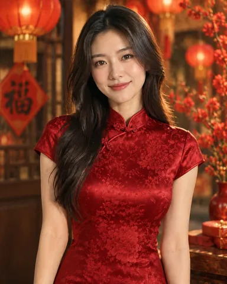</a>

[Example result & try this prompt](https://aiclothswap.net/inspiration/p/qipao-silk-floral-new-year/?utm_source=github&utm_medium=awesome&utm_campaign=awesome-ai-outfit-swap-prompts)
