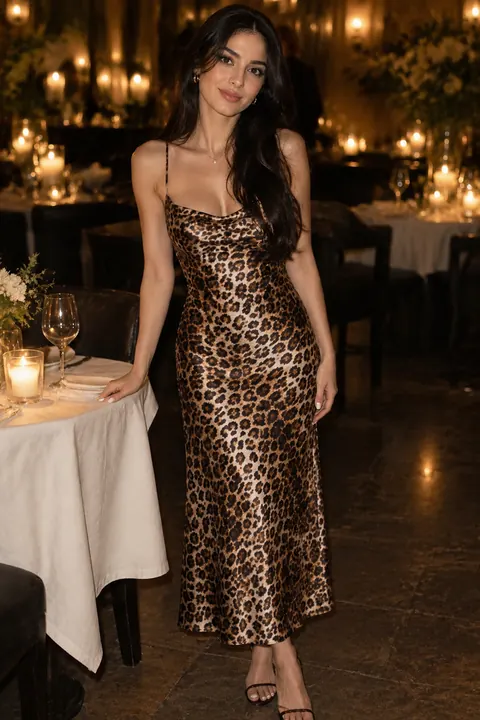
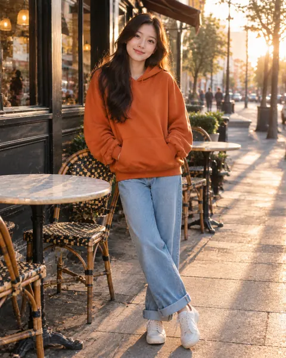
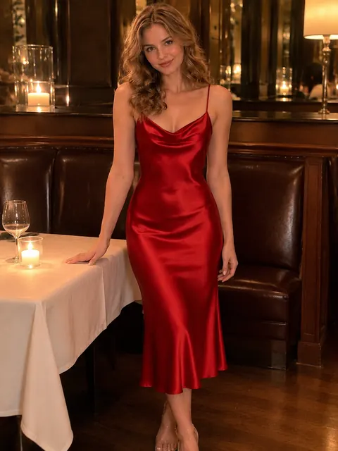
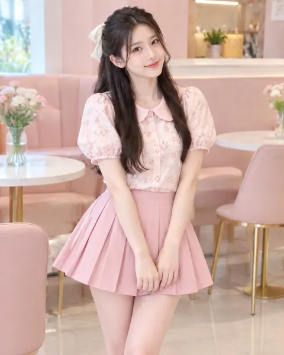
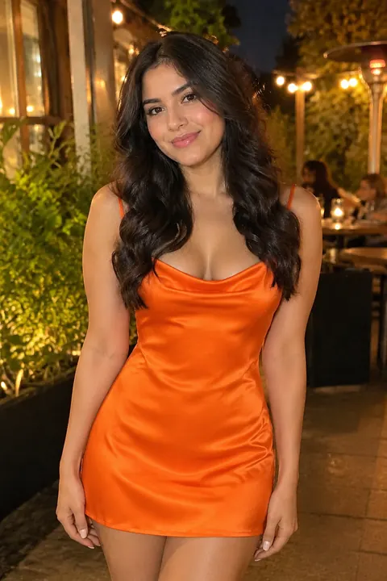
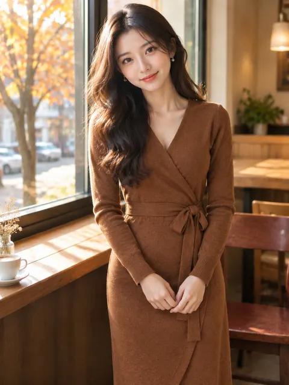
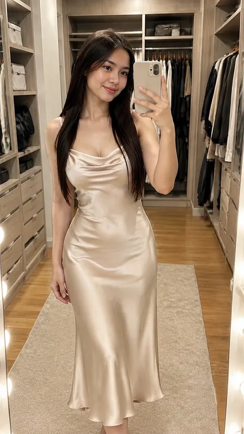
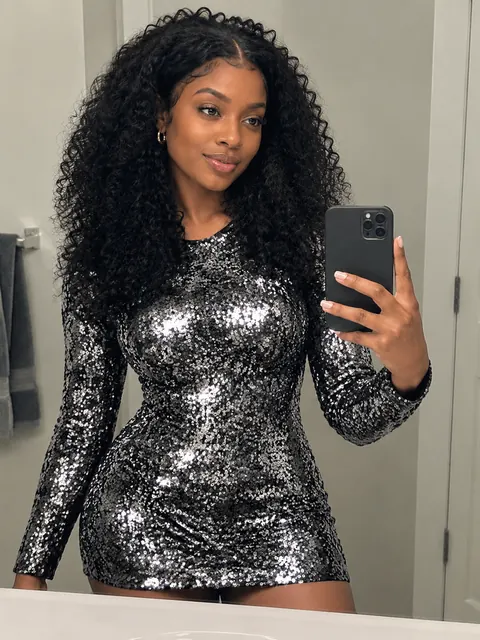
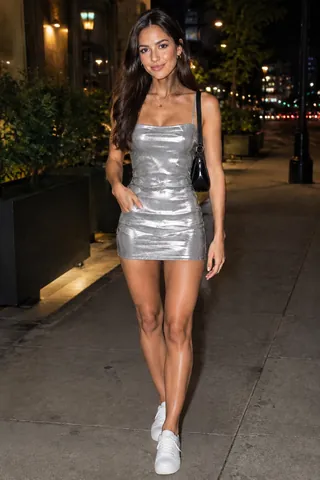

# 🍸 Date & Party · AI Outfit Swap Prompts

[← README](../README.md) · 17 prompts · [aiclothswap.net](https://aiclothswap.net/inspiration?utm_source=github&utm_medium=awesome&utm_campaign=awesome-ai-outfit-swap-prompts)

### French Mulberry Silk Slip Dress Evening Date

```text
Virtual try-on prompt: Keep the person identity and face from image 1 intact. Change her dress to the champagne mulberry silk slip dress with cowl neck from image 2. Golden hour romantic terrace setting, photorealistic, 3:4.
```

**Model:** Nano Banana Pro

> The fluid drape and luminous highlights of silk satin are key to this prompt—ideal for romantic date nights and cocktail parties.

<a href="https://aiclothswap.net/inspiration/p/french-silk-slip-dress-dating/?utm_source=github&utm_medium=awesome&utm_campaign=awesome-ai-outfit-swap-prompts"></a>

[Example result & try this prompt](https://aiclothswap.net/inspiration/p/french-silk-slip-dress-dating/?utm_source=github&utm_medium=awesome&utm_campaign=awesome-ai-outfit-swap-prompts)

### Emerald Satin Wrap Midi Date-Night Dress

```text
Keep the exact same face, hair, body and identity from image 1; dress her in the emerald green satin wrap midi dress with long sleeves and tie waist from image 2. Cozy candlelit restaurant with warm bokeh lights, full-body date-night portrait. Full garment visible, face fully in frame and not cropped, no logos, no text, photorealistic, aspect ratio 3:4.
```

**Model:** Nano Banana Pro

> Satin in a jewel tone catches candlelight beautifully for dinner dates.

<a href="https://aiclothswap.net/inspiration/p/emerald-satin-wrap-midi-date-night/?utm_source=github&utm_medium=awesome&utm_campaign=awesome-ai-outfit-swap-prompts"></a>

[Example result & try this prompt](https://aiclothswap.net/inspiration/p/emerald-satin-wrap-midi-date-night/?utm_source=github&utm_medium=awesome&utm_campaign=awesome-ai-outfit-swap-prompts)

### Burgundy Velvet Blazer Party Look

```text
Keep the exact same face, hair, body and identity from image 1; dress him in the burgundy velvet single-breasted blazer over a black crewneck tee with black slim trousers from image 2. Stylish cocktail bar with moody warm lighting, full-body party portrait. Full garment visible, face fully in frame and not cropped, no logos, no text, photorealistic, aspect ratio 2:3.
```

**Model:** Nano Banana Pro

> A velvet blazer over a tee is an easy dressed-up night-out look.

<a href="https://aiclothswap.net/inspiration/p/burgundy-velvet-blazer-party-mens/?utm_source=github&utm_medium=awesome&utm_campaign=awesome-ai-outfit-swap-prompts"></a>

[Example result & try this prompt](https://aiclothswap.net/inspiration/p/burgundy-velvet-blazer-party-mens/?utm_source=github&utm_medium=awesome&utm_campaign=awesome-ai-outfit-swap-prompts)

### Lilac Satin Slip Skirt & Knit Date Look

```text
Keep the exact same face, hair, body and identity from image 1; dress her in a lilac satin bias-cut midi slip skirt paired with a fitted cream short-sleeve knit top from image 2. Cozy candlelit wine bar interior, full-body standing pose. Full garment visible, face fully in frame and not cropped, no logos, no text, photorealistic, aspect ratio 3:4.
```

**Model:** GPT Image 2.5

> A satin skirt with a soft knit balances dressy and relaxed for dinner dates.

<a href="https://aiclothswap.net/inspiration/p/lilac-satin-slip-skirt-date/?utm_source=github&utm_medium=awesome&utm_campaign=awesome-ai-outfit-swap-prompts"></a>

[Example result & try this prompt](https://aiclothswap.net/inspiration/p/lilac-satin-slip-skirt-date/?utm_source=github&utm_medium=awesome&utm_campaign=awesome-ai-outfit-swap-prompts)

### Black Sequin Blazer Dress Party Look

```text
Keep the exact same face, hair, body and identity from image 1; dress her in a black sequined double-breasted blazer mini dress with long sleeves and plain covered buttons from image 2. Rooftop party at night with soft bokeh city lights, full-body pose. Full garment visible, face fully in frame and not cropped, no logos, no text, photorealistic, aspect ratio 9:16.
```

**Model:** GPT Image 2.5

> A sequin blazer dress is sharp tailoring with full party sparkle.

<a href="https://aiclothswap.net/inspiration/p/black-sequin-blazer-dress-party/?utm_source=github&utm_medium=awesome&utm_campaign=awesome-ai-outfit-swap-prompts"></a>

[Example result & try this prompt](https://aiclothswap.net/inspiration/p/black-sequin-blazer-dress-party/?utm_source=github&utm_medium=awesome&utm_campaign=awesome-ai-outfit-swap-prompts)

### Y2K Denim Party Two-Piece

```text
Keep the exact same face, hair, body and identity from image 1; dress her in the medium-wash denim vest top and matching denim mini skirt set from image 2. Rooftop bar at dusk, playful standing pose, city lights behind. Full garment visible, face fully in frame and not cropped, no logos, no text, photorealistic, aspect ratio 4:5.
```

**Model:** GPT Image 2.5

> Y2K denim-on-denim is back for party nights.

<a href="https://aiclothswap.net/inspiration/p/y2k-denim-party-two-piece/?utm_source=github&utm_medium=awesome&utm_campaign=awesome-ai-outfit-swap-prompts"></a>

[Example result & try this prompt](https://aiclothswap.net/inspiration/p/y2k-denim-party-two-piece/?utm_source=github&utm_medium=awesome&utm_campaign=awesome-ai-outfit-swap-prompts)

### Leopard Satin Midi Date Dress

```text
Keep the exact same face, hair, body and identity from image 1; dress her in the leopard print satin midi slip dress from image 2. Candlelit restaurant, elegant seated-turned standing pose near a table. Full garment visible, face fully in frame and not cropped, no logos, no text, photorealistic, aspect ratio 2:3.
```

**Model:** GPT Image 2.5

> A leopard midi is the date-night print that never stays away long.

<a href="https://aiclothswap.net/inspiration/p/leopard-satin-midi-date-dress/?utm_source=github&utm_medium=awesome&utm_campaign=awesome-ai-outfit-swap-prompts"></a>

[Example result & try this prompt](https://aiclothswap.net/inspiration/p/leopard-satin-midi-date-dress/?utm_source=github&utm_medium=awesome&utm_campaign=awesome-ai-outfit-swap-prompts)

### Burnt Orange Hoodie Street Date Look

```text
Keep the exact same face, hair, body and identity from image 1; dress her in the oversized burnt orange hoodie and cuffed light jeans from image 2. Golden-hour cafe street, relaxed leaning pose laughing toward camera, editorial poster feel with no text. Full garment visible, face fully in frame and not cropped, no logos, no text, photorealistic, aspect ratio 4:5.
```

**Model:** GPT Image 2.5

> Oversized hoodie editorial posters are a viral casual photo style.

<a href="https://aiclothswap.net/inspiration/p/burnt-orange-hoodie-street-date/?utm_source=github&utm_medium=awesome&utm_campaign=awesome-ai-outfit-swap-prompts"></a>

[Example result & try this prompt](https://aiclothswap.net/inspiration/p/burnt-orange-hoodie-street-date/?utm_source=github&utm_medium=awesome&utm_campaign=awesome-ai-outfit-swap-prompts)

### Fuchsia Satin Wrap Party Dress

```text
Keep the exact same face, hair, body and identity from image 1; dress her in the fuchsia pink satin wrap midi party dress from image 2. Neon-lit cocktail bar, confident standing pose with a gentle turn. Full garment visible, face fully in frame and not cropped, no logos, no text, photorealistic, aspect ratio 2:3.
```

**Model:** GPT Image 2.5

> Bold fuchsia satin is the party colour everyone is photographing.

<a href="https://aiclothswap.net/inspiration/p/fuchsia-satin-wrap-party-dress/?utm_source=github&utm_medium=awesome&utm_campaign=awesome-ai-outfit-swap-prompts"></a>

[Example result & try this prompt](https://aiclothswap.net/inspiration/p/fuchsia-satin-wrap-party-dress/?utm_source=github&utm_medium=awesome&utm_campaign=awesome-ai-outfit-swap-prompts)

### Cherry-Red Satin Date Dress

```text
Keep the exact same face, hair, body and identity from image 1; dress her in the cherry-red satin midi dress from image 2. Candlelit restaurant, seated-then-standing pose smiling at camera, modest neckline. Full garment visible, face fully in frame and not cropped, no logos, no text, photorealistic, aspect ratio 3:4.
```

**Model:** GPT Image 2.5

> Cherry-red satin date-night dresses are a recurring viral outfit ask on X.

<a href="https://aiclothswap.net/inspiration/p/cherry-red-satin-date-dress/?utm_source=github&utm_medium=awesome&utm_campaign=awesome-ai-outfit-swap-prompts"></a>

[Example result & try this prompt](https://aiclothswap.net/inspiration/p/cherry-red-satin-date-dress/?utm_source=github&utm_medium=awesome&utm_campaign=awesome-ai-outfit-swap-prompts)

### Coquette Pink Peter-Pan Party Look

```text
Keep the exact same face, hair, body and identity from image 1; dress her in the pink floral Peter Pan blouse and pleated mini skirt from image 2. Pastel cafe interior, playful standing pose facing camera. Full garment visible, face fully in frame and not cropped, no logos, no text, photorealistic, aspect ratio 4:5.
```

**Model:** GPT Image 2.5

> Coquette aesthetic — Peter Pan collar, pink florals — is still climbing on X fashion tags.

<a href="https://aiclothswap.net/inspiration/p/coquette-pink-peter-pan-party/?utm_source=github&utm_medium=awesome&utm_campaign=awesome-ai-outfit-swap-prompts"></a>

[Example result & try this prompt](https://aiclothswap.net/inspiration/p/coquette-pink-peter-pan-party/?utm_source=github&utm_medium=awesome&utm_campaign=awesome-ai-outfit-swap-prompts)

### Pumpkin-Orange Satin Date Dress

```text
Keep the exact same face, hair, body and identity from image 1; dress her in the pumpkin-orange satin mini dress from image 2. Warm evening restaurant patio, playful standing pose facing camera. Human adult face fully in frame and not cropped, no pumpkin head, no logos, no text, photorealistic, aspect ratio 2:3.
```

**Model:** GPT Image 2.5

> Couple and bestie pumpkin-head shoots on X often end in orange date-night satin — keep the face human.

<a href="https://aiclothswap.net/inspiration/p/pumpkin-orange-satin-date-dress/?utm_source=github&utm_medium=awesome&utm_campaign=awesome-ai-outfit-swap-prompts"></a>

[Example result & try this prompt](https://aiclothswap.net/inspiration/p/pumpkin-orange-satin-date-dress/?utm_source=github&utm_medium=awesome&utm_campaign=awesome-ai-outfit-swap-prompts)

### Cinnamon Wrap Knit Date Look

```text
Keep the exact same face, hair, body and identity from image 1; dress her in the cinnamon wrap knit midi dress from image 2. Autumn cafe window with warm light, relaxed standing pose. Human adult face fully in frame and not cropped, no pumpkin head, no logos, no text, photorealistic, aspect ratio 3:4.
```

**Model:** GPT Image 2.5

> Cozy cinnamon knits appear beside pumpkin-head posts as the softer after-shoot date look.

<a href="https://aiclothswap.net/inspiration/p/cinnamon-wrap-knit-date-look/?utm_source=github&utm_medium=awesome&utm_campaign=awesome-ai-outfit-swap-prompts"></a>

[Example result & try this prompt](https://aiclothswap.net/inspiration/p/cinnamon-wrap-knit-date-look/?utm_source=github&utm_medium=awesome&utm_campaign=awesome-ai-outfit-swap-prompts)

### AI Mirror Selfie for Girls: Walk-In Closet Fit Check

```text
Keep the exact same face, hair, body and identity from image 1; dress her in the champagne satin slip midi dress from image 2. Walk-in closet full-length mirror selfie holding a plain phone that does not cover the face, warm vanity lights. Adult faces fully visible and not cropped, no logos, no text, no watermark, photorealistic, aspect ratio 9:16.
```

**Model:** GPT Image 2.5

> ‘ai mirror selfie prompt for girl’ is a top autocomplete — swap a satin date dress into a walk-in closet mirror shot.

<a href="https://aiclothswap.net/inspiration/p/ai-mirror-selfie-girl-walk-in-closet/?utm_source=github&utm_medium=awesome&utm_campaign=awesome-ai-outfit-swap-prompts"></a>

[Example result & try this prompt](https://aiclothswap.net/inspiration/p/ai-mirror-selfie-girl-walk-in-closet/?utm_source=github&utm_medium=awesome&utm_campaign=awesome-ai-outfit-swap-prompts)

### AI Mirror Selfie for Girls: Sequin Party Dress

```text
Keep the exact same face, hair, body and identity from image 1; dress her in the silver-black sequin long-sleeve mini dress from image 2. Bathroom vanity mirror selfie with plain phone held low so the face is visible, flash glints on the sequins. Adult faces fully visible and not cropped, no logos, no text, no watermark, photorealistic, aspect ratio 3:4.
```

**Model:** GPT Image 2.5

> Mirror selfie prompts on X spike before weekend parties — try a sequin mini before heading out.

<a href="https://aiclothswap.net/inspiration/p/ai-mirror-selfie-girl-party-sequin/?utm_source=github&utm_medium=awesome&utm_campaign=awesome-ai-outfit-swap-prompts"></a>

[Example result & try this prompt](https://aiclothswap.net/inspiration/p/ai-mirror-selfie-girl-party-sequin/?utm_source=github&utm_medium=awesome&utm_campaign=awesome-ai-outfit-swap-prompts)

### Scarlet Bodycon Party Dress

```text
Virtual try-on: keep person identity from image 1 intact. Change her outfit to the scarlet bodycon midi dress from image 2. Soft evening date lighting, photorealistic, aspect ratio 3:4.
```

**Model:** GPT Image 2.5

> Scarlet bodycon midi for evening dates; keep identity while swapping the dress.

<a href="https://aiclothswap.net/inspiration/p/scarlet-bodycon-party-dress/?utm_source=github&utm_medium=awesome&utm_campaign=awesome-ai-outfit-swap-prompts"></a>

[Example result & try this prompt](https://aiclothswap.net/inspiration/p/scarlet-bodycon-party-dress/?utm_source=github&utm_medium=awesome&utm_campaign=awesome-ai-outfit-swap-prompts)

### Silver Metallic Mini Night-Out Dress

```text
Preserve face, hair and pose from image 1. Replace outfit with the silver metallic mini dress from image 2. Soft club lighting accents, photorealistic, aspect ratio 2:3.
```

**Model:** GPT Image 2.5

> Silver metallic mini with subtle shimmer for night-out try-ons.

<a href="https://aiclothswap.net/inspiration/p/silver-metallic-mini-night-out/?utm_source=github&utm_medium=awesome&utm_campaign=awesome-ai-outfit-swap-prompts"></a>

[Example result & try this prompt](https://aiclothswap.net/inspiration/p/silver-metallic-mini-night-out/?utm_source=github&utm_medium=awesome&utm_campaign=awesome-ai-outfit-swap-prompts)
