# 🛍️ E-commerce Model · AI Outfit Swap Prompts

[← README](../README.md) · 17 prompts · [aiclothswap.net](https://aiclothswap.net/inspiration?utm_source=github&utm_medium=awesome&utm_campaign=awesome-ai-outfit-swap-prompts)

### Ribbed Knit Midi Dress On-Model Shot

```text
Keep the exact same face, hair, body and identity from image 1; dress her in the oatmeal ribbed knit long-sleeve midi dress from image 2. Clean seamless white studio, even softbox lighting, ecommerce product-page full-body pose. Full garment visible, face fully in frame and not cropped, no logos, no text, photorealistic, aspect ratio 2:3.
```

**Model:** Nano Banana Pro

> Turn a hanger shot into a clean on-model product image.

<a href="https://aiclothswap.net/inspiration/p/ribbed-knit-midi-dress-ecommerce/?utm_source=github&utm_medium=awesome&utm_campaign=awesome-ai-outfit-swap-prompts"></a>

[Example result & try this prompt](https://aiclothswap.net/inspiration/p/ribbed-knit-midi-dress-ecommerce/?utm_source=github&utm_medium=awesome&utm_campaign=awesome-ai-outfit-swap-prompts)

### Gray Hoodie Flat-Lay to Model Shot

```text
Keep the exact same face, hair, body and identity from image 1; dress him in the heather gray pullover hoodie with kangaroo pocket from image 2. Seamless light gray studio, soft even lighting, ecommerce catalog full-body pose. Full garment visible, face fully in frame and not cropped, no logos, no text, photorealistic, aspect ratio 3:4.
```

**Model:** Nano Banana Pro

> Flat-lay to on-model makes basic hoodies look ready for a product page.

<a href="https://aiclothswap.net/inspiration/p/gray-hoodie-flatlay-to-model-mens/?utm_source=github&utm_medium=awesome&utm_campaign=awesome-ai-outfit-swap-prompts"></a>

[Example result & try this prompt](https://aiclothswap.net/inspiration/p/gray-hoodie-flatlay-to-model-mens/?utm_source=github&utm_medium=awesome&utm_campaign=awesome-ai-outfit-swap-prompts)

### Belted Trench Dress Catalog Model

```text
Keep the exact same face, hair, body and identity from image 1; dress her in a beige belted trench-style midi shirt dress with storm flap and plain buttons from image 2. Seamless white studio, soft even ecommerce lighting, full-body catalog pose. Full garment visible, face fully in frame and not cropped, no logos, no text, photorealistic, aspect ratio 3:4.
```

**Model:** GPT Image 2.5

> Turn a trench dress product shot into a clean catalog photo.

<a href="https://aiclothswap.net/inspiration/p/trench-dress-catalog-model/?utm_source=github&utm_medium=awesome&utm_campaign=awesome-ai-outfit-swap-prompts"></a>

[Example result & try this prompt](https://aiclothswap.net/inspiration/p/trench-dress-catalog-model/?utm_source=github&utm_medium=awesome&utm_campaign=awesome-ai-outfit-swap-prompts)

### Quilted Vest Lookbook Model

```text
Keep the exact same face, hair, body and identity from image 1; dress him in an olive green diamond-quilted lightweight vest with snap buttons, worn over a cream knit sweater, no logos from image 2. Light gray seamless studio, soft catalog lighting, three-quarter lookbook pose. Full garment visible, face fully in frame and not cropped, no logos, no text, photorealistic, aspect ratio 4:5.
```

**Model:** GPT Image 2.5

> A quilted vest on-model shows fit and layering better than a flat-lay.

<a href="https://aiclothswap.net/inspiration/p/quilted-vest-lookbook-model/?utm_source=github&utm_medium=awesome&utm_campaign=awesome-ai-outfit-swap-prompts"></a>

[Example result & try this prompt](https://aiclothswap.net/inspiration/p/quilted-vest-lookbook-model/?utm_source=github&utm_medium=awesome&utm_campaign=awesome-ai-outfit-swap-prompts)

### Leopard Cardigan Catalog Model

```text
Keep the exact same face, hair, body and identity from image 1; dress her in the leopard print knit cardigan from image 2 over a white top and jeans. Light gray seamless studio, catalog three-quarter pose. Full garment visible, face fully in frame and not cropped, no logos, no text, photorealistic, aspect ratio 4:5.
```

**Model:** GPT Image 2.5

> See the leopard cardigan on a model, not just flat.

<a href="https://aiclothswap.net/inspiration/p/leopard-cardigan-catalog-model/?utm_source=github&utm_medium=awesome&utm_campaign=awesome-ai-outfit-swap-prompts"></a>

[Example result & try this prompt](https://aiclothswap.net/inspiration/p/leopard-cardigan-catalog-model/?utm_source=github&utm_medium=awesome&utm_campaign=awesome-ai-outfit-swap-prompts)

### Plaid Blazer Lookbook Model

```text
Keep the exact same face, hair, body and identity from image 1; dress him in the brown plaid tailored blazer over a white shirt from image 2. White seamless studio, lookbook standing pose. Full garment visible, face fully in frame and not cropped, no logos, no text, photorealistic, aspect ratio 3:4.
```

**Model:** GPT Image 2.5

> A plaid blazer lookbook shot that sells the whole outfit.

<a href="https://aiclothswap.net/inspiration/p/plaid-blazer-lookbook-model/?utm_source=github&utm_medium=awesome&utm_campaign=awesome-ai-outfit-swap-prompts"></a>

[Example result & try this prompt](https://aiclothswap.net/inspiration/p/plaid-blazer-lookbook-model/?utm_source=github&utm_medium=awesome&utm_campaign=awesome-ai-outfit-swap-prompts)

### Burnt Orange Hoodie Editorial Poster Model

```text
Keep the exact same face, hair, body and identity from image 1; dress him in the oversized burnt orange hoodie from image 2. Light gray seamless studio, bold editorial poster pose, no text or graphics anywhere. Full garment visible, face fully in frame and not cropped, no logos, no text, photorealistic, aspect ratio 4:5.
```

**Model:** GPT Image 2.5

> Editorial poster model shots sell hoodies better than flat lays.

<a href="https://aiclothswap.net/inspiration/p/burnt-orange-hoodie-poster-model/?utm_source=github&utm_medium=awesome&utm_campaign=awesome-ai-outfit-swap-prompts">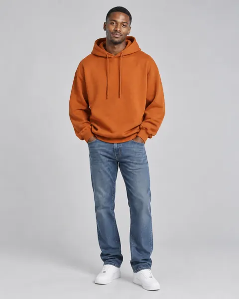</a>

[Example result & try this prompt](https://aiclothswap.net/inspiration/p/burnt-orange-hoodie-poster-model/?utm_source=github&utm_medium=awesome&utm_campaign=awesome-ai-outfit-swap-prompts)

### Sage Linen Co-ord Catalog Model

```text
Keep the exact same face, hair, body and identity from image 1; dress her in the sage green linen short-sleeve shirt and matching drawstring trousers set from image 2. White seamless studio, catalog standing pose showing the full set. Full garment visible, face fully in frame and not cropped, no logos, no text, photorealistic, aspect ratio 3:4.
```

**Model:** GPT Image 2.5

> Linen co-ords are the catalog set every summer shop is listing.

<a href="https://aiclothswap.net/inspiration/p/sage-linen-coord-catalog-model/?utm_source=github&utm_medium=awesome&utm_campaign=awesome-ai-outfit-swap-prompts">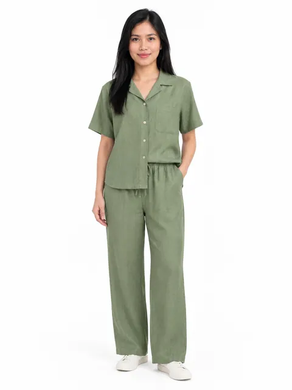</a>

[Example result & try this prompt](https://aiclothswap.net/inspiration/p/sage-linen-coord-catalog-model/?utm_source=github&utm_medium=awesome&utm_campaign=awesome-ai-outfit-swap-prompts)

### Flash Mirror Black Set Model Shot

```text
Keep the exact same face, hair, body and identity from image 1; dress her in the all-black twist-front top and high-waist trousers from image 2. Modern apartment full-length mirror scene with on-camera direct flash look, phone held low so face stays fully visible, confident stance. Full garment visible, face fully in frame and not cropped, no logos, no text, photorealistic, aspect ratio 9:16.
```

**Model:** GPT Image 2.5

> Direct-flash mirror selfies are a viral AI-prompt and UGC format on X this week.

<a href="https://aiclothswap.net/inspiration/p/flash-mirror-black-set-model/?utm_source=github&utm_medium=awesome&utm_campaign=awesome-ai-outfit-swap-prompts">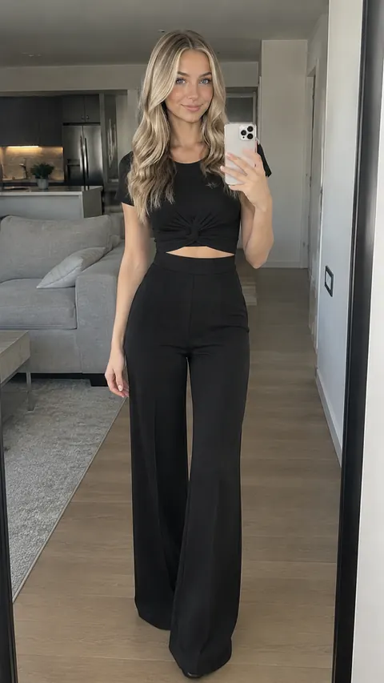</a>

[Example result & try this prompt](https://aiclothswap.net/inspiration/p/flash-mirror-black-set-model/?utm_source=github&utm_medium=awesome&utm_campaign=awesome-ai-outfit-swap-prompts)

### Runway Striped Knit Lookbook Model

```text
Keep the exact same face, hair, body and identity from image 1; dress her in the navy-and-cream striped knit sweater dress from image 2. Seamless light gray studio, editorial runway lookbook standing pose. Full garment visible, face fully in frame and not cropped, no logos, no text, photorealistic, aspect ratio 3:4.
```

**Model:** GPT Image 2.5

> Editorial runway-style ecommerce templates and lookbooks are a hot maker topic on X.

<a href="https://aiclothswap.net/inspiration/p/runway-striped-knit-lookbook-model/?utm_source=github&utm_medium=awesome&utm_campaign=awesome-ai-outfit-swap-prompts">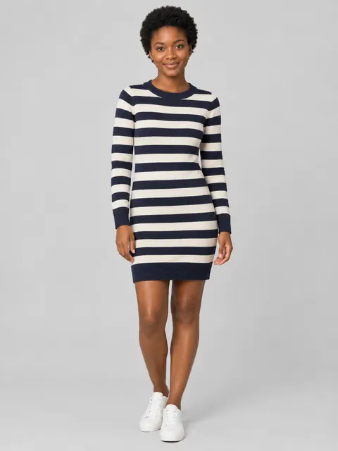</a>

[Example result & try this prompt](https://aiclothswap.net/inspiration/p/runway-striped-knit-lookbook-model/?utm_source=github&utm_medium=awesome&utm_campaign=awesome-ai-outfit-swap-prompts)

### Autumn Orange Knit Catalog Model

```text
Keep the exact same face, hair, body and identity from image 1; dress her in the chunky autumn-orange crewneck knit from image 2 with dark jeans. Seamless light gray studio, editorial catalog standing pose. Human adult face fully in frame and not cropped, no pumpkin head, no logos, no text, photorealistic, aspect ratio 3:4.
```

**Model:** GPT Image 2.5

> Ecommerce makers on X push autumn-orange knits in catalog poses while pumpkin-head content peaks.

<a href="https://aiclothswap.net/inspiration/p/autumn-orange-knit-catalog-model/?utm_source=github&utm_medium=awesome&utm_campaign=awesome-ai-outfit-swap-prompts">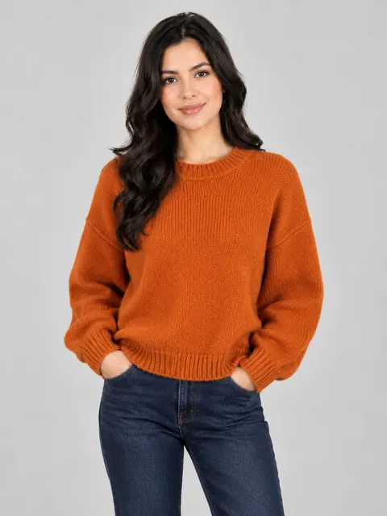</a>

[Example result & try this prompt](https://aiclothswap.net/inspiration/p/autumn-orange-knit-catalog-model/?utm_source=github&utm_medium=awesome&utm_campaign=awesome-ai-outfit-swap-prompts)

### Pumpkin-Spice Coat Lookbook Model

```text
Keep the exact same face, hair, body and identity from image 1; dress her in the pumpkin-spice belted long coat from image 2 over a cream turtleneck. Seamless light gray studio, lookbook walking-stopped pose facing camera. Human adult face fully in frame and not cropped, no pumpkin head, no logos, no text, photorealistic, aspect ratio 2:3.
```

**Model:** GPT Image 2.5

> Lookbook posts on X lean pumpkin-spice coats during the same week pumpkin-head photoshoot goes viral.

<a href="https://aiclothswap.net/inspiration/p/pumpkin-spice-coat-lookbook-model/?utm_source=github&utm_medium=awesome&utm_campaign=awesome-ai-outfit-swap-prompts">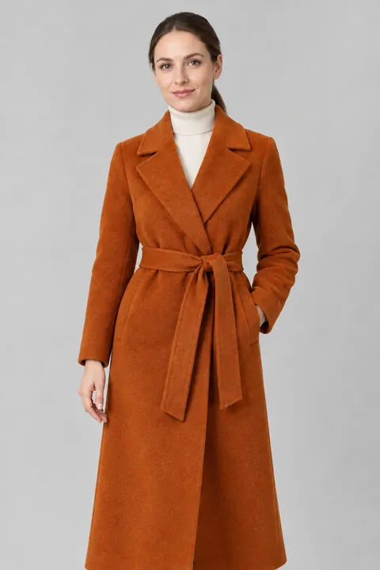</a>

[Example result & try this prompt](https://aiclothswap.net/inspiration/p/pumpkin-spice-coat-lookbook-model/?utm_source=github&utm_medium=awesome&utm_campaign=awesome-ai-outfit-swap-prompts)

### Fitting Room Try-On Haul: UGC Ad Shot

```text
Keep the exact same face, hair, body and identity from image 1; dress her in the black square-neck ribbed midi dress from image 2. Store fitting-room mirror selfie with plain phone, curtain half open, a few other plain garments on hooks, bright retail light, authentic UGC style. Adult faces fully visible and not cropped, no logos, no text, no watermark, photorealistic, aspect ratio 9:16.
```

**Model:** GPT Image 2.5

> ‘try-on haul in the fitting room’ prompts are a thin, rising UGC-ad format — create one from a product photo.

<a href="https://aiclothswap.net/inspiration/p/fitting-room-try-on-haul-ugc-ad/?utm_source=github&utm_medium=awesome&utm_campaign=awesome-ai-outfit-swap-prompts">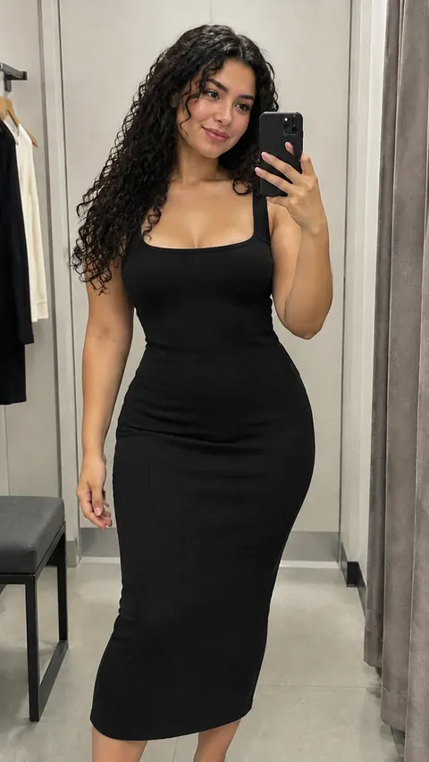</a>

[Example result & try this prompt](https://aiclothswap.net/inspiration/p/fitting-room-try-on-haul-ugc-ad/?utm_source=github&utm_medium=awesome&utm_campaign=awesome-ai-outfit-swap-prompts)

### Exploded Outfit Infographic for Product Listings

```text
Keep the exact same face, hair, body and identity from image 1; dress her in the camel knit cropped cardigan and wide-leg trousers from image 2. Exploded outfit infographic: she stands in the center wearing the set, with the cardigan, trousers, a small bag and loafers floating around her in a circle with dotted guide lines, light gray seamless background, no words or labels. Adult faces fully visible and not cropped, no logos, no text, no watermark, photorealistic, aspect ratio 1:1.
```

**Model:** GPT Image 2.5

> Exploded outfit infographics are a fresh listing format — show the model plus every piece of the set.

<a href="https://aiclothswap.net/inspiration/p/exploded-outfit-infographic-product-model/?utm_source=github&utm_medium=awesome&utm_campaign=awesome-ai-outfit-swap-prompts">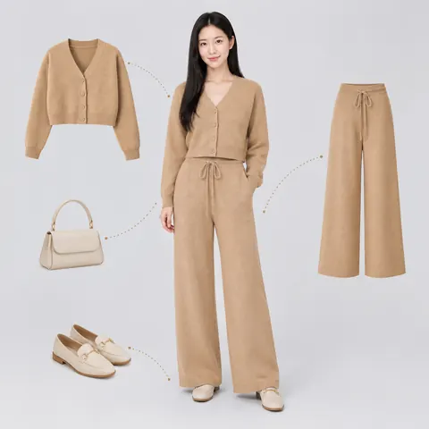</a>

[Example result & try this prompt](https://aiclothswap.net/inspiration/p/exploded-outfit-infographic-product-model/?utm_source=github&utm_medium=awesome&utm_campaign=awesome-ai-outfit-swap-prompts)

### Flat Lay Garment to Studio E-commerce Model Try-On

```text
Take the white background flat lay cotton shirt from image 2 and realistically dress it onto the standing commercial model in image 1. Commercial studio lighting, catalog lookbook style, 4:3 ratio.
```

**Model:** Nano Banana Pro

> Turn flat-lay catalog garments into realistic on-model studio lookbook images without physical photoshoots.

<a href="https://aiclothswap.net/inspiration/p/minimalist-linen-ecommerce-studio-model/?utm_source=github&utm_medium=awesome&utm_campaign=awesome-ai-outfit-swap-prompts">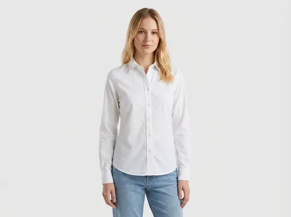</a>

[Example result & try this prompt](https://aiclothswap.net/inspiration/p/minimalist-linen-ecommerce-studio-model/?utm_source=github&utm_medium=awesome&utm_campaign=awesome-ai-outfit-swap-prompts)

### Denim Jacket Flat Lay to Studio Model

```text
Take the white-background flat-lay denim jacket from image 2 and realistically dress it onto the standing commercial model from image 1. Keep identity and studio backdrop. Clean e-commerce catalog look, photorealistic, aspect ratio 4:3.
```

**Model:** GPT Image 2.5

> Flat-lay denim jacket dressed onto a white-studio e-commerce model.

<a href="https://aiclothswap.net/inspiration/p/denim-jacket-flatlay-to-model/?utm_source=github&utm_medium=awesome&utm_campaign=awesome-ai-outfit-swap-prompts">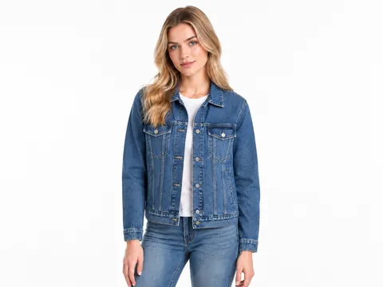</a>

[Example result & try this prompt](https://aiclothswap.net/inspiration/p/denim-jacket-flatlay-to-model/?utm_source=github&utm_medium=awesome&utm_campaign=awesome-ai-outfit-swap-prompts)

### Knit Sweater E-commerce Studio Try-On

```text
Dress the studio model from image 1 in the cream cable-knit sweater from the flat-lay image 2. Preserve face and seamless white backdrop. Catalog-ready e-commerce photo, photorealistic, aspect ratio 1:1.
```

**Model:** GPT Image 2.5

> Cream cable-knit sweater flat-lay to catalog studio try-on.

<a href="https://aiclothswap.net/inspiration/p/knit-sweater-ecommerce-studio/?utm_source=github&utm_medium=awesome&utm_campaign=awesome-ai-outfit-swap-prompts">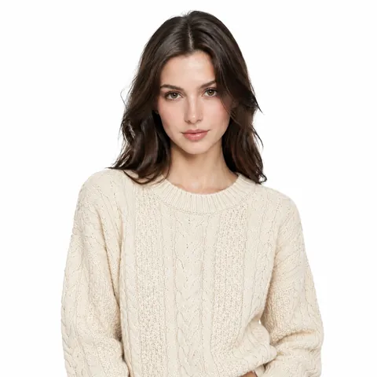</a>

[Example result & try this prompt](https://aiclothswap.net/inspiration/p/knit-sweater-ecommerce-studio/?utm_source=github&utm_medium=awesome&utm_campaign=awesome-ai-outfit-swap-prompts)
