# ✨ Formal & Events · AI Outfit Swap Prompts

[← README](../README.md) · 21 prompts · [aiclothswap.net](https://aiclothswap.net/outfit-swap-prompts?utm_source=github&utm_medium=awesome&utm_campaign=awesome-ai-outfit-swap-prompts)

### Emerald Green Velvet Gala Evening Gown

```text
Change clothes: Dress the model from image 1 in the floor-length emerald green velvet evening dress from image 2. Maintain exact facial features and lighting. Cinematic indoor chandelier bokeh, Black Tie formal event, 4:5.
```

**Model:** Nano Banana Pro

> Specifying 'velvet sheen' and emerald jewel tones helps the AI accurately render deep fabric texture and silhouette contours.

<a href="https://aiclothswap.net/outfit-swap-prompts/p/emerald-velvet-formal-evening-dress/?utm_source=github&utm_medium=awesome&utm_campaign=awesome-ai-outfit-swap-prompts"></a>

[Example result & try this prompt](https://aiclothswap.net/outfit-swap-prompts/p/emerald-velvet-formal-evening-dress/?utm_source=github&utm_medium=awesome&utm_campaign=awesome-ai-outfit-swap-prompts)

### Midnight Blue Velvet Tuxedo Gala Look

```text
Keep the exact same face, hair, body and identity from image 1; dress him in the midnight blue velvet tuxedo jacket with black satin peak lapels from image 2. Upscale gala ballroom with warm chandelier light, three-quarter portrait. Full garment visible, face fully in frame and not cropped, no logos, no text, photorealistic, aspect ratio 3:4.
```

**Model:** Nano Banana Pro

> Velvet in midnight blue is a refined alternative to the classic black tux.

<a href="https://aiclothswap.net/outfit-swap-prompts/p/midnight-velvet-tuxedo-gala/?utm_source=github&utm_medium=awesome&utm_campaign=awesome-ai-outfit-swap-prompts"></a>

[Example result & try this prompt](https://aiclothswap.net/outfit-swap-prompts/p/midnight-velvet-tuxedo-gala/?utm_source=github&utm_medium=awesome&utm_campaign=awesome-ai-outfit-swap-prompts)

### Ruby One-Shoulder Satin Evening Gown

```text
Keep the exact same face, hair, body and identity from image 1; dress her in the ruby red one-shoulder satin evening gown with draped bodice and floor-length skirt from image 2. Elegant evening event with soft spotlight and dark backdrop, full-body portrait. Full garment visible, face fully in frame and not cropped, no logos, no text, photorealistic, aspect ratio 2:3.
```

**Model:** Nano Banana Pro

> A one-shoulder drape keeps a red gown modern and dramatic.

<a href="https://aiclothswap.net/outfit-swap-prompts/p/ruby-one-shoulder-satin-gown/?utm_source=github&utm_medium=awesome&utm_campaign=awesome-ai-outfit-swap-prompts"></a>

[Example result & try this prompt](https://aiclothswap.net/outfit-swap-prompts/p/ruby-one-shoulder-satin-gown/?utm_source=github&utm_medium=awesome&utm_campaign=awesome-ai-outfit-swap-prompts)

### Cobalt Cape-Sleeve Crepe Gala Gown

```text
Keep the exact same face, hair, body and identity from image 1; dress her in a cobalt blue floor-length crepe column gown with sheer chiffon cape sleeves and a high round neckline from image 2. Elegant ballroom entrance with warm chandelier light, full-body pose. Full garment visible, face fully in frame and not cropped, no logos, no text, photorealistic, aspect ratio 2:3.
```

**Model:** GPT Image 2.5

> Cape sleeves give a column gown drama without extra embellishment.

<a href="https://aiclothswap.net/outfit-swap-prompts/p/cobalt-cape-sleeve-gala-gown/?utm_source=github&utm_medium=awesome&utm_campaign=awesome-ai-outfit-swap-prompts"></a>

[Example result & try this prompt](https://aiclothswap.net/outfit-swap-prompts/p/cobalt-cape-sleeve-gala-gown/?utm_source=github&utm_medium=awesome&utm_campaign=awesome-ai-outfit-swap-prompts)

### Charcoal Shawl-Collar Tuxedo Opera Night

```text
Keep the exact same face, hair, body and identity from image 1; dress him in a charcoal gray shawl-collar tuxedo jacket with matching trousers, white pleated dress shirt and black bow tie from image 2. Opera house lobby with marble stairs and soft warm lighting, three-quarter portrait. Full garment visible, face fully in frame and not cropped, no logos, no text, photorealistic, aspect ratio 4:5.
```

**Model:** GPT Image 2.5

> A charcoal tux is a subtle twist on black tie for evening events.

<a href="https://aiclothswap.net/outfit-swap-prompts/p/charcoal-shawl-tux-opera/?utm_source=github&utm_medium=awesome&utm_campaign=awesome-ai-outfit-swap-prompts"></a>

[Example result & try this prompt](https://aiclothswap.net/outfit-swap-prompts/p/charcoal-shawl-tux-opera/?utm_source=github&utm_medium=awesome&utm_campaign=awesome-ai-outfit-swap-prompts)

### Black Lace Gothic Gala Gown

```text
Keep the exact same face, hair, body and identity from image 1; dress her in the black lace gala gown from image 2. Candlelit ballroom, poised standing pose, dramatic but elegant light. Full garment visible, face fully in frame and not cropped, no logos, no text, photorealistic, aspect ratio 2:3.
```

**Model:** GPT Image 2.5

> Gothic romance translated into black-tie elegance.

<a href="https://aiclothswap.net/outfit-swap-prompts/p/black-lace-gothic-gala-gown/?utm_source=github&utm_medium=awesome&utm_campaign=awesome-ai-outfit-swap-prompts"></a>

[Example result & try this prompt](https://aiclothswap.net/outfit-swap-prompts/p/black-lace-gothic-gala-gown/?utm_source=github&utm_medium=awesome&utm_campaign=awesome-ai-outfit-swap-prompts)

### Gold Disco Sequin Gala Dress

```text
Keep the exact same face, hair, body and identity from image 1; dress her in the gold sequin gala dress from image 2. Warm ballroom lights, confident standing pose with a slight turn. Full garment visible, face fully in frame and not cropped, no logos, no text, photorealistic, aspect ratio 3:4.
```

**Model:** GPT Image 2.5

> Disco sparkle makes a gala entrance impossible to miss.

<a href="https://aiclothswap.net/outfit-swap-prompts/p/gold-disco-sequin-gala-dress/?utm_source=github&utm_medium=awesome&utm_campaign=awesome-ai-outfit-swap-prompts">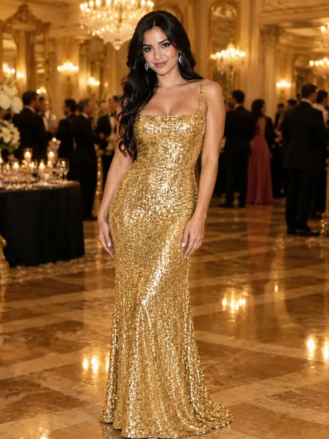</a>

[Example result & try this prompt](https://aiclothswap.net/outfit-swap-prompts/p/gold-disco-sequin-gala-dress/?utm_source=github&utm_medium=awesome&utm_campaign=awesome-ai-outfit-swap-prompts)

### Renaissance Velvet Cape Gown

```text
Keep the exact same face, hair, body and identity from image 1; dress her in the deep emerald velvet Renaissance-inspired gala gown with gold trim and short cape from image 2. Grand hall with tall windows, painterly dramatic side light, regal standing pose. Full garment visible, face fully in frame and not cropped, no logos, no text, photorealistic, aspect ratio 2:3.
```

**Model:** GPT Image 2.5

> Renaissance oil-portrait styling is a viral photo transformation this season.

<a href="https://aiclothswap.net/outfit-swap-prompts/p/renaissance-velvet-cape-gown/?utm_source=github&utm_medium=awesome&utm_campaign=awesome-ai-outfit-swap-prompts">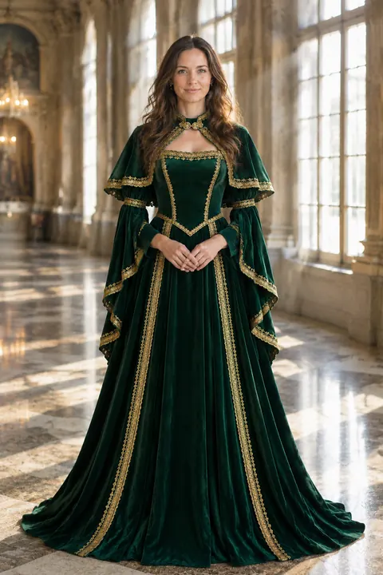</a>

[Example result & try this prompt](https://aiclothswap.net/outfit-swap-prompts/p/renaissance-velvet-cape-gown/?utm_source=github&utm_medium=awesome&utm_campaign=awesome-ai-outfit-swap-prompts)

### Silver Fringe Flapper Gala Dress

```text
Keep the exact same face, hair, body and identity from image 1; dress her in the silver beaded fringe gala dress from image 2. Art-deco ballroom, joyful mid-twirl pose so the fringe moves, face turned to camera and fully visible. Full garment visible, face fully in frame and not cropped, no logos, no text, photorealistic, aspect ratio 3:4.
```

**Model:** GPT Image 2.5

> Fringe movement dresses are back for gala dance floors.

<a href="https://aiclothswap.net/outfit-swap-prompts/p/silver-fringe-flapper-gala-dress/?utm_source=github&utm_medium=awesome&utm_campaign=awesome-ai-outfit-swap-prompts">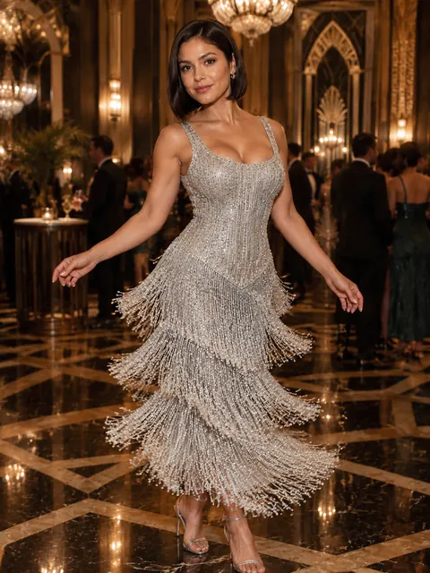</a>

[Example result & try this prompt](https://aiclothswap.net/outfit-swap-prompts/p/silver-fringe-flapper-gala-dress/?utm_source=github&utm_medium=awesome&utm_campaign=awesome-ai-outfit-swap-prompts)

### Balletcore Blush Tulle Gala Dress

```text
Keep the exact same face, hair, body and identity from image 1; dress her in the blush pink balletcore gala dress with boned bodice and tulle skirt from image 2. Marble foyer with chandelier, graceful standing pose, soft warm light. Full garment visible, face fully in frame and not cropped, no logos, no text, photorealistic, aspect ratio 2:3.
```

**Model:** GPT Image 2.5

> Balletcore 2.0 is trending as structured boning meets soft tulle on X fashion posts.

<a href="https://aiclothswap.net/outfit-swap-prompts/p/balletcore-blush-tulle-gala/?utm_source=github&utm_medium=awesome&utm_campaign=awesome-ai-outfit-swap-prompts">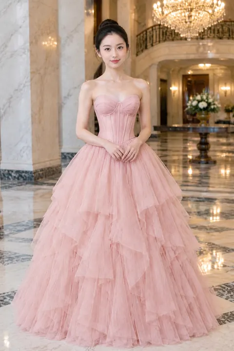</a>

[Example result & try this prompt](https://aiclothswap.net/outfit-swap-prompts/p/balletcore-blush-tulle-gala/?utm_source=github&utm_medium=awesome&utm_campaign=awesome-ai-outfit-swap-prompts)

### Champagne Trench-Cape Gala Look

```text
Keep the exact same face, hair, body and identity from image 1; dress her in the champagne satin trench-cape coat over the matching slim column dress from image 2. Evening city plaza, confident walking-stopped pose facing camera. Full garment visible, face fully in frame and not cropped, no logos, no text, photorealistic, aspect ratio 3:4.
```

**Model:** GPT Image 2.5

> Paris Fashion Week street style and trench coats dominate X outerwear talk.

<a href="https://aiclothswap.net/outfit-swap-prompts/p/champagne-trench-cape-gala/?utm_source=github&utm_medium=awesome&utm_campaign=awesome-ai-outfit-swap-prompts">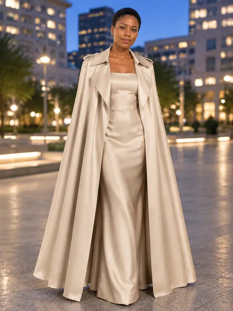</a>

[Example result & try this prompt](https://aiclothswap.net/outfit-swap-prompts/p/champagne-trench-cape-gala/?utm_source=github&utm_medium=awesome&utm_campaign=awesome-ai-outfit-swap-prompts)

### Burnt-Orange Velvet Spooky-Chic Gala

```text
Keep the exact same face, hair, body and identity from image 1; dress her in the burnt-orange velvet floor-length gala gown from image 2. Marble foyer with warm chandelier light, elegant standing pose. Human adult face fully in frame and not cropped, no pumpkin head, no logos, no text, photorealistic, aspect ratio 2:3.
```

**Model:** GPT Image 2.5

> Pumpkin-head photoshoot virality pairs with spooky-chic formalwear on X — velvet in burnt orange is the gala translation.

<a href="https://aiclothswap.net/outfit-swap-prompts/p/burnt-orange-velvet-gala-gown/?utm_source=github&utm_medium=awesome&utm_campaign=awesome-ai-outfit-swap-prompts">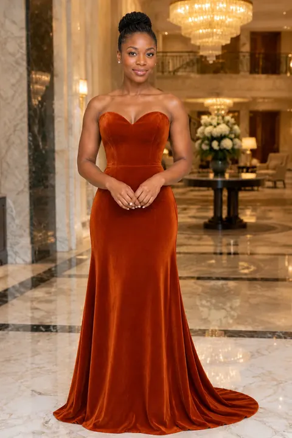</a>

[Example result & try this prompt](https://aiclothswap.net/outfit-swap-prompts/p/burnt-orange-velvet-gala-gown/?utm_source=github&utm_medium=awesome&utm_campaign=awesome-ai-outfit-swap-prompts)

### Amber Column Satin Evening Look

```text
Keep the exact same face, hair, body and identity from image 1; dress her in the amber satin column evening dress from image 2. Evening city terrace, confident standing pose facing camera. Human adult face fully in frame and not cropped, no pumpkin head, no logos, no text, photorealistic, aspect ratio 3:4.
```

**Model:** GPT Image 2.5

> AI pumpkin-head shoots on X push amber/orange formal columns as the non-costume night-out alternative.

<a href="https://aiclothswap.net/outfit-swap-prompts/p/amber-column-satin-evening-look/?utm_source=github&utm_medium=awesome&utm_campaign=awesome-ai-outfit-swap-prompts">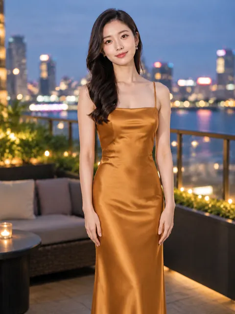</a>

[Example result & try this prompt](https://aiclothswap.net/outfit-swap-prompts/p/amber-column-satin-evening-look/?utm_source=github&utm_medium=awesome&utm_campaign=awesome-ai-outfit-swap-prompts)

### AI Graduation Photoshoot: Cap and Gown on Campus

```text
Keep the exact same face, hair, body and identity from image 1; dress her in the navy graduation gown and mortarboard cap from image 2. Sunny stone campus steps with trees, full-length graduation pose, joyful smile. Adult faces fully visible and not cropped, no logos, no text, no watermark, photorealistic, aspect ratio 2:3.
```

**Model:** GPT Image 2.5

> Graduation photo prompts are a strong-intent long tail — adult grads swap into cap and gown on stone campus steps.

<a href="https://aiclothswap.net/outfit-swap-prompts/p/ai-graduation-photoshoot-cap-gown-campus/?utm_source=github&utm_medium=awesome&utm_campaign=awesome-ai-outfit-swap-prompts">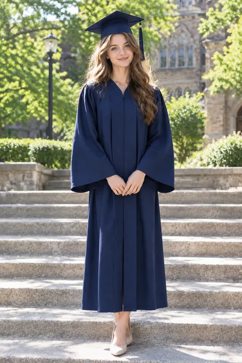</a>

[Example result & try this prompt](https://aiclothswap.net/outfit-swap-prompts/p/ai-graduation-photoshoot-cap-gown-campus/?utm_source=github&utm_medium=awesome&utm_campaign=awesome-ai-outfit-swap-prompts)

### AI Graduation Photo for Men: Gown over Suit

```text
Keep the exact same face, hair, body and identity from image 1; dress him in the black graduation gown with burgundy hood over navy suit from image 2. Grand university hall with arched windows, waist-up confident pose holding a rolled blank diploma. Adult faces fully visible and not cropped, no logos, no text, no watermark, photorealistic, aspect ratio 4:5.
```

**Model:** GPT Image 2.5

> Men’s graduation photo prompts are a thinner variant of the trending keyword — gown over a sharp suit.

<a href="https://aiclothswap.net/outfit-swap-prompts/p/ai-graduation-photo-men-gown-suit/?utm_source=github&utm_medium=awesome&utm_campaign=awesome-ai-outfit-swap-prompts"></a>

[Example result & try this prompt](https://aiclothswap.net/outfit-swap-prompts/p/ai-graduation-photo-men-gown-suit/?utm_source=github&utm_medium=awesome&utm_campaign=awesome-ai-outfit-swap-prompts)

### AI Museum Gala Look: Cobalt Column Gown

```text
Keep the exact same face, hair, body and identity from image 1; dress her in the cobalt blue one-shoulder column gown from image 2. Museum gala entrance with marble staircase and soft press flashes, full-length red-carpet pose. Adult faces fully visible and not cropped, no logos, no text, no watermark, photorealistic, aspect ratio 2:3.
```

**Model:** GPT Image 2.5

> Museum gala red-carpet looks are trending on X — try a cobalt column gown with a flowing skirt.

<a href="https://aiclothswap.net/outfit-swap-prompts/p/ai-museum-gala-cobalt-column-gown/?utm_source=github&utm_medium=awesome&utm_campaign=awesome-ai-outfit-swap-prompts">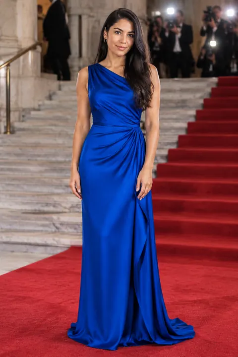</a>

[Example result & try this prompt](https://aiclothswap.net/outfit-swap-prompts/p/ai-museum-gala-cobalt-column-gown/?utm_source=github&utm_medium=awesome&utm_campaign=awesome-ai-outfit-swap-prompts)

### AI Ballroom Competition Latin Dress

```text
Keep the exact same face, hair, body and identity from image 1; dress her in the ruby red fringed Latin competition dress from image 2. Ballroom competition floor with spotlights, dynamic dance pose with fringe in motion, full body. Adult faces fully visible and not cropped, no logos, no text, no watermark, photorealistic, aspect ratio 3:4.
```

**Model:** GPT Image 2.5

> #dwts is trending — test a fringed Latin competition dress on yourself.

<a href="https://aiclothswap.net/outfit-swap-prompts/p/ai-ballroom-dance-competition-latin-dress/?utm_source=github&utm_medium=awesome&utm_campaign=awesome-ai-outfit-swap-prompts">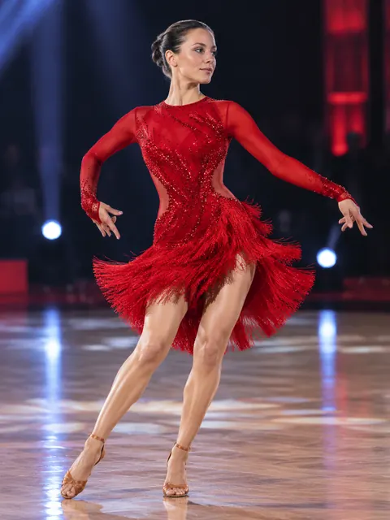</a>

[Example result & try this prompt](https://aiclothswap.net/outfit-swap-prompts/p/ai-ballroom-dance-competition-latin-dress/?utm_source=github&utm_medium=awesome&utm_campaign=awesome-ai-outfit-swap-prompts)

### Sheer Black Gala Gown with Oversized Bow

```text
Keep the exact same face, hair, body and identity from image 1; dress her in the sheer black gala gown with an opaque bodice slip, long sheer sleeves and a dramatic oversized black satin bow at the waist from image 2. Grand museum staircase under warm spotlights, full-body red-carpet pose. Adult faces fully visible and not cropped, no logos, no text, no watermark, photorealistic, aspect ratio 2:3.
```

**Model:** GPT Image 2.5

> Sheer black plus a giant bow is the gala formula of the moment — dramatic, adult, logo-free.

<a href="https://aiclothswap.net/outfit-swap-prompts/p/sheer-black-gala-gown-oversized-bow/?utm_source=github&utm_medium=awesome&utm_campaign=awesome-ai-outfit-swap-prompts">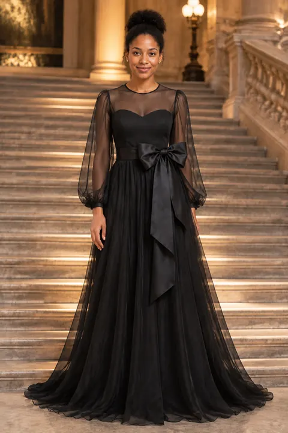</a>

[Example result & try this prompt](https://aiclothswap.net/outfit-swap-prompts/p/sheer-black-gala-gown-oversized-bow/?utm_source=github&utm_medium=awesome&utm_campaign=awesome-ai-outfit-swap-prompts)

### Cobalt Bias Satin Evening Column

```text
Keep the exact same face, hair, body and identity from image 1; dress her in the cobalt blue bias-cut satin evening column gown with a soft cowl neckline and a low back from image 2. Night city skyline balcony, full-body vertical fashion frame. Adult faces fully visible and not cropped, no logos, no text, no watermark, photorealistic, aspect ratio 9:16.
```

**Model:** GPT Image 2.5

> Cobalt evening gowns are trending hard — a bias satin column keeps it liquid and modern.

<a href="https://aiclothswap.net/outfit-swap-prompts/p/cobalt-bias-satin-evening-column/?utm_source=github&utm_medium=awesome&utm_campaign=awesome-ai-outfit-swap-prompts">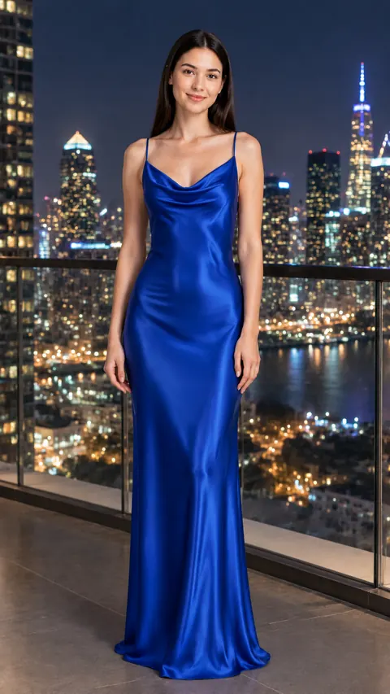</a>

[Example result & try this prompt](https://aiclothswap.net/outfit-swap-prompts/p/cobalt-bias-satin-evening-column/?utm_source=github&utm_medium=awesome&utm_campaign=awesome-ai-outfit-swap-prompts)

### Black-Tie Sequin Column Evening Gown

```text
Change clothes: dress the adult model from image 1 in the floor-length black sequin column evening gown from image 2. Keep face and body identity. Elegant black-tie lighting, photorealistic, aspect ratio 9:16.
```

**Model:** GPT Image 2.5

> Floor-length black sequin column gown for black-tie evenings.

<a href="https://aiclothswap.net/outfit-swap-prompts/p/black-tie-sequin-column-gown/?utm_source=github&utm_medium=awesome&utm_campaign=awesome-ai-outfit-swap-prompts">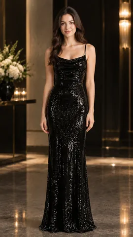</a>

[Example result & try this prompt](https://aiclothswap.net/outfit-swap-prompts/p/black-tie-sequin-column-gown/?utm_source=github&utm_medium=awesome&utm_campaign=awesome-ai-outfit-swap-prompts)

### Champagne Cape Overlay Formal Dress

```text
Fit the woman in image 1 with the champagne satin formal dress and sheer cape from image 2. Preserve face and hair. Soft gala lighting, photorealistic, aspect ratio 4:5.
```

**Model:** GPT Image 2.5

> Champagne satin formal dress with sheer cape overlay for gala nights.

<a href="https://aiclothswap.net/outfit-swap-prompts/p/champagne-cape-formal-dress/?utm_source=github&utm_medium=awesome&utm_campaign=awesome-ai-outfit-swap-prompts">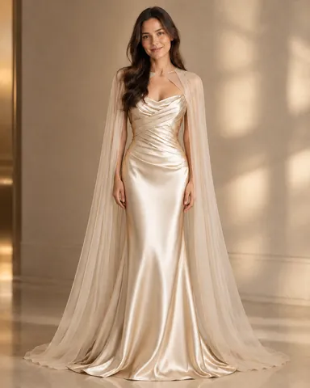</a>

[Example result & try this prompt](https://aiclothswap.net/outfit-swap-prompts/p/champagne-cape-formal-dress/?utm_source=github&utm_medium=awesome&utm_campaign=awesome-ai-outfit-swap-prompts)
