# 🎃 Halloween & Costume · AI Outfit Swap Prompts

[← README](../README.md) · 21 prompts · [aiclothswap.net](https://aiclothswap.net/outfit-swap-prompts?utm_source=github&utm_medium=awesome&utm_campaign=awesome-ai-outfit-swap-prompts)

### Gothic Victorian Vampire Embroidered Long Coat

```text
Vertical mobile try-on: Keep the adult model identity from image 1. Put on the gothic dark burgundy velvet trench coat with antique gold embroidery and high collar from image 2. Moody mist, 9:16 vertical ratio.
```

**Model:** Nano Banana Pro

> Popular 9:16 vertical ratio for social video transforms. Captures sharp standing collars, intricate brocade, and moody cinematic lighting.

<a href="https://aiclothswap.net/outfit-swap-prompts/p/gothic-vampire-victorian-coat/?utm_source=github&utm_medium=awesome&utm_campaign=awesome-ai-outfit-swap-prompts"></a>

[Example result & try this prompt](https://aiclothswap.net/outfit-swap-prompts/p/gothic-vampire-victorian-coat/?utm_source=github&utm_medium=awesome&utm_campaign=awesome-ai-outfit-swap-prompts)

### Retro Space Explorer Jumpsuit Costume

```text
Keep the exact same face, hair, body and identity from image 1; dress her in the white retro sci-fi space explorer jumpsuit with silver panels and utility belt from image 2. Dramatic retro sci-fi set with glowing teal lights and a starfield backdrop, full-body costume portrait. Full garment visible, face fully in frame and not cropped, no logos, no text, photorealistic, aspect ratio 9:16.
```

**Model:** Nano Banana Pro

> A clean silver-and-white jumpsuit makes an instantly readable space costume.

<a href="https://aiclothswap.net/outfit-swap-prompts/p/retro-space-explorer-jumpsuit-costume/?utm_source=github&utm_medium=awesome&utm_campaign=awesome-ai-outfit-swap-prompts"></a>

[Example result & try this prompt](https://aiclothswap.net/outfit-swap-prompts/p/retro-space-explorer-jumpsuit-costume/?utm_source=github&utm_medium=awesome&utm_campaign=awesome-ai-outfit-swap-prompts)

### Pirate Captain Long Coat Costume

```text
Keep the exact same face, hair, body and identity from image 1; dress him in the deep red pirate captain long coat with gold buttons from image 2. Wooden ship deck at dusk with lanterns and sea mist, full-body costume portrait. Full garment visible, face fully in frame and not cropped, no logos, no text, photorealistic, aspect ratio 2:3.
```

**Model:** Nano Banana Pro

> A long brocade-style coat sells the pirate captain look at any party.

<a href="https://aiclothswap.net/outfit-swap-prompts/p/pirate-captain-coat-costume/?utm_source=github&utm_medium=awesome&utm_campaign=awesome-ai-outfit-swap-prompts"></a>

[Example result & try this prompt](https://aiclothswap.net/outfit-swap-prompts/p/pirate-captain-coat-costume/?utm_source=github&utm_medium=awesome&utm_campaign=awesome-ai-outfit-swap-prompts)

### Mad Scientist Lab Coat Costume

```text
Keep the exact same face, hair, body and identity from image 1; dress him in a long white lab coat with faux green chemical stains, worn with brass steampunk goggles and a bow tie, no text, no badges from image 2. Spooky laboratory with bubbling glass flasks and green glow, full-body dramatic pose. Full garment visible, face fully in frame and not cropped, no logos, no text, photorealistic, aspect ratio 2:3.
```

**Model:** GPT Image 2.5

> A stained lab coat with goggles is an easy, recognizable costume.

<a href="https://aiclothswap.net/outfit-swap-prompts/p/mad-scientist-lab-coat-costume/?utm_source=github&utm_medium=awesome&utm_campaign=awesome-ai-outfit-swap-prompts"></a>

[Example result & try this prompt](https://aiclothswap.net/outfit-swap-prompts/p/mad-scientist-lab-coat-costume/?utm_source=github&utm_medium=awesome&utm_campaign=awesome-ai-outfit-swap-prompts)

### Forest Elf Tunic & Cloak Costume

```text
Keep the exact same face, hair, body and identity from image 1; dress her in an olive green suede-look tunic with a brown leather belt and a moss green hooded cloak with leaf embroidery from image 2. Misty enchanted forest with soft sunbeams, three-quarter portrait. Full garment visible, face fully in frame and not cropped, no logos, no text, photorealistic, aspect ratio 4:5.
```

**Model:** GPT Image 2.5

> Layered greens and a hooded cloak make a fantasy elf look wearable.

<a href="https://aiclothswap.net/outfit-swap-prompts/p/fairy-tale-forest-elf-costume/?utm_source=github&utm_medium=awesome&utm_campaign=awesome-ai-outfit-swap-prompts"></a>

[Example result & try this prompt](https://aiclothswap.net/outfit-swap-prompts/p/fairy-tale-forest-elf-costume/?utm_source=github&utm_medium=awesome&utm_campaign=awesome-ai-outfit-swap-prompts)

### Gothic Horror Victorian Dress Costume

```text
Keep the exact same face, hair, body and identity from image 1; dress her in the black Victorian lace Halloween costume dress from image 2. Foggy old street at night, mysterious but friendly expression, lantern light. Full garment visible, face fully in frame and not cropped, no logos, no text, photorealistic, aspect ratio 2:3.
```

**Model:** GPT Image 2.5

> Gothic horror is Halloween 2026's defining costume mood.

<a href="https://aiclothswap.net/outfit-swap-prompts/p/gothic-horror-victorian-dress-costume/?utm_source=github&utm_medium=awesome&utm_campaign=awesome-ai-outfit-swap-prompts"></a>

[Example result & try this prompt](https://aiclothswap.net/outfit-swap-prompts/p/gothic-horror-victorian-dress-costume/?utm_source=github&utm_medium=awesome&utm_campaign=awesome-ai-outfit-swap-prompts)

### Disco Unicorn Sequin Halloween Costume

```text
Keep the exact same face, hair, body and identity from image 1; dress her in the pastel iridescent sequin jumpsuit costume with soft unicorn horn headband from image 2. Colorful Halloween party street, joyful dancing pose. Full garment visible, face fully in frame and not cropped, no logos, no text, photorealistic, aspect ratio 4:5.
```

**Model:** GPT Image 2.5

> Unicorn sparkle meets disco: Halloween's happiest trending mashup.

<a href="https://aiclothswap.net/outfit-swap-prompts/p/disco-unicorn-sequin-costume/?utm_source=github&utm_medium=awesome&utm_campaign=awesome-ai-outfit-swap-prompts">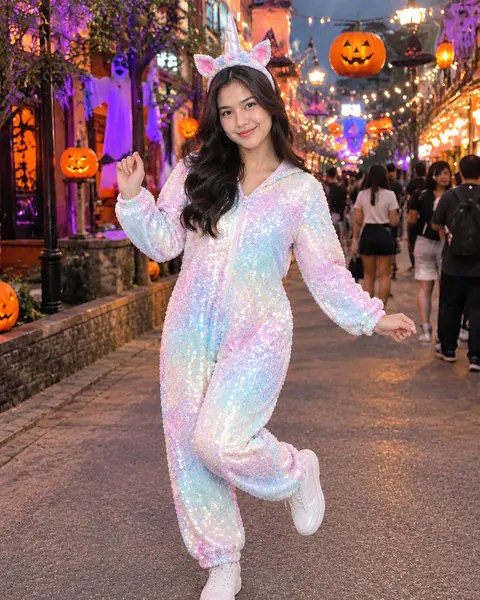</a>

[Example result & try this prompt](https://aiclothswap.net/outfit-swap-prompts/p/disco-unicorn-sequin-costume/?utm_source=github&utm_medium=awesome&utm_campaign=awesome-ai-outfit-swap-prompts)

### Y2K It Girl Glam Halloween Costume

```text
Keep the exact same face, hair, body and identity from image 1; dress her in the pink velour Y2K party costume set with small tiara headband from image 2. Colorful Halloween party room, playful confident pose, generic glam styling with no celebrity likeness. Full garment visible, face fully in frame and not cropped, no logos, no text, photorealistic, aspect ratio 4:5.
```

**Model:** GPT Image 2.5

> Y2K It Girl glam is a top Halloween 2026 costume search trend.

<a href="https://aiclothswap.net/outfit-swap-prompts/p/y2k-it-girl-glam-costume/?utm_source=github&utm_medium=awesome&utm_campaign=awesome-ai-outfit-swap-prompts">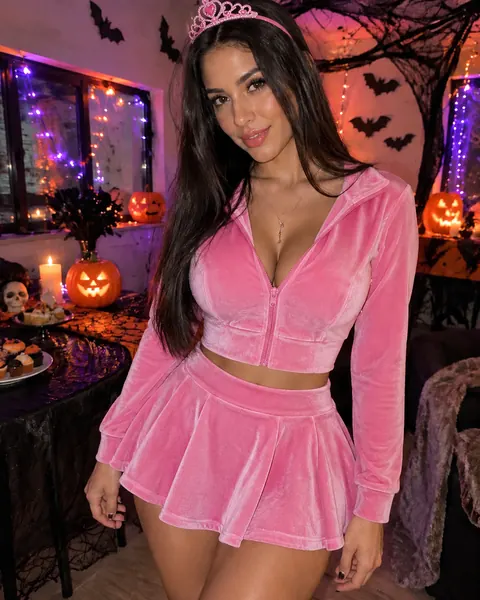</a>

[Example result & try this prompt](https://aiclothswap.net/outfit-swap-prompts/p/y2k-it-girl-glam-costume/?utm_source=github&utm_medium=awesome&utm_campaign=awesome-ai-outfit-swap-prompts)

### Ancient Greek Hero Cloak Costume

```text
Keep the exact same face, hair, body and identity from image 1; dress him in the ivory Greek hero tunic costume with burgundy cloak and gold laurel headband from image 2. Stone-column party backdrop, heroic standing pose, generic ancient styling with no film likeness. Full garment visible, face fully in frame and not cropped, no logos, no text, photorealistic, aspect ratio 2:3.
```

**Model:** GPT Image 2.5

> Ancient Greek heroes are trending in Halloween 2026 costume searches.

<a href="https://aiclothswap.net/outfit-swap-prompts/p/ancient-greek-hero-cloak-costume/?utm_source=github&utm_medium=awesome&utm_campaign=awesome-ai-outfit-swap-prompts">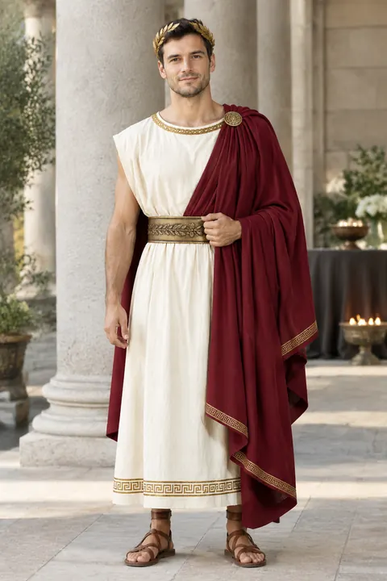</a>

[Example result & try this prompt](https://aiclothswap.net/outfit-swap-prompts/p/ancient-greek-hero-cloak-costume/?utm_source=github&utm_medium=awesome&utm_campaign=awesome-ai-outfit-swap-prompts)

### Sheer Ghost Gown Halloween Costume

```text
Keep the exact same face, hair, body and identity from image 1; dress her in the sheer white ghost gown with hood resting on her shoulders so her face stays fully visible from image 2. Foggy night street, ethereal standing pose. Full garment visible, face fully in frame and not cropped, no logos, no text, photorealistic, aspect ratio 2:3.
```

**Model:** GPT Image 2.5

> Ghost costumes are a top last-minute Halloween 2026 pick across X shopping posts.

<a href="https://aiclothswap.net/outfit-swap-prompts/p/sheer-ghost-gown-halloween/?utm_source=github&utm_medium=awesome&utm_campaign=awesome-ai-outfit-swap-prompts">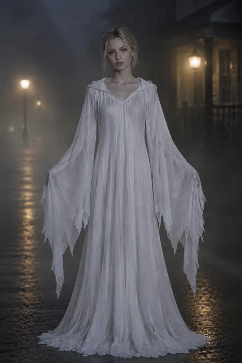</a>

[Example result & try this prompt](https://aiclothswap.net/outfit-swap-prompts/p/sheer-ghost-gown-halloween/?utm_source=github&utm_medium=awesome&utm_campaign=awesome-ai-outfit-swap-prompts)

### Marine Mermaid Scale Gown Costume

```text
Keep the exact same face, hair, body and identity from image 1; dress her in the teal mermaid scale gown with fishtail hem from image 2. Dusk seaside boardwalk, elegant standing pose facing camera. Full garment visible, face fully in frame and not cropped, no logos, no text, photorealistic, aspect ratio 3:4.
```

**Model:** GPT Image 2.5

> Mermaid-inspired Halloween outfits are being pitched as costumes you can reuse after Oct 31.

<a href="https://aiclothswap.net/outfit-swap-prompts/p/marine-mermaid-scale-gown-costume/?utm_source=github&utm_medium=awesome&utm_campaign=awesome-ai-outfit-swap-prompts">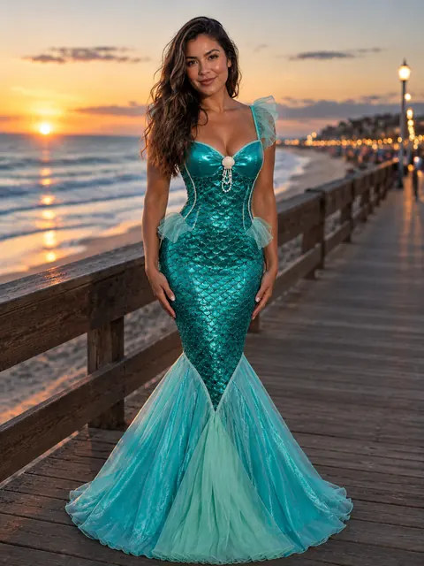</a>

[Example result & try this prompt](https://aiclothswap.net/outfit-swap-prompts/p/marine-mermaid-scale-gown-costume/?utm_source=github&utm_medium=awesome&utm_campaign=awesome-ai-outfit-swap-prompts)

### Pumpkin-Patch Overalls Halloween Costume

```text
Keep the exact same face, hair, body and identity from image 1; dress him in the denim pumpkin-patch overalls over the bright orange henley from image 2. Pumpkin-patch field with hay bales, playful standing pose facing camera. Human adult face fully in frame and not cropped, no pumpkin head, no jack-o-lantern mask, no logos, no text, photorealistic, aspect ratio 3:4.
```

**Model:** GPT Image 2.5

> Viral pumpkin-head photoshoots on X almost always include patch overalls and orange layers — costume the outfit, not the face.

<a href="https://aiclothswap.net/outfit-swap-prompts/p/pumpkin-patch-overalls-halloween/?utm_source=github&utm_medium=awesome&utm_campaign=awesome-ai-outfit-swap-prompts">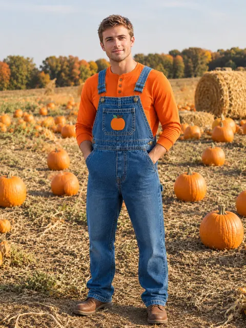</a>

[Example result & try this prompt](https://aiclothswap.net/outfit-swap-prompts/p/pumpkin-patch-overalls-halloween/?utm_source=github&utm_medium=awesome&utm_campaign=awesome-ai-outfit-swap-prompts)

### Jack-o-Lantern Tulle Party Costume

```text
Keep the exact same face, hair, body and identity from image 1; dress her in the bright jack-o-lantern orange tulle party dress from image 2. Dusk Halloween party with soft string lights, fun standing pose. Human adult face fully in frame and not cropped, no pumpkin head, no mask, no logos, no text, photorealistic, aspect ratio 2:3.
```

**Model:** GPT Image 2.5

> AI pumpkin-head heat on X pairs with bright orange tulle party looks — glow-up the dress, keep the human face.

<a href="https://aiclothswap.net/outfit-swap-prompts/p/jackolantern-tulle-party-costume/?utm_source=github&utm_medium=awesome&utm_campaign=awesome-ai-outfit-swap-prompts">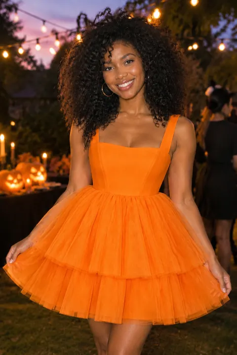</a>

[Example result & try this prompt](https://aiclothswap.net/outfit-swap-prompts/p/jackolantern-tulle-party-costume/?utm_source=github&utm_medium=awesome&utm_campaign=awesome-ai-outfit-swap-prompts)

### AI Pumpkin Patch Couple Photoshoot Outfits

```text
Keep the exact same face, hair, body and identity from image 1; dress the woman and the man in the mustard flannel shirt dress (for her) and rust plaid flannel with jeans (for him) from image 2. Pumpkin patch at golden hour with hay bales and orange pumpkins on the ground, couple holding hands and laughing. Real human faces, no pumpkin heads, no masks. Adult faces fully visible and not cropped, no logos, no text, no watermark, photorealistic, aspect ratio 3:2.
```

**Model:** GPT Image 2.5

> Pumpkin-head couple shoots are trending — we keep faces human and focus on matching fall outfits in the pumpkin patch.

<a href="https://aiclothswap.net/outfit-swap-prompts/p/ai-pumpkin-patch-couple-photoshoot/?utm_source=github&utm_medium=awesome&utm_campaign=awesome-ai-outfit-swap-prompts">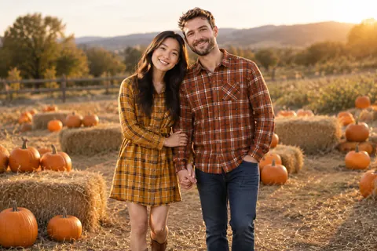</a>

[Example result & try this prompt](https://aiclothswap.net/outfit-swap-prompts/p/ai-pumpkin-patch-couple-photoshoot/?utm_source=github&utm_medium=awesome&utm_campaign=awesome-ai-outfit-swap-prompts)

### AI Y2K Halloween Photo: Bedroom with Masked Figure

```text
Keep the exact same face, hair, body and identity from image 1; dress her in the pink baby tee and red plaid pleated mini skirt from image 2. Late-90s pink bedroom with fairy lights, she lies on the bed holding a corded phone, in the dim doorway behind her stands a figure in a plain blank white mask and black hooded robe, film flash photo look. Generic mask only, not any movie character. Adult faces fully visible and not cropped, no logos, no text, no watermark, photorealistic, aspect ratio 4:5.
```

**Model:** GPT Image 2.5

> The Y2K Halloween bedroom trend is everywhere on X — we use a generic plain-masked figure, no film characters.

<a href="https://aiclothswap.net/outfit-swap-prompts/p/ai-y2k-halloween-masked-figure-bedroom/?utm_source=github&utm_medium=awesome&utm_campaign=awesome-ai-outfit-swap-prompts">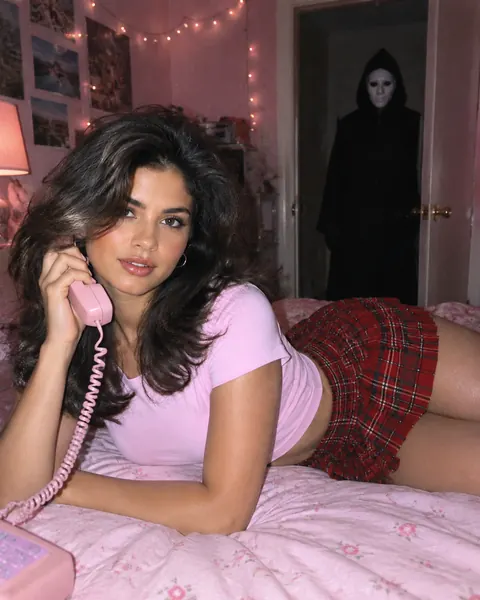</a>

[Example result & try this prompt](https://aiclothswap.net/outfit-swap-prompts/p/ai-y2k-halloween-masked-figure-bedroom/?utm_source=github&utm_medium=awesome&utm_campaign=awesome-ai-outfit-swap-prompts)

### AI Halloween Retro Varsity Jacket Costume

```text
Keep the exact same face, hair, body and identity from image 1; dress her in the maroon and cream varsity jacket and pleated skirt from image 2. Retro 1950s diner-style Halloween party with orange string lights, fun three-quarter pose. Adult faces fully visible and not cropped, no logos, no text, no watermark, photorealistic, aspect ratio 4:5.
```

**Model:** GPT Image 2.5

> Varsity jackets are a top Halloween seller per X trending news — an easy retro costume base.

<a href="https://aiclothswap.net/outfit-swap-prompts/p/ai-halloween-varsity-jacket-costume/?utm_source=github&utm_medium=awesome&utm_campaign=awesome-ai-outfit-swap-prompts">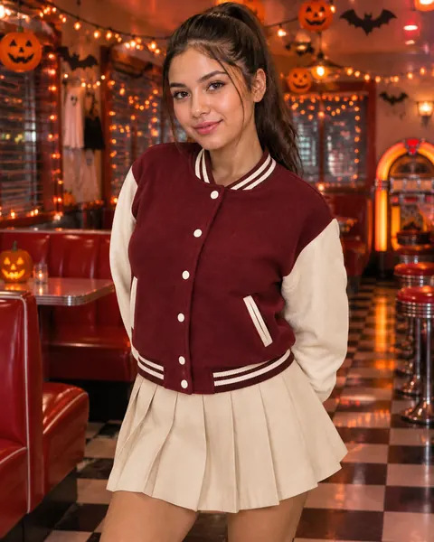</a>

[Example result & try this prompt](https://aiclothswap.net/outfit-swap-prompts/p/ai-halloween-varsity-jacket-costume/?utm_source=github&utm_medium=awesome&utm_campaign=awesome-ai-outfit-swap-prompts)

### AI Halloween Forest Archer Costume

```text
Keep the exact same face, hair, body and identity from image 1; dress him in the forest green hooded archer costume with longbow from image 2. Misty autumn forest at dusk with fallen leaves, heroic standing pose holding the bow, hood down so the face is visible. Adult faces fully visible and not cropped, no logos, no text, no watermark, photorealistic, aspect ratio 2:3.
```

**Model:** GPT Image 2.5

> Costume packs with folk-hero archer looks are trending on X — a hooded forest archer costume.

<a href="https://aiclothswap.net/outfit-swap-prompts/p/ai-halloween-forest-archer-costume/?utm_source=github&utm_medium=awesome&utm_campaign=awesome-ai-outfit-swap-prompts">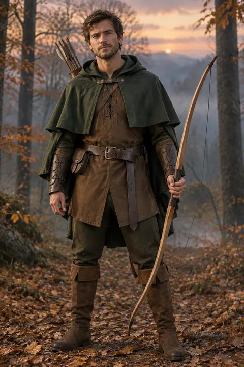</a>

[Example result & try this prompt](https://aiclothswap.net/outfit-swap-prompts/p/ai-halloween-forest-archer-costume/?utm_source=github&utm_medium=awesome&utm_campaign=awesome-ai-outfit-swap-prompts)

### Noir Detective Wet Trench Costume

```text
Keep the exact same face, hair, body and identity from image 1; dress him in the long black wet-look noir trench coat over a charcoal suit, white shirt, loosened black tie and black fedora from image 2. Rainy night alley with reflective wet cobblestones and a single street lamp, full-body shot. Adult faces fully visible and not cropped, no logos, no text, no watermark, photorealistic, aspect ratio 2:3.
```

**Model:** GPT Image 2.5

> Wet-street noir outerwear is trending — a black trench and fedora make a sharp adult Halloween costume.

<a href="https://aiclothswap.net/outfit-swap-prompts/p/noir-detective-wet-trench-costume/?utm_source=github&utm_medium=awesome&utm_campaign=awesome-ai-outfit-swap-prompts">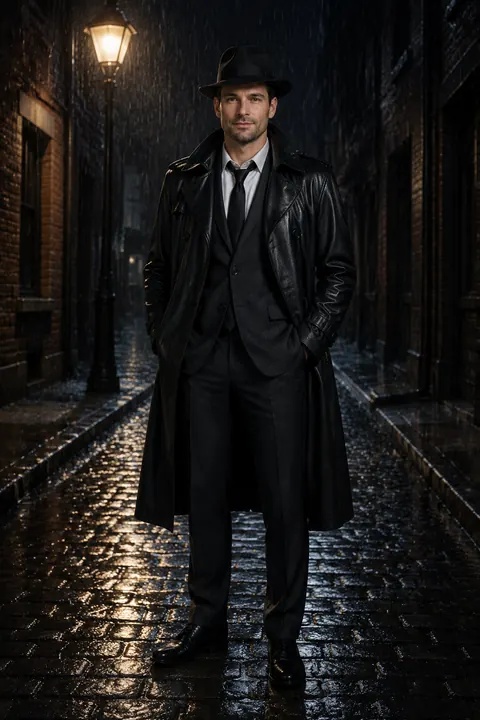</a>

[Example result & try this prompt](https://aiclothswap.net/outfit-swap-prompts/p/noir-detective-wet-trench-costume/?utm_source=github&utm_medium=awesome&utm_campaign=awesome-ai-outfit-swap-prompts)

### Leopard Disco Jumpsuit Halloween

```text
Keep the exact same face, hair, body and identity from image 1; dress her in the long-sleeve leopard-print jersey jumpsuit with a soft V-neck, wide legs and a matching fabric sash belt from image 2. Retro disco party with warm amber lights and a mirrored wall, three-quarter dance pose. Adult faces fully visible and not cropped, no logos, no text, no watermark, photorealistic, aspect ratio 4:5.
```

**Model:** GPT Image 2.5

> Leopard accents are peaking — a full disco jumpsuit is a fun, covered Halloween party look.

<a href="https://aiclothswap.net/outfit-swap-prompts/p/leopard-disco-jumpsuit-halloween/?utm_source=github&utm_medium=awesome&utm_campaign=awesome-ai-outfit-swap-prompts">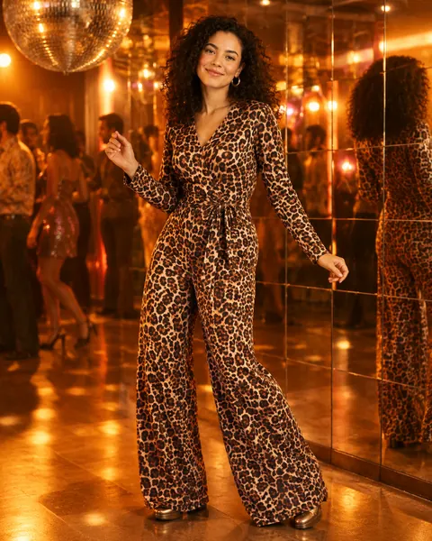</a>

[Example result & try this prompt](https://aiclothswap.net/outfit-swap-prompts/p/leopard-disco-jumpsuit-halloween/?utm_source=github&utm_medium=awesome&utm_campaign=awesome-ai-outfit-swap-prompts)

### Witch Velvet Cloak Halloween Costume

```text
Vertical mobile try-on: keep adult model identity from image 1. Put on the deep purple velvet witch cloak costume from image 2. Atmospheric Halloween lighting, photorealistic, aspect ratio 9:16.
```

**Model:** GPT Image 2.5

> Deep purple velvet witch cloak costume—atmospheric Halloween vertical framing.

<a href="https://aiclothswap.net/outfit-swap-prompts/p/witch-velvet-cloak-costume/?utm_source=github&utm_medium=awesome&utm_campaign=awesome-ai-outfit-swap-prompts">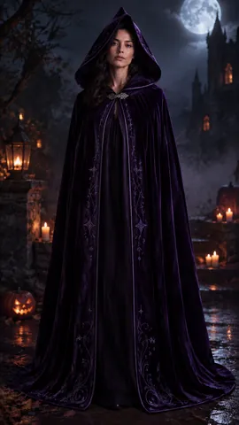</a>

[Example result & try this prompt](https://aiclothswap.net/outfit-swap-prompts/p/witch-velvet-cloak-costume/?utm_source=github&utm_medium=awesome&utm_campaign=awesome-ai-outfit-swap-prompts)

### Steampunk Corset Coat Costume

```text
Keep the adult identity from image 1. Dress her in the steampunk corset coat costume from image 2. Dramatic costume lighting, photorealistic, aspect ratio 2:3.
```

**Model:** GPT Image 2.5

> Steampunk corset coat over a blouse as a costume look (not lingerie).

<a href="https://aiclothswap.net/outfit-swap-prompts/p/steampunk-corset-coat-costume/?utm_source=github&utm_medium=awesome&utm_campaign=awesome-ai-outfit-swap-prompts">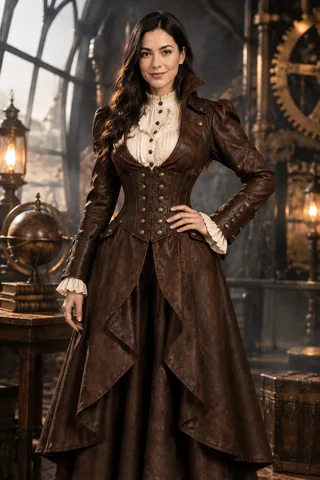</a>

[Example result & try this prompt](https://aiclothswap.net/outfit-swap-prompts/p/steampunk-corset-coat-costume/?utm_source=github&utm_medium=awesome&utm_campaign=awesome-ai-outfit-swap-prompts)
