# 🎉 Holiday Looks · AI Outfit Swap Prompts

[← README](../README.md) · 24 prompts · [aiclothswap.net](https://aiclothswap.net/outfit-swap-prompts?utm_source=github&utm_medium=awesome&utm_campaign=awesome-ai-outfit-swap-prompts)

### Black Lace Corset Witch Dress

```text
Keep the exact same face, hair, body and identity from image 1; dress her in the black lace-up corset-bodice midi witch dress with sheer black lace sleeves and a pointed black witch hat with a short black tulle veil from image 2. Moody candle-lit Halloween parlor with dried herbs and a vintage spell book on a table, three-quarter body shot from knees up. Adult faces fully visible and not cropped, no logos, no text, no watermark, photorealistic, aspect ratio 3:4.
```

**Model:** GPT Image 2.5

> Witch is the #1 Halloween 2026 costume — this lace-up corset midi with a veiled pointed hat makes it chic, not cheap.

<a href="https://aiclothswap.net/outfit-swap-prompts/p/black-lace-corset-witch-dress/?utm_source=github&utm_medium=awesome&utm_campaign=awesome-ai-outfit-swap-prompts"></a>

[Example result & try this prompt](https://aiclothswap.net/outfit-swap-prompts/p/black-lace-corset-witch-dress/?utm_source=github&utm_medium=awesome&utm_campaign=awesome-ai-outfit-swap-prompts)

### Vampire Countess Lace Cape Gown

```text
Keep the exact same face, hair, body and identity from image 1; dress her in the black lace ball gown with a high Victorian collar and a floor-length black velvet cape lined in blood-red satin from image 2. Grand gothic castle staircase lit by candelabras, full-body shot with the cape open to reveal the red lining. Adult faces fully visible and not cropped, no logos, no text, no watermark, photorealistic, aspect ratio 2:3.
```

**Model:** GPT Image 2.5

> Vampire is Halloween 2026's #2 costume — a lace ball gown plus a red-lined velvet cape is the elegant way to play it.

<a href="https://aiclothswap.net/outfit-swap-prompts/p/vampire-countess-lace-cape-gown/?utm_source=github&utm_medium=awesome&utm_campaign=awesome-ai-outfit-swap-prompts"></a>

[Example result & try this prompt](https://aiclothswap.net/outfit-swap-prompts/p/vampire-countess-lace-cape-gown/?utm_source=github&utm_medium=awesome&utm_campaign=awesome-ai-outfit-swap-prompts)

### Emerald Velvet Witch Coat Dress

```text
Keep the exact same face, hair, body and identity from image 1; dress her in the deep emerald-black velvet witch coat dress with a high collar, bell sleeves, antique silver clasps and a wide-brim black witch hat from image 2. Autumn forest path at dusk with fallen leaves and lantern light, three-quarter body shot. Adult faces fully visible and not cropped, no logos, no text, no watermark, photorealistic, aspect ratio 4:5.
```

**Model:** GPT Image 2.5

> A second take on the #1 witch trend — jewel-toned velvet and silver clasps for a forest-witch look.

<a href="https://aiclothswap.net/outfit-swap-prompts/p/emerald-velvet-witch-coat-dress/?utm_source=github&utm_medium=awesome&utm_campaign=awesome-ai-outfit-swap-prompts"></a>

[Example result & try this prompt](https://aiclothswap.net/outfit-swap-prompts/p/emerald-velvet-witch-coat-dress/?utm_source=github&utm_medium=awesome&utm_campaign=awesome-ai-outfit-swap-prompts)

### Oxblood Velvet Vampire Tailcoat (Men)

```text
Keep the exact same face, hair, body and identity from image 1; dress him in the oxblood velvet vampire tailcoat with a black satin waistcoat, white ruffled jabot shirt and black tailored trousers from image 2. Dim gothic library with tall candles and leather books, full-body shot standing by a carved chair. Adult faces fully visible and not cropped, no logos, no text, no watermark, photorealistic, aspect ratio 2:3.
```

**Model:** GPT Image 2.5

> Vampire is #2 for Halloween 2026 — an oxblood velvet tailcoat and ruffled jabot is the classic count look for men.

<a href="https://aiclothswap.net/outfit-swap-prompts/p/oxblood-velvet-vampire-tailcoat-mens/?utm_source=github&utm_medium=awesome&utm_campaign=awesome-ai-outfit-swap-prompts"></a>

[Example result & try this prompt](https://aiclothswap.net/outfit-swap-prompts/p/oxblood-velvet-vampire-tailcoat-mens/?utm_source=github&utm_medium=awesome&utm_campaign=awesome-ai-outfit-swap-prompts)

### Black Lace Gothic Bride with Veil

```text
Keep the exact same face, hair, body and identity from image 1; dress her in the black lace A-line wedding gown with a sweetheart neckline, long sheer lace sleeves, a long black tulle veil and a bouquet of dark burgundy roses from image 2. Overgrown gothic chapel with candles and ivy, full-body bridal shot holding the dark rose bouquet. Adult faces fully visible and not cropped, no logos, no text, no watermark, photorealistic, aspect ratio 2:3.
```

**Model:** GPT Image 2.5

> The gothic bride is surging this Halloween — black lace, a black tulle veil and dark roses.

<a href="https://aiclothswap.net/outfit-swap-prompts/p/black-lace-gothic-bride-veil/?utm_source=github&utm_medium=awesome&utm_campaign=awesome-ai-outfit-swap-prompts"></a>

[Example result & try this prompt](https://aiclothswap.net/outfit-swap-prompts/p/black-lace-gothic-bride-veil/?utm_source=github&utm_medium=awesome&utm_campaign=awesome-ai-outfit-swap-prompts)

### Reanimated Bride Ivory Chiffon Gown

```text
Keep the exact same face, hair, body and identity from image 1; dress her in the ivory draped chiffon gown with long bell sleeves, soft bandage-wrapped waist detail and a flowing floor-length skirt from image 2. Vintage laboratory set with old brass instruments, glowing bulbs and dramatic blue-white storm lighting, full-body shot. Adult faces fully visible and not cropped, no logos, no text, no watermark, photorealistic, aspect ratio 9:16.
```

**Model:** GPT Image 2.5

> Classic monster-bride energy is trending — ivory chiffon, bandage-wrap waist and storm-lit lab drama.

<a href="https://aiclothswap.net/outfit-swap-prompts/p/reanimated-bride-ivory-chiffon-gown/?utm_source=github&utm_medium=awesome&utm_campaign=awesome-ai-outfit-swap-prompts"></a>

[Example result & try this prompt](https://aiclothswap.net/outfit-swap-prompts/p/reanimated-bride-ivory-chiffon-gown/?utm_source=github&utm_medium=awesome&utm_campaign=awesome-ai-outfit-swap-prompts)

### Gothic Brocade Waistcoat & Chain Suit

```text
Keep the exact same face, hair, body and identity from image 1; dress him in the black wool frock coat over a burgundy-and-black brocade waistcoat with silver pocket chains, black shirt and slim black trousers from image 2. Rainy cobblestone alley at night under a gas street lamp, three-quarter body shot. Adult faces fully visible and not cropped, no logos, no text, no watermark, photorealistic, aspect ratio 3:4.
```

**Model:** GPT Image 2.5

> Gothic menswear posts are pulling thousands of likes this October — frock coat, brocade waistcoat and silver chains.

<a href="https://aiclothswap.net/outfit-swap-prompts/p/gothic-brocade-waistcoat-chain-suit/?utm_source=github&utm_medium=awesome&utm_campaign=awesome-ai-outfit-swap-prompts">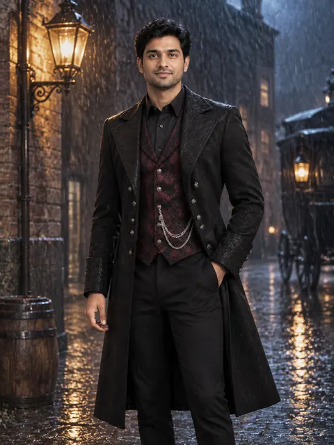</a>

[Example result & try this prompt](https://aiclothswap.net/outfit-swap-prompts/p/gothic-brocade-waistcoat-chain-suit/?utm_source=github&utm_medium=awesome&utm_campaign=awesome-ai-outfit-swap-prompts)

### Victorian Poet Shirt & Velvet Trousers (Men)

```text
Keep the exact same face, hair, body and identity from image 1; dress him in the black billowy Victorian poet shirt with lace cuffs and a laced V-neck, high-waisted black velvet trousers and a wide black leather belt from image 2. Candle-lit gothic manor drawing room with a fireplace, three-quarter body shot. Adult faces fully visible and not cropped, no logos, no text, no watermark, photorealistic, aspect ratio 4:5.
```

**Model:** GPT Image 2.5

> An easier gothic menswear option — a billowy poet shirt and velvet trousers, no jacket needed.

<a href="https://aiclothswap.net/outfit-swap-prompts/p/victorian-poet-shirt-velvet-trousers-mens/?utm_source=github&utm_medium=awesome&utm_campaign=awesome-ai-outfit-swap-prompts">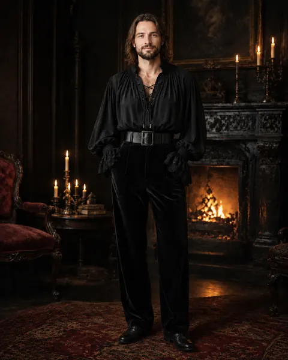</a>

[Example result & try this prompt](https://aiclothswap.net/outfit-swap-prompts/p/victorian-poet-shirt-velvet-trousers-mens/?utm_source=github&utm_medium=awesome&utm_campaign=awesome-ai-outfit-swap-prompts)

### Black Lace Pannier Gala Gown

```text
Keep the exact same face, hair, body and identity from image 1; dress her in the black lace gala gown with wide 18th-century pannier hips, a fitted square-neck bodice and black satin bows from image 2. Candle-lit baroque ballroom with gilded mirrors, full-body shot centered in a square frame. Adult faces fully visible and not cropped, no logos, no text, no watermark, photorealistic, aspect ratio 1:1.
```

**Model:** GPT Image 2.5

> Dark-romance formalwear for Halloween balls — wide pannier hips in all-black lace.

<a href="https://aiclothswap.net/outfit-swap-prompts/p/black-lace-pannier-gala-gown/?utm_source=github&utm_medium=awesome&utm_campaign=awesome-ai-outfit-swap-prompts">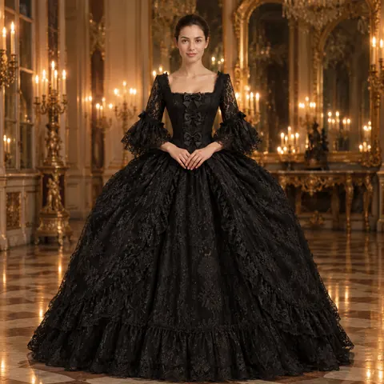</a>

[Example result & try this prompt](https://aiclothswap.net/outfit-swap-prompts/p/black-lace-pannier-gala-gown/?utm_source=github&utm_medium=awesome&utm_campaign=awesome-ai-outfit-swap-prompts)

### Oxblood Velvet Corset Masquerade Gown

```text
Keep the exact same face, hair, body and identity from image 1; dress her in the oxblood velvet off-shoulder corset ball gown with a black lace overlay and a black lace eye mask from image 2. Masquerade ball in a candle-lit Venetian-style palace hall, full-body shot holding the lace mask at chin height so her whole face stays visible. Adult faces fully visible and not cropped, no logos, no text, no watermark, photorealistic, aspect ratio 2:3.
```

**Model:** GPT Image 2.5

> Masquerade parties peak around Halloween — oxblood velvet and a black lace mask.

<a href="https://aiclothswap.net/outfit-swap-prompts/p/oxblood-velvet-corset-masquerade-gown/?utm_source=github&utm_medium=awesome&utm_campaign=awesome-ai-outfit-swap-prompts">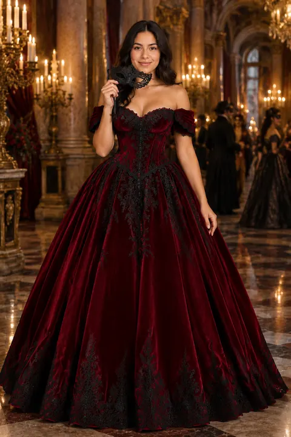</a>

[Example result & try this prompt](https://aiclothswap.net/outfit-swap-prompts/p/oxblood-velvet-corset-masquerade-gown/?utm_source=github&utm_medium=awesome&utm_campaign=awesome-ai-outfit-swap-prompts)

### Deadpan Gothic White-Collar Dress

```text
Keep the exact same face, hair, body and identity from image 1; dress her in the black long-sleeve knee-length dress with a crisp white pointed collar and white cuffs, black tights and black platform loafers from image 2. Gloomy Victorian mansion hallway with dark wood paneling, standing straight with a deadpan expression, three-quarter body shot. Adult faces fully visible and not cropped, no logos, no text, no watermark, photorealistic, aspect ratio 4:5.
```

**Model:** GPT Image 2.5

> The deadpan goth look is still huge for adults this Halloween — black dress, crisp white collar, braids and a straight face.

<a href="https://aiclothswap.net/outfit-swap-prompts/p/deadpan-gothic-white-collar-dress/?utm_source=github&utm_medium=awesome&utm_campaign=awesome-ai-outfit-swap-prompts">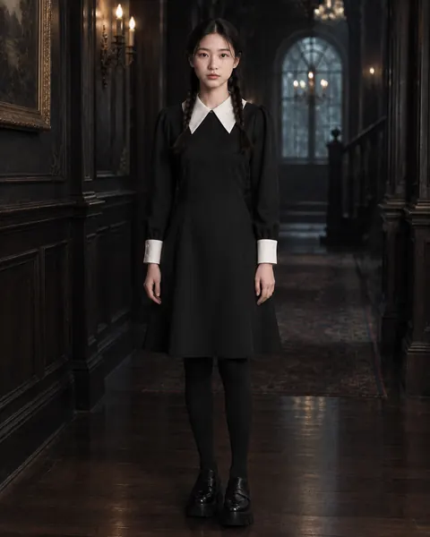</a>

[Example result & try this prompt](https://aiclothswap.net/outfit-swap-prompts/p/deadpan-gothic-white-collar-dress/?utm_source=github&utm_medium=awesome&utm_campaign=awesome-ai-outfit-swap-prompts)

### Black Tiered Tulle Gothic Dance Dress

```text
Keep the exact same face, hair, body and identity from image 1; dress her in the black tiered tulle midi dress with a fitted lace bodice, long sheer sleeves and chunky black lace-up boots from image 2. Dark nightclub with purple and red haze lights, mid-dance pose with the tulle skirt swinging, full-body vertical shot. Adult faces fully visible and not cropped, no logos, no text, no watermark, photorealistic, aspect ratio 9:16.
```

**Model:** GPT Image 2.5

> Made for gothic dance trends on short video — layered black tulle that moves.

<a href="https://aiclothswap.net/outfit-swap-prompts/p/black-tiered-tulle-gothic-dance-dress/?utm_source=github&utm_medium=awesome&utm_campaign=awesome-ai-outfit-swap-prompts">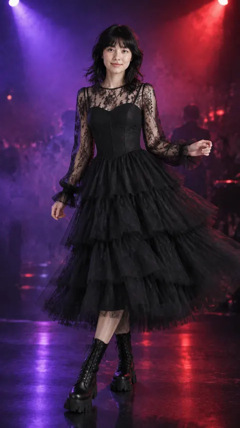</a>

[Example result & try this prompt](https://aiclothswap.net/outfit-swap-prompts/p/black-tiered-tulle-gothic-dance-dress/?utm_source=github&utm_medium=awesome&utm_campaign=awesome-ai-outfit-swap-prompts)

### Skeleton Bone Embroidered Black Gown

```text
Keep the exact same face, hair, body and identity from image 1; dress her in the black velvet column gown with elegant ivory skeleton rib-cage and spine embroidery on the bodice and long sleeves from image 2. Moody dark studio with a single warm spotlight and dry-ice fog, three-quarter body shot. Adult faces fully visible and not cropped, no logos, no text, no watermark, photorealistic, aspect ratio 3:4.
```

**Model:** GPT Image 2.5

> Skeleton prints go glam for 2026 — ivory rib-cage embroidery on black velvet.

<a href="https://aiclothswap.net/outfit-swap-prompts/p/skeleton-bone-embroidered-black-gown/?utm_source=github&utm_medium=awesome&utm_campaign=awesome-ai-outfit-swap-prompts">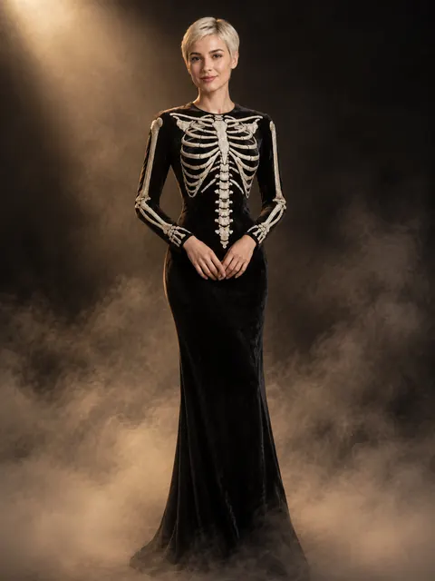</a>

[Example result & try this prompt](https://aiclothswap.net/outfit-swap-prompts/p/skeleton-bone-embroidered-black-gown/?utm_source=github&utm_medium=awesome&utm_campaign=awesome-ai-outfit-swap-prompts)

### Black Lace Marigold Catrina-Inspired Gown

```text
Keep the exact same face, hair, body and identity from image 1; dress her in the black lace off-shoulder Catrina-inspired gown with a ruffled tiered skirt and a crown of orange marigold flowers from image 2. Día de los Muertos street at night with papel picado banners, candles and marigold arches, full-body shot with natural makeup and no face paint. Adult faces fully visible and not cropped, no logos, no text, no watermark, photorealistic, aspect ratio 2:3.
```

**Model:** GPT Image 2.5

> Día de los Muertos lands right after Halloween — a respectful Catrina-inspired black lace gown with a marigold crown, no face paint needed.

<a href="https://aiclothswap.net/outfit-swap-prompts/p/black-lace-marigold-catrina-gown/?utm_source=github&utm_medium=awesome&utm_campaign=awesome-ai-outfit-swap-prompts">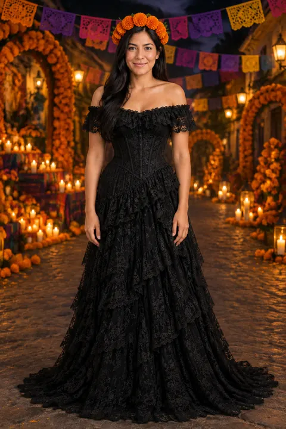</a>

[Example result & try this prompt](https://aiclothswap.net/outfit-swap-prompts/p/black-lace-marigold-catrina-gown/?utm_source=github&utm_medium=awesome&utm_campaign=awesome-ai-outfit-swap-prompts)

### Misty Grey Tattered Chiffon Phantom Dress

```text
Keep the exact same face, hair, body and identity from image 1; dress her in the misty grey layered chiffon phantom dress with tattered asymmetric hems, long trailing sleeves and a sheer grey hooded shawl from image 2. Foggy moonlit forest clearing with bare trees, the chiffon drifting in the wind, full-body vertical shot with the hood down so the face is visible. Adult faces fully visible and not cropped, no logos, no text, no watermark, photorealistic, aspect ratio 9:16.
```

**Model:** GPT Image 2.5

> Ghost looks stay a Halloween staple — layered grey chiffon with tattered hems that drift like fog.

<a href="https://aiclothswap.net/outfit-swap-prompts/p/misty-grey-tattered-chiffon-phantom-dress/?utm_source=github&utm_medium=awesome&utm_campaign=awesome-ai-outfit-swap-prompts">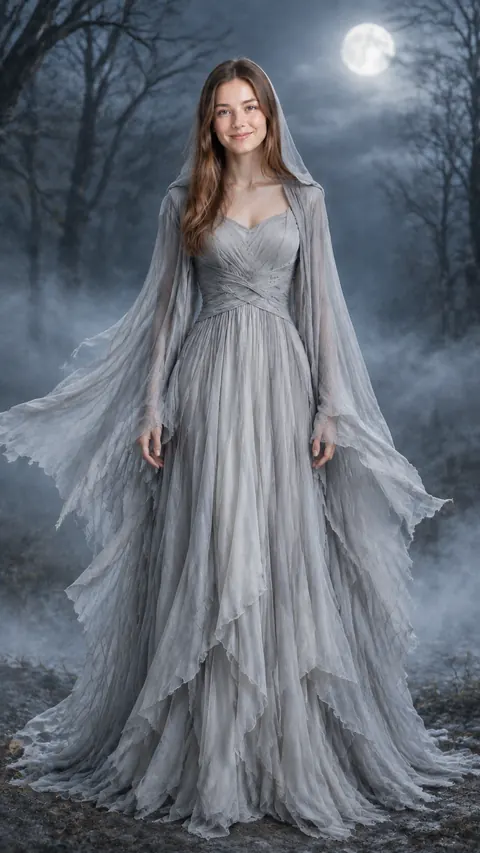</a>

[Example result & try this prompt](https://aiclothswap.net/outfit-swap-prompts/p/misty-grey-tattered-chiffon-phantom-dress/?utm_source=github&utm_medium=awesome&utm_campaign=awesome-ai-outfit-swap-prompts)

### Gothic Couple Lace Gown & Tailcoat Set

```text
Keep the exact same faces, hair, bodies and identities of both people from image 1; dress them in the matching gothic couple set: her black lace mermaid gown with long sleeves, his black velvet tailcoat with a black lace pocket square from image 2. Candle-lit gothic cathedral aisle, the couple standing side by side arm in arm, both faces visible, full-body horizontal shot. The woman wears the gown and the man wears the tailcoat. Adult faces fully visible and not cropped, no logos, no text, no watermark, photorealistic, aspect ratio 4:3.
```

**Model:** GPT Image 2.5

> Couples costumes are big for Halloween 2026 — a matching black lace gown and velvet tailcoat.

<a href="https://aiclothswap.net/outfit-swap-prompts/p/gothic-couple-lace-gown-tailcoat-set/?utm_source=github&utm_medium=awesome&utm_campaign=awesome-ai-outfit-swap-prompts">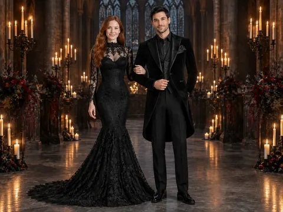</a>

[Example result & try this prompt](https://aiclothswap.net/outfit-swap-prompts/p/gothic-couple-lace-gown-tailcoat-set/?utm_source=github&utm_medium=awesome&utm_campaign=awesome-ai-outfit-swap-prompts)

### Black Cat Velvet Mini Dress & Ear Headband

```text
Keep the exact same face, hair, body and identity from image 1; dress her in the black velvet long-sleeve mini dress with a white Peter Pan collar, a black lace cat-ear headband and black sheer tights from image 2. Cozy Halloween apartment party with fairy lights and carved pumpkins, three-quarter body shot. Adult faces fully visible and not cropped, no logos, no text, no watermark, photorealistic, aspect ratio 4:5.
```

**Model:** GPT Image 2.5

> Black cat is a perennial top-10 costume — keep it chic with velvet and lace ears.

<a href="https://aiclothswap.net/outfit-swap-prompts/p/black-cat-velvet-mini-dress-ear-headband/?utm_source=github&utm_medium=awesome&utm_campaign=awesome-ai-outfit-swap-prompts">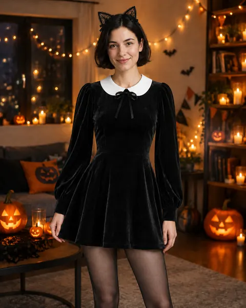</a>

[Example result & try this prompt](https://aiclothswap.net/outfit-swap-prompts/p/black-cat-velvet-mini-dress-ear-headband/?utm_source=github&utm_medium=awesome&utm_campaign=awesome-ai-outfit-swap-prompts)

### Bat-Wing Sleeve Black Chiffon Dress

```text
Keep the exact same face, hair, body and identity from image 1; dress her in the black chiffon maxi dress with dramatic scalloped bat-wing sleeves that open into wing shapes when the arms are raised from image 2. Rooftop at night with a huge full moon behind her, arms raised to spread the bat-wing sleeves, full-body horizontal wide shot. Adult faces fully visible and not cropped, no logos, no text, no watermark, photorealistic, aspect ratio 16:9.
```

**Model:** GPT Image 2.5

> Bat-inspired chic for Halloween — scalloped chiffon sleeves that spread into wings.

<a href="https://aiclothswap.net/outfit-swap-prompts/p/bat-wing-sleeve-black-chiffon-dress/?utm_source=github&utm_medium=awesome&utm_campaign=awesome-ai-outfit-swap-prompts">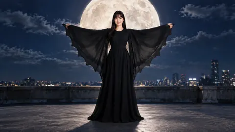</a>

[Example result & try this prompt](https://aiclothswap.net/outfit-swap-prompts/p/bat-wing-sleeve-black-chiffon-dress/?utm_source=github&utm_medium=awesome&utm_campaign=awesome-ai-outfit-swap-prompts)

### Victorian Mourning High-Neck Lace Dress

```text
Keep the exact same face, hair, body and identity from image 1; dress her in the black Victorian mourning dress with a high lace neck, leg-of-mutton sleeves, jet bead buttons and a cameo brooch from image 2. Antique portrait studio with a dark painted backdrop and soft window light, chest-up to waist-up formal portrait. Adult faces fully visible and not cropped, no logos, no text, no watermark, photorealistic, aspect ratio 3:4.
```

**Model:** GPT Image 2.5

> Victorian mourning lace is a quiet-gothic favorite — high neck, jet buttons and a cameo, perfect for portraits.

<a href="https://aiclothswap.net/outfit-swap-prompts/p/victorian-mourning-high-neck-lace-dress/?utm_source=github&utm_medium=awesome&utm_campaign=awesome-ai-outfit-swap-prompts">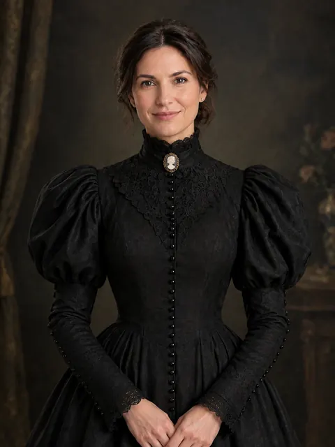</a>

[Example result & try this prompt](https://aiclothswap.net/outfit-swap-prompts/p/victorian-mourning-high-neck-lace-dress/?utm_source=github&utm_medium=awesome&utm_campaign=awesome-ai-outfit-swap-prompts)

### Pumpkin Orange & Black Lace Overlay Dress

```text
Keep the exact same face, hair, body and identity from image 1; dress her in the burnt pumpkin-orange satin midi slip dress with a black floral lace overlay, black lace long sleeves and a black velvet belt from image 2. Pumpkin patch at golden hour with stacked pumpkins and hay bales, three-quarter body shot. Adult faces fully visible and not cropped, no logos, no text, no watermark, photorealistic, aspect ratio 4:5.
```

**Model:** GPT Image 2.5

> Halloween's two colors in one dress — pumpkin orange glowing through black lace.

<a href="https://aiclothswap.net/outfit-swap-prompts/p/pumpkin-orange-black-lace-overlay-dress/?utm_source=github&utm_medium=awesome&utm_campaign=awesome-ai-outfit-swap-prompts">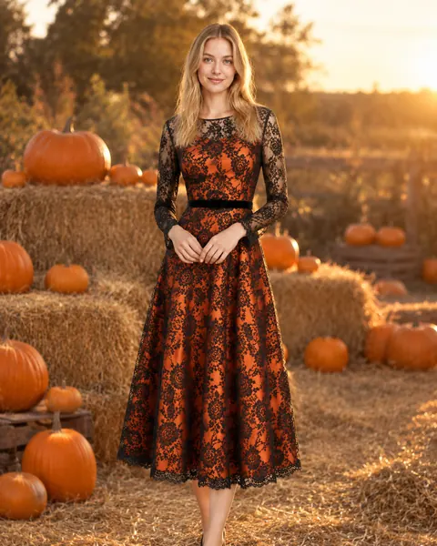</a>

[Example result & try this prompt](https://aiclothswap.net/outfit-swap-prompts/p/pumpkin-orange-black-lace-overlay-dress/?utm_source=github&utm_medium=awesome&utm_campaign=awesome-ai-outfit-swap-prompts)

### Black Lace Midi & Combat Boots City Night

```text
Keep the exact same face, hair, body and identity from image 1; dress her in the black lace midi dress with a cropped black leather moto jacket and chunky black combat boots from image 2. City street at night on Halloween weekend with neon signs and wet pavement, walking toward camera, full-body vertical shot. Adult faces fully visible and not cropped, no logos, no text, no watermark, photorealistic, aspect ratio 9:16.
```

**Model:** GPT Image 2.5

> Halloween weekend in the city without a costume — lace midi, leather jacket and combat boots.

<a href="https://aiclothswap.net/outfit-swap-prompts/p/black-lace-midi-combat-boots-city/?utm_source=github&utm_medium=awesome&utm_campaign=awesome-ai-outfit-swap-prompts">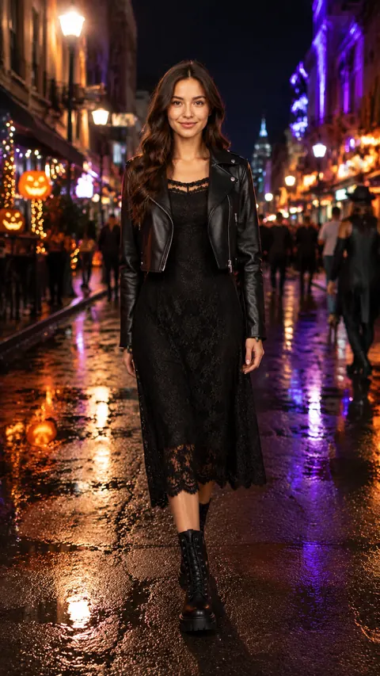</a>

[Example result & try this prompt](https://aiclothswap.net/outfit-swap-prompts/p/black-lace-midi-combat-boots-city/?utm_source=github&utm_medium=awesome&utm_campaign=awesome-ai-outfit-swap-prompts)

### Black Lace Blouse & Leather Trousers Office Look

```text
Keep the exact same face, hair, body and identity from image 1; dress her in the black high-neck lace blouse with long sleeves, high-waisted black faux-leather straight trousers and black pointed pumps from image 2. Modern office with a small Halloween decoration on the desk, standing by the window, three-quarter body shot. Adult faces fully visible and not cropped, no logos, no text, no watermark, photorealistic, aspect ratio 4:5.
```

**Model:** GPT Image 2.5

> Office Halloween without a costume — a black lace blouse and faux-leather trousers say 'spooky season' and still meeting-ready.

<a href="https://aiclothswap.net/outfit-swap-prompts/p/black-lace-blouse-leather-trouser-office/?utm_source=github&utm_medium=awesome&utm_campaign=awesome-ai-outfit-swap-prompts">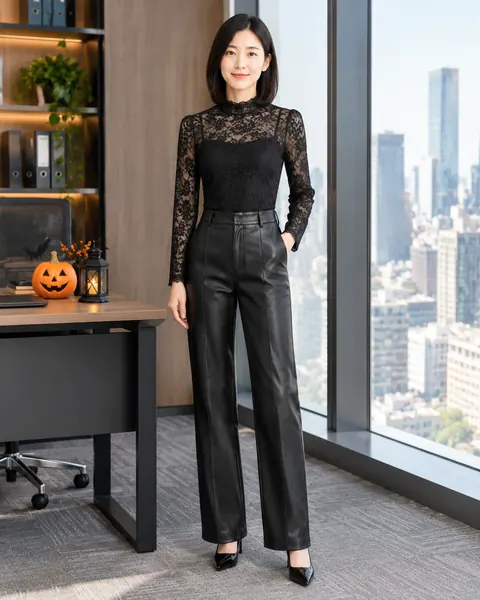</a>

[Example result & try this prompt](https://aiclothswap.net/outfit-swap-prompts/p/black-lace-blouse-leather-trouser-office/?utm_source=github&utm_medium=awesome&utm_campaign=awesome-ai-outfit-swap-prompts)

### Lace Gown Black-to-Blood-Red Recolor

```text
Keep the exact same face, hair, body and identity from image 1; dress her in the the same long-sleeve lace mermaid gown recolored in deep blood red, keeping the exact lace pattern and cut from image 2. Dark gothic studio with black velvet drapes and candles, three-quarter body shot. Adult faces fully visible and not cropped, no logos, no text, no watermark, photorealistic, aspect ratio 3:4.
```

**Model:** GPT Image 2.5

> Test your gothic gown in Halloween's other color — swap black lace to blood red while keeping the same lace and cut.

<a href="https://aiclothswap.net/outfit-swap-prompts/p/black-lace-gown-blood-red-recolor/?utm_source=github&utm_medium=awesome&utm_campaign=awesome-ai-outfit-swap-prompts">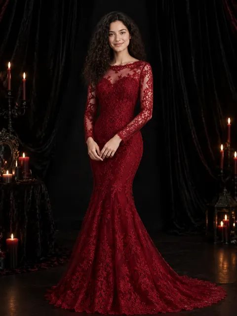</a>

[Example result & try this prompt](https://aiclothswap.net/outfit-swap-prompts/p/black-lace-gown-blood-red-recolor/?utm_source=github&utm_medium=awesome&utm_campaign=awesome-ai-outfit-swap-prompts)

### Gothic Lace-Trim Cape Coat Lookbook Model

```text
Keep the exact same face, hair, body and identity from image 1; dress her in the black wool cape coat with black lace trim on the hem and collar, worn over a black turtleneck, black wide-leg trousers and black ankle boots from image 2. Light grey seamless studio with a few small carved pumpkins on the floor, full-body lookbook pose, square frame. Adult faces fully visible and not cropped, no logos, no text, no watermark, photorealistic, aspect ratio 1:1.
```

**Model:** GPT Image 2.5

> Selling gothic outerwear for spooky season — a clean lookbook shot of a lace-trim cape coat.

<a href="https://aiclothswap.net/outfit-swap-prompts/p/gothic-lace-trim-cape-coat-lookbook-model/?utm_source=github&utm_medium=awesome&utm_campaign=awesome-ai-outfit-swap-prompts">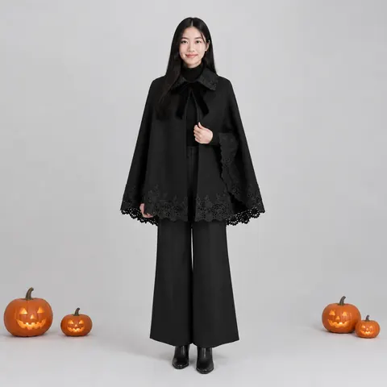</a>

[Example result & try this prompt](https://aiclothswap.net/outfit-swap-prompts/p/gothic-lace-trim-cape-coat-lookbook-model/?utm_source=github&utm_medium=awesome&utm_campaign=awesome-ai-outfit-swap-prompts)
