# 💍 Wedding · AI Outfit Swap Prompts

[← README](../README.md) · 17 prompts · [aiclothswap.net](https://aiclothswap.net/inspiration?utm_source=github&utm_medium=awesome&utm_campaign=awesome-ai-outfit-swap-prompts)

### French Minimalist Backless Satin Bridal Gown

```text
Virtual try-on: preserve face, skin tone, hair and pose of the woman in image 1. Replace her outfit with the luxury heavy-silk ivory wedding dress in image 2 with cathedral train. Warm European courtyard sunlight, elegant editorial, 2:3 ratio.
```

**Model:** Nano Banana Pro

> Use a 2:3 portrait aspect ratio for cathedral train gowns to fully capture the dramatic satin drape and subtle sheen.

<a href="https://aiclothswap.net/inspiration/p/french-satin-bridal-wedding-gown/?utm_source=github&utm_medium=awesome&utm_campaign=awesome-ai-outfit-swap-prompts"></a>

[Example result & try this prompt](https://aiclothswap.net/inspiration/p/french-satin-bridal-wedding-gown/?utm_source=github&utm_medium=awesome&utm_campaign=awesome-ai-outfit-swap-prompts)

### Ivory Dinner Jacket Groom Look

```text
Keep the exact same face, hair, body and identity from image 1; dress him in the ivory white shawl-lapel dinner jacket with black trousers and black bow tie from image 2. Elegant garden wedding ceremony background with soft daylight, full-body groom portrait. Full garment visible, face fully in frame and not cropped, no logos, no text, photorealistic, aspect ratio 2:3.
```

**Model:** Nano Banana Pro

> An ivory dinner jacket is a timeless groom option for warm-weather weddings.

<a href="https://aiclothswap.net/inspiration/p/ivory-dinner-jacket-groom/?utm_source=github&utm_medium=awesome&utm_campaign=awesome-ai-outfit-swap-prompts"></a>

[Example result & try this prompt](https://aiclothswap.net/inspiration/p/ivory-dinner-jacket-groom/?utm_source=github&utm_medium=awesome&utm_campaign=awesome-ai-outfit-swap-prompts)

### Boho Flutter-Sleeve Beach Wedding Dress

```text
Keep the exact same face, hair, body and identity from image 1; dress her in the flowing ivory chiffon boho wedding dress with flutter sleeves from image 2. Golden-hour beach wedding setting with gentle breeze in the fabric, full-body bridal portrait. Full garment visible, face fully in frame and not cropped, no logos, no text, photorealistic, aspect ratio 9:16.
```

**Model:** Nano Banana Pro

> Light chiffon and flutter sleeves suit beach and destination weddings.

<a href="https://aiclothswap.net/inspiration/p/boho-flutter-sleeve-beach-wedding-dress/?utm_source=github&utm_medium=awesome&utm_campaign=awesome-ai-outfit-swap-prompts"></a>

[Example result & try this prompt](https://aiclothswap.net/inspiration/p/boho-flutter-sleeve-beach-wedding-dress/?utm_source=github&utm_medium=awesome&utm_campaign=awesome-ai-outfit-swap-prompts)

### Tulle Ball Gown Garden Wedding

```text
Keep the exact same face, hair, body and identity from image 1; dress her in an ivory sleeveless sweetheart-neckline wedding ball gown with a full layered tulle skirt and a plain satin bodice from image 2. Blooming rose garden at golden hour, full-body bridal portrait. Full garment visible, face fully in frame and not cropped, no logos, no text, photorealistic, aspect ratio 2:3.
```

**Model:** GPT Image 2.5

> A full tulle skirt photographs dreamy in an outdoor garden ceremony.

<a href="https://aiclothswap.net/inspiration/p/tulle-ballgown-garden-wedding/?utm_source=github&utm_medium=awesome&utm_campaign=awesome-ai-outfit-swap-prompts"></a>

[Example result & try this prompt](https://aiclothswap.net/inspiration/p/tulle-ballgown-garden-wedding/?utm_source=github&utm_medium=awesome&utm_campaign=awesome-ai-outfit-swap-prompts)

### Sage Green Groomsman Suit Rustic Wedding

```text
Keep the exact same face, hair, body and identity from image 1; dress him in a sage green two-piece wool suit with a white dress shirt and a plain cream tie from image 2. Rustic wooden barn venue with string lights, three-quarter portrait. Full garment visible, face fully in frame and not cropped, no logos, no text, photorealistic, aspect ratio 3:4.
```

**Model:** GPT Image 2.5

> Sage suits are a fresh alternative to gray for barn and garden weddings.

<a href="https://aiclothswap.net/inspiration/p/sage-groomsman-suit-rustic/?utm_source=github&utm_medium=awesome&utm_campaign=awesome-ai-outfit-swap-prompts"></a>

[Example result & try this prompt](https://aiclothswap.net/inspiration/p/sage-groomsman-suit-rustic/?utm_source=github&utm_medium=awesome&utm_campaign=awesome-ai-outfit-swap-prompts)

### Classic Bouquet Over-Shoulder Bride

```text
Keep the exact same face, hair, body and identity from image 1; dress her in the ivory A-line lace wedding gown from image 2. She glances over her shoulder holding a simple white bouquet, garden chapel light, romantic editorial framing. Full garment visible, face fully in frame and not cropped, no logos, no text, photorealistic, aspect ratio 2:3.
```

**Model:** GPT Image 2.5

> The timeless over-shoulder bouquet glance every bridal album needs.

<a href="https://aiclothswap.net/inspiration/p/classic-bouquet-over-shoulder-bride/?utm_source=github&utm_medium=awesome&utm_campaign=awesome-ai-outfit-swap-prompts"></a>

[Example result & try this prompt](https://aiclothswap.net/inspiration/p/classic-bouquet-over-shoulder-bride/?utm_source=github&utm_medium=awesome&utm_campaign=awesome-ai-outfit-swap-prompts)

### Champagne Bridesmaid Mirror Check

```text
Keep the exact same face, hair, body and identity from image 1; dress her in the champagne satin A-line bridesmaid dress from image 2. She stands beside a tall hotel mirror in a pre-ceremony mirror-check pose, smiling at her reflection, face turned to camera and fully visible. Full garment visible, face fully in frame and not cropped, no logos, no text, photorealistic, aspect ratio 4:5.
```

**Model:** GPT Image 2.5

> A mirror-check moment captures the real pre-ceremony excitement.

<a href="https://aiclothswap.net/inspiration/p/champagne-bridesmaid-mirror-check/?utm_source=github&utm_medium=awesome&utm_campaign=awesome-ai-outfit-swap-prompts">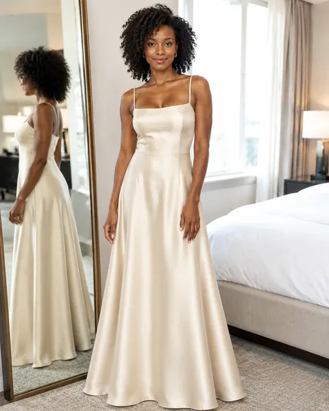</a>

[Example result & try this prompt](https://aiclothswap.net/inspiration/p/champagne-bridesmaid-mirror-check/?utm_source=github&utm_medium=awesome&utm_campaign=awesome-ai-outfit-swap-prompts)

### Pearl Veil Soft-Focus Bride

```text
Keep the exact same face, hair, body and identity from image 1; dress her in the ivory pearl-embellished tulle wedding gown and long pearl-dotted veil from image 2, veil lifted back so her face is fully visible. Bright chapel window light, soft dreamy glow, romantic standing pose. Full garment visible, face fully in frame and not cropped, no logos, no text, photorealistic, aspect ratio 2:3.
```

**Model:** GPT Image 2.5

> Soft-focus pearl veil bridal portraits are a dreamy wedding photo trend.

<a href="https://aiclothswap.net/inspiration/p/pearl-veil-soft-focus-bride/?utm_source=github&utm_medium=awesome&utm_campaign=awesome-ai-outfit-swap-prompts">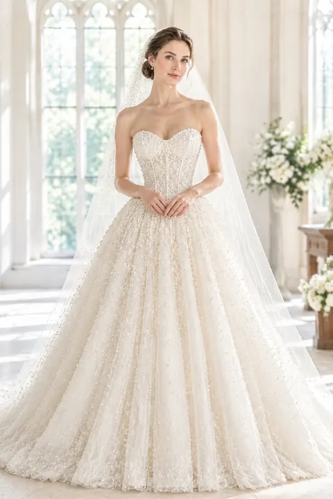</a>

[Example result & try this prompt](https://aiclothswap.net/inspiration/p/pearl-veil-soft-focus-bride/?utm_source=github&utm_medium=awesome&utm_campaign=awesome-ai-outfit-swap-prompts)

### Midnight Velvet Groom Aisle Look

```text
Keep the exact same face, hair, body and identity from image 1; dress him in the midnight blue velvet tuxedo jacket, black trousers and bow tie from image 2. Candlelit chapel aisle, proud standing pose facing camera. Full garment visible, face fully in frame and not cropped, no logos, no text, photorealistic, aspect ratio 3:4.
```

**Model:** GPT Image 2.5

> Velvet groom suits are the statement wedding look for evening ceremonies.

<a href="https://aiclothswap.net/inspiration/p/midnight-velvet-groom-aisle/?utm_source=github&utm_medium=awesome&utm_campaign=awesome-ai-outfit-swap-prompts">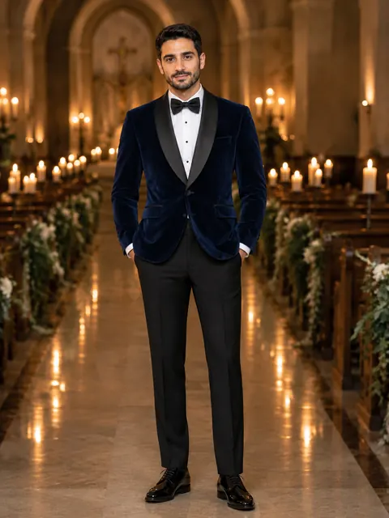</a>

[Example result & try this prompt](https://aiclothswap.net/inspiration/p/midnight-velvet-groom-aisle/?utm_source=github&utm_medium=awesome&utm_campaign=awesome-ai-outfit-swap-prompts)

### Lilac Bishop-Sleeve Wedding Guest Gown

```text
Keep the exact same face, hair, body and identity from image 1; dress her in the lilac chiffon bishop-sleeve wedding-guest maxi from image 2. Garden ceremony lawn, soft afternoon light, smiling standing pose facing camera. Full garment visible, face fully in frame and not cropped, no logos, no text, photorealistic, aspect ratio 2:3.
```

**Model:** GPT Image 2.5

> Lilac wedding-guest dresses and bishop sleeves are trending hard on X wedding feeds.

<a href="https://aiclothswap.net/inspiration/p/lilac-bishop-sleeve-guest-gown/?utm_source=github&utm_medium=awesome&utm_campaign=awesome-ai-outfit-swap-prompts">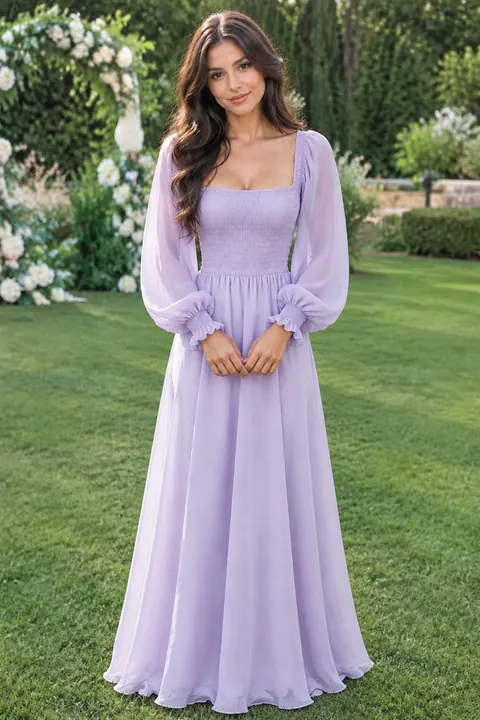</a>

[Example result & try this prompt](https://aiclothswap.net/inspiration/p/lilac-bishop-sleeve-guest-gown/?utm_source=github&utm_medium=awesome&utm_campaign=awesome-ai-outfit-swap-prompts)

### Ivory Cottagecore Garden Bride

```text
Keep the exact same face, hair, body and identity from image 1; dress her in the ivory cottagecore wedding dress with puffed sleeves and tiered skirt from image 2. Wildflower meadow, soft natural daylight, gentle standing pose looking toward camera. Full garment visible, face fully in frame and not cropped, no logos, no text, photorealistic, aspect ratio 3:4.
```

**Model:** GPT Image 2.5

> Cottagecore meadow-dress portraits went viral on X — soft vintage bridal energy.

<a href="https://aiclothswap.net/inspiration/p/ivory-cottagecore-garden-bride/?utm_source=github&utm_medium=awesome&utm_campaign=awesome-ai-outfit-swap-prompts">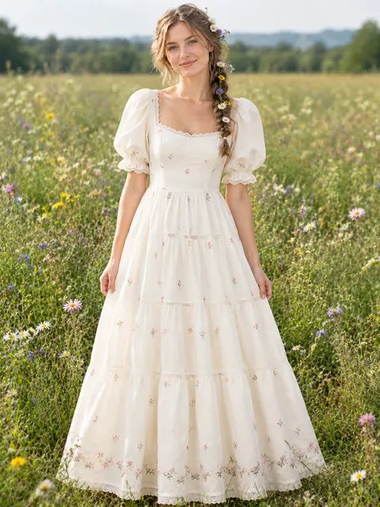</a>

[Example result & try this prompt](https://aiclothswap.net/inspiration/p/ivory-cottagecore-garden-bride/?utm_source=github&utm_medium=awesome&utm_campaign=awesome-ai-outfit-swap-prompts)

### Terracotta Chiffon Harvest Wedding Guest

```text
Keep the exact same face, hair, body and identity from image 1; dress her in the terracotta chiffon flutter-sleeve wedding-guest midi from image 2. Golden-hour garden lawn, smiling standing pose facing camera. Human adult face fully in frame and not cropped, no pumpkin head, no logos, no text, photorealistic, aspect ratio 2:3.
```

**Model:** GPT Image 2.5

> October pumpkin-head and harvest-patch posts on X make terracotta guest dresses a natural autumn wedding pick.

<a href="https://aiclothswap.net/inspiration/p/terracotta-chiffon-harvest-guest/?utm_source=github&utm_medium=awesome&utm_campaign=awesome-ai-outfit-swap-prompts">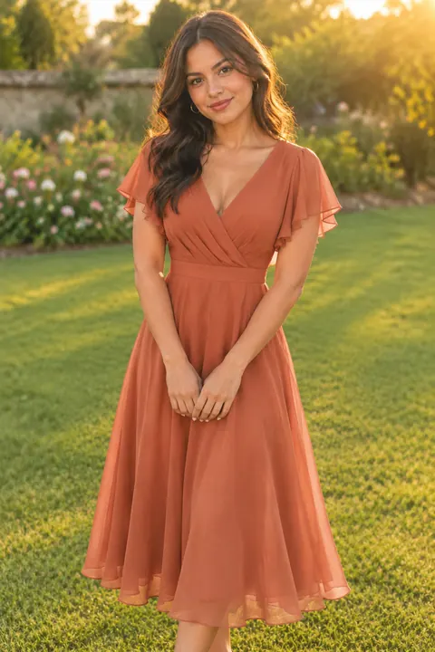</a>

[Example result & try this prompt](https://aiclothswap.net/inspiration/p/terracotta-chiffon-harvest-guest/?utm_source=github&utm_medium=awesome&utm_campaign=awesome-ai-outfit-swap-prompts)

### Copper Satin Autumn Reception Bride

```text
Keep the exact same face, hair, body and identity from image 1; dress her in the copper satin cowl-neck reception bridal gown from image 2. Candlelit reception hall, graceful standing pose. Human adult face fully in frame and not cropped, no pumpkin head, no logos, no text, photorealistic, aspect ratio 3:4.
```

**Model:** GPT Image 2.5

> Spooky-season X feeds love copper and amber formal looks for October receptions after pumpkin-patch shoots.

<a href="https://aiclothswap.net/inspiration/p/copper-satin-autumn-reception-bride/?utm_source=github&utm_medium=awesome&utm_campaign=awesome-ai-outfit-swap-prompts">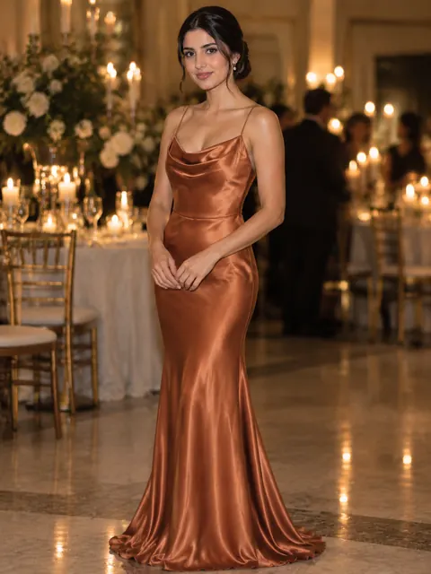</a>

[Example result & try this prompt](https://aiclothswap.net/inspiration/p/copper-satin-autumn-reception-bride/?utm_source=github&utm_medium=awesome&utm_campaign=awesome-ai-outfit-swap-prompts)

### AI Pre-Wedding Photoshoot: Couple at Lake Palace

```text
Keep the exact same face, hair, body and identity from image 1; dress the woman and the man in the blush-pink lehenga (for her) and ivory sherwani (for him) from image 2. Lake palace terrace at golden hour, romantic pre-wedding pose holding hands, soft warm light. Adult faces fully visible and not cropped, no logos, no text, no watermark, photorealistic, aspect ratio 3:2.
```

**Model:** GPT Image 2.5

> ‘ai pre wedding photoshoot prompt’ is a rising autocomplete — try a pastel lehenga and sherwani pair at golden hour.

<a href="https://aiclothswap.net/inspiration/p/ai-pre-wedding-photoshoot-couple-lake-palace/?utm_source=github&utm_medium=awesome&utm_campaign=awesome-ai-outfit-swap-prompts">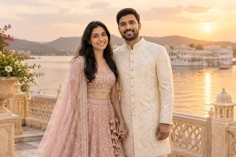</a>

[Example result & try this prompt](https://aiclothswap.net/inspiration/p/ai-pre-wedding-photoshoot-couple-lake-palace/?utm_source=github&utm_medium=awesome&utm_campaign=awesome-ai-outfit-swap-prompts)

### AI Pre-Wedding Photoshoot: City-Night Satin Gown

```text
Keep the exact same face, hair, body and identity from image 1; dress her in the ivory satin off-shoulder gown from image 2. City street at night with soft bokeh lights, full-length pre-wedding pose, skirt gently flowing. Adult faces fully visible and not cropped, no logos, no text, no watermark, photorealistic, aspect ratio 2:3.
```

**Model:** GPT Image 2.5

> City-night pre-wedding shoots are a fresh twist on the trending pre-wedding prompt — a sleek satin gown under neon bokeh.

<a href="https://aiclothswap.net/inspiration/p/ai-pre-wedding-photoshoot-city-night-gown/?utm_source=github&utm_medium=awesome&utm_campaign=awesome-ai-outfit-swap-prompts">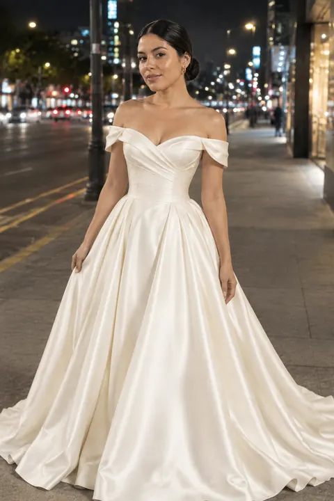</a>

[Example result & try this prompt](https://aiclothswap.net/inspiration/p/ai-pre-wedding-photoshoot-city-night-gown/?utm_source=github&utm_medium=awesome&utm_campaign=awesome-ai-outfit-swap-prompts)

### Lace Illusion Neckline Bridal Gown with Cathedral Veil

```text
Virtual try-on: preserve face, skin tone, hair and pose of the woman in image 1. Replace her outfit with the white lace illusion-neckline bridal gown and cathedral veil from image 2. Soft romantic lighting, photorealistic wedding look, aspect ratio 2:3.
```

**Model:** GPT Image 2.5

> Illusion-neckline lace gown with cathedral veil. Preserve face and hair for bridal try-on.

<a href="https://aiclothswap.net/inspiration/p/lace-illusion-cathedral-veil-gown/?utm_source=github&utm_medium=awesome&utm_campaign=awesome-ai-outfit-swap-prompts">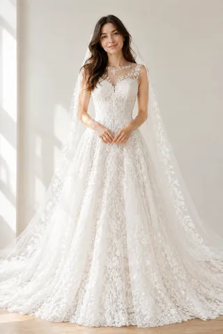</a>

[Example result & try this prompt](https://aiclothswap.net/inspiration/p/lace-illusion-cathedral-veil-gown/?utm_source=github&utm_medium=awesome&utm_campaign=awesome-ai-outfit-swap-prompts)

### Modern Minimal Satin Column Wedding Dress

```text
Keep identity and pose from image 1. Dress her in the minimal ivory satin column wedding dress from image 2. Clean modern bridal studio lighting, photorealistic, aspect ratio 3:4.
```

**Model:** GPT Image 2.5

> Minimal ivory satin column dress for a modern bridal studio look.

<a href="https://aiclothswap.net/inspiration/p/modern-minimal-column-wedding-dress/?utm_source=github&utm_medium=awesome&utm_campaign=awesome-ai-outfit-swap-prompts">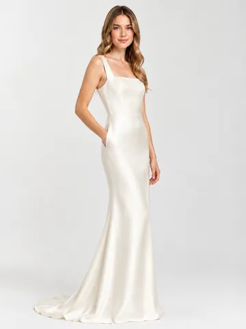</a>

[Example result & try this prompt](https://aiclothswap.net/inspiration/p/modern-minimal-column-wedding-dress/?utm_source=github&utm_medium=awesome&utm_campaign=awesome-ai-outfit-swap-prompts)
